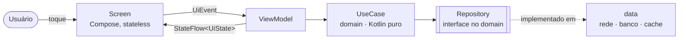

# Arquitetura

> Mapa de alto nível para quem chega: **onde fica cada coisa e o que nunca acontece**.
> Mudam raramente, por isso não citam classes específicas: use a busca do IDE pelos nomes
> mencionados. Regras detalhadas e verificadas por sensores ficam no
> [guia de arquitetura](docs/harness/guides/architecture.md); este arquivo não as repete.

## Visão geral
O app é um conjunto de **features independentes** (`feature/<nome>/`) apoiadas por
**módulos de infraestrutura** (`core/*`) e montadas pelo `app`. Cada feature segue
Clean Architecture em quatro módulos e a UI segue fluxo unidirecional:

Para entender uma feature, leia nesta ordem: `spec.md` da feature → `README.md` do módulo
`ui` → `UiState`/`UiEvent` → `ViewModel` → use cases → repositório.

## Mapa do código
| Diretório | Propósito | Invariante (o que nunca acontece) |
|---|---|---|
| `app/` | `Application`, `MainActivity`, `NavHost`, agregação do grafo de DI | Não contém regra de negócio nem telas |
| `feature/<x>/api/` | Contrato público: rotas de navegação e interfaces expostas a outras features | Não depende de Compose, Hilt ou de outra feature |
| `feature/<x>/domain/` | Modelos, interfaces de repositório, use cases | Nenhum `import android.*`; módulo JVM puro |
| `feature/<x>/data/` | Repositórios, DTOs, data sources, mappers, DI | Tudo `internal`; DTO nunca sai daqui |
| `feature/<x>/ui/` | `UiState`, `UiEvent`, `ViewModel`, `Route`, `Screen`, previews | Não depende de `data`; `Screen` não guarda estado |
| `core/common/` | `DataResult`, `AppError`, dispatchers | Único lugar com `Dispatchers.*` literal |
| `core/designsystem/` | Tema, tokens e componentes visuais | Sem regra de negócio |
| `core/network/`, `database/`, `datastore/` | I/O compartilhado | Nunca conhecem features |
| `core/security/` | Criptografia, Keystore, mascaramento | Única porta para material sensível |
| `core/testing/` | Fakes, extensões e builders de teste | Só entra em `testImplementation` |
| `build-logic/` | Convention plugins | Único lugar com configuração Gradle |
| `quality/` | Testes de arquitetura (Konsist) e regras detekt próprias | Fazem o build falhar; não são opcionais |
| `docs/specs/NNN-*/` | Spec, plano, tarefas e progresso de cada feature | Código sem `AC-xx` correspondente é código sem requisito |

Cada módulo tem um `README.md` curto com propósito, API pública e grafo de dependências
gerado ([padrão](docs/harness/templates/module-README.md)).

## Preocupações transversais
| Tema | Onde vive | Regra-chave |
|---|---|---|
| Erros | `core:common` (`AppError`) → `UiState` de erro | Nenhuma falha silenciosa ([guia](docs/harness/guides/error-handling.md)) |
| Dados de cartão e PII | `core:security` | PAN/CVV/trilha nunca em log, analytics ou disco ([guia](docs/harness/guides/security.md)) |
| Concorrência | Dispatchers injetados | `suspend` público é main-safe |
| Navegação entre features | Rotas em `feature:*:api`, ligadas no `app` | Uma feature nunca instancia tela de outra |
| Testes | Ao lado do código + `core:testing` | Todo `AC-xx` tem teste que cita o ID |
| Qualidade | `scripts/harness/verify.sh` | O que o CI roda é o que você roda local |

## Decisões que explicam o desenho
[ADR-0001](docs/adr/0001-adotar-spec-driven-development.md) (SDD) ·
[ADR-0002](docs/adr/0002-adotar-harness-engineering-para-agentes-de-ia.md) (harness de IA) ·
[ADR-0003](docs/adr/0003-stack-de-sensores-de-qualidade.md) (sensores) ·
[ADR-0004](docs/adr/0004-adotar-workflows-agenticos-orquestrados.md) (workflows agênticos) ·
[ADR-0005](docs/adr/0005-documentacao-em-camadas-e-onboarding-assistido-por-ia.md) (documentação e onboarding)
