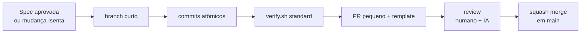

# Como contribuir

> O fluxo completo, do branch ao merge, em uma página. Vale para pessoas e agentes de IA.
> Revisão de código tem guia próprio: [docs/code-review.md](docs/code-review.md).



## 1. Antes de codar
- Toda mudança tem spec aprovada em `docs/specs/NNN-*/` ou é **Isenta** (typo, string,
  bump sem mudança de API, bug que restaura comportamento já especificado). Ver o
  quadro de tamanhos em [AGENTS.md](AGENTS.md#escopo-e-tamanho).
- Uma vez por clone: `git config core.hooksPath .githooks` e
  `git config commit.template .gitmessage`.

## 2. Branches
Trunk-based: `main` está sempre verde e publicável; branches vivem dias, não semanas.

| Tipo | Padrão | Exemplo |
|---|---|---|
| Feature com spec | `feat/NNN-slug` | `feat/003-saldo-recebiveis` |
| Correção | `fix/slug` ou `fix/NNN-slug` | `fix/crash-rotacao-extrato` |
| Demais | `<tipo>/slug` (tipos da tabela abaixo) | `chore/bump-agp`, `docs/glossario` |

Feature grande (G) vira **PRs empilhados por camada**, na ordem do `tasks.md`:
`domain` → `data` → `ui`. Cada PR compila e passa no CI sozinho.

## 3. Commits — Conventional Commits 1.0
```
<tipo>(<escopo>): <resumo no imperativo, em inglês, até 72 caracteres>

<corpo: o PORQUÊ da mudança, não o como. Quebre em 72 colunas.>

Refs: AC-02, AC-03 · docs/specs/003-saldo-recebiveis
BREAKING CHANGE: <o que quebra e como migrar>      (só se houver)
```

| Tipo | Quando | Entra no changelog? |
|---|---|---|
| `feat` | Comportamento novo para o usuário | Sim |
| `fix` | Corrige comportamento | Sim |
| `perf` | Melhora desempenho sem mudar comportamento | Sim |
| `refactor` | Muda estrutura sem mudar comportamento | Não |
| `test` | Só testes | Não |
| `docs` | Só documentação | Não |
| `build` | Gradle, dependências, `build-logic` | Não |
| `ci` | Pipelines e workflows | Não |
| `style` | Formatação | Não |
| `chore` | Manutenção que não cabe acima | Não |
| `revert` | Reverte commit anterior | Sim |

- **Escopo = módulo** em kebab-case: `balance-ui`, `balance-data`, `core-network`, `app`.
  Fora de módulos: `harness`, `deps`, `specs`, `adr`.
- **Atômico:** um commit, uma intenção; o build passa em cada commit.
- **Proibido:** "wip", "fix", "ajustes", commits misturando refactor e feature.
- **IA:** commits gerados por agente mantêm o trailer `Co-Authored-By` da ferramenta.
- O hook `.githooks/commit-msg` valida o formato localmente.

## 4. Pull requests
| Regra | Por quê |
|---|---|
| **Uma intenção por PR** | Revisão focada; revert simples |
| **≤ 400 linhas de código de produção** alteradas (sem contar testes, snapshots e gerados) | Acima disso a detecção de defeitos cai (estudo SmartBear/Cisco) |
| **Título em Conventional Commits** | Vira a mensagem do squash e alimenta o changelog |
| **Template completo** ([pull_request_template.md](.github/pull_request_template.md)) | O revisor sabe por onde começar e o que provar |
| **Auto-revisão antes de pedir review** | Você lê o próprio diff no GitHub e anota os pontos difíceis |
| **Draft cedo** em mudança M/G | Feedback de design antes de 400 linhas prontas |
| **CI verde** antes de pedir review | Revisor humano não faz trabalho de sensor |

Um agente redige a descrição com `/summarize change` (ou `/open-pr` no fechamento de feature).

**Merge:** *squash and merge* com o título do PR, depois de 1 aprovação humana (mais o
code owner quando o diff tocar caminhos de [CODEOWNERS](.github/CODEOWNERS)) e CI verde.
O branch é apagado após o merge.

## 5. Definição de Pronto
A lista oficial está em [AGENTS.md](AGENTS.md#definição-de-pronto) e espelhada no template de PR.
