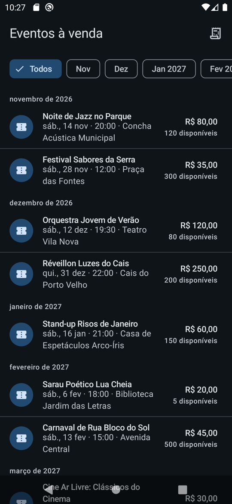
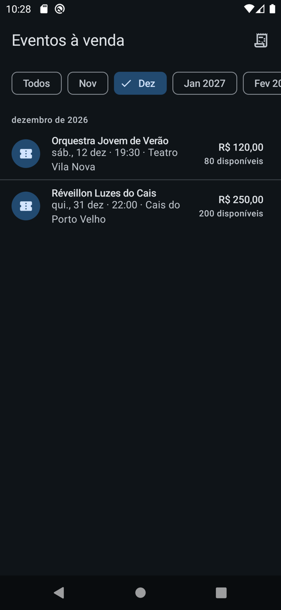
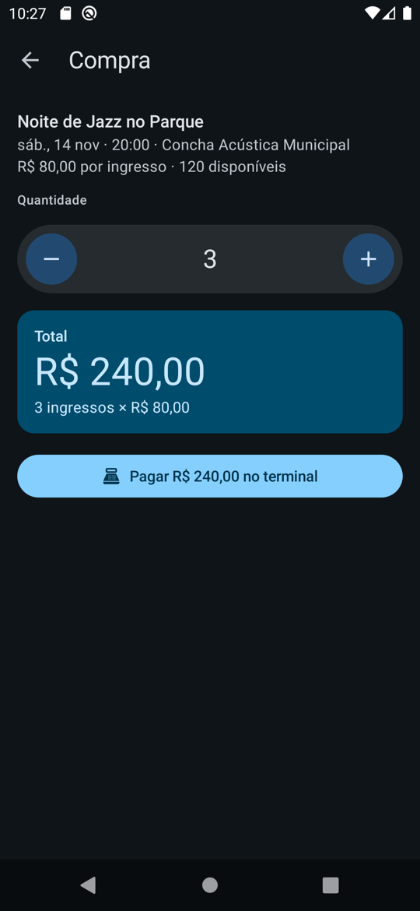
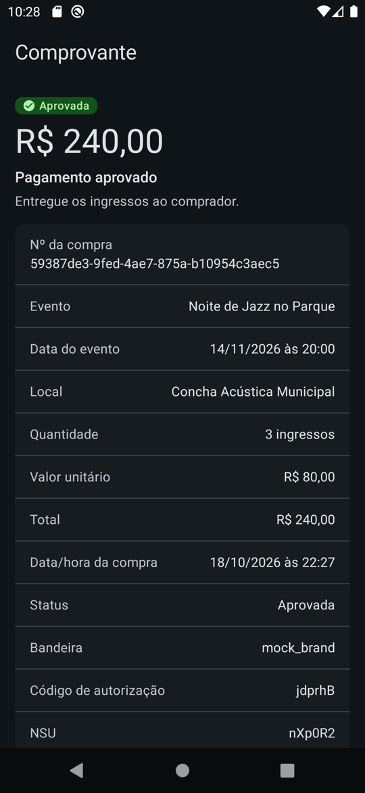
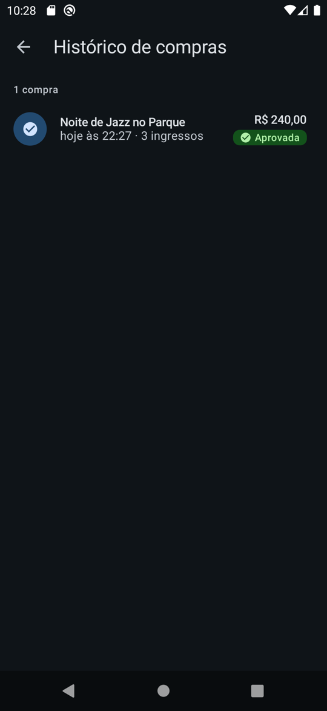

# Bilheteria

> App Android nativo (Kotlin, Compose, Coroutines/Flow) de venda de ingressos para eventos locais,
> com pagamento pelo ecossistema Cielo Smart / Cielo LIO. Case técnico ([case_android.md](case_android.md))
> construído com Spec-Driven Development, Clean Architecture modular e agentes de IA guiados por harness.

**Status:** fundação pronta (000); feature de venda de ingressos (001) implementada; QR Code (opcional no case) não feito. Plano: [roadmap](docs/roadmap.md).
Uso de IA no processo: [docs/ai/](docs/ai/README.md).

## Comece por aqui
| Você é… | Leia, nesta ordem | Tempo |
|---|---|---|
| Quem vai avaliar o case | [roadmap](docs/roadmap.md) → [docs/ai/](docs/ai/README.md) → [docs/specs/](docs/specs/) → [docs/adr/](docs/adr/) | 20 min |
| Quem vai mudar código | [ARCHITECTURE.md](ARCHITECTURE.md) → [CONTRIBUTING.md](CONTRIBUTING.md) | 30 min |
| Quem vai revisar PR | [Guia de code review](docs/code-review.md) | 10 min |
| Agente de IA | [AGENTS.md](AGENTS.md) | — |

## O app
Capturas no AVD Android 10 com o `lio-emulator` da Cielo (tema escuro; dados fictícios do emulador).
| Eventos à venda | Filtro por mês | Compra | Comprovante | Histórico |
|:--:|:--:|:--:|:--:|:--:|
|  |  |  |  |  |

## Rodando localmente
### Requisitos
| Ferramenta | Versão | Observação |
|---|---|---|
| JDK | 21 (Temurin) | O Gradle provisiona a toolchain 17 dos módulos sozinho (foojay) |
| Android SDK | Platform 37, Build-Tools 36 | `android sdk install platforms/android-37.0 build-tools/36.0.0 platform-tools emulator` |
| Android CLI | `android info` | Opcional; instala SDK, cria AVD e inspeciona telas |

### Build e verificação
```bash
git config core.hooksPath .githooks      # hooks de commit (uma vez)
echo "sdk.dir=$HOME/Library/Android/sdk" > local.properties   # caminho do SDK (não versionado)
./gradlew :app:assembleDebug             # APK em app/build/outputs/apk/debug/
scripts/harness/verify.sh standard       # o que o CI roda em todo PR (full na main)
```

### Emulador e emulador Cielo
O emulador Cielo (`lio-emulator.apk`) só instala em Android 7 ou 10
([doc oficial](https://docs.cielo.com.br/cielo-smart/docs/baixando-o-emulador-cielo)).
```bash
android sdk install cmdline-tools/latest "system-images/android-29/google_apis/arm64-v8a"  # x86_64 em Intel
echo no | ~/Library/Android/sdk/cmdline-tools/latest/bin/avdmanager create avd \
  -n Bilheteria_API29 -k "system-images;android-29;google_apis;arm64-v8a" -d pixel_5
android emulator start Bilheteria_API29
adb -s emulator-5554 install lio-emulator.apk                          # emulador Cielo
ANDROID_SERIAL=emulator-5554 ./gradlew :app:installDebug               # o app (id com sufixo .debug)
```
O passo a passo do pagamento no emulador está em [Integração Cielo](#integração-cielo).

### APK pronto
**[Baixar o APK da última versão](https://github.com/rafaeldso/bilheteria-cielo-smart/releases/latest)** (GitHub Release;
arquivo `.apk` em *Assets*). É um APK de **debug**, assinado com chave efêmera (sem loja, [ADR-0009](docs/adr/0009-escopo-de-case-itens-de-producao-fora.md)).
Para pagar, instale também o `lio-emulator.apk` da Cielo em um AVD Android 7 ou 10 (seção acima); sem ele o app abre, mas o
pagamento não completa.

Cada push na `main` publica o APK de debug como artefato do workflow `release`; cada tag `v*` cria
uma GitHub Release com o APK anexado.

## Onde está cada coisa
| Pergunta | Resposta |
|---|---|
| Como o código está organizado? | [ARCHITECTURE.md](ARCHITECTURE.md) |
| O que o app deve fazer? | [docs/specs/](docs/specs/) (uma pasta por feature) |
| Por que foi decidido assim? | [docs/adr/](docs/adr/) |
| O que ficou fora por ser um case? | [ADR-0009](docs/adr/0009-escopo-de-case-itens-de-producao-fora.md) |
| Como a IA foi usada | [docs/ai/](docs/ai/README.md) |
| Regras que nunca quebramos | [constitution.md](docs/constitution.md) |
| Como os agentes de IA trabalham aqui | [docs/harness/](docs/harness/README.md) |

## Integração Cielo
O app pede o pagamento ao app da Cielo por **Deep Link** (`lio://payment`), sem SDK, e recebe o resultado em
`order://response`. Motivos e alternativas: [ADR-0010](docs/adr/0010-integracao-cielo-smart-por-deep-link.md).
- **Compra no Room antes do pagamento** (`Pending`, `reference` UUID v4): se o processo morrer, a reabertura consulta
  `lio://orders` (paginado) e decide pelo pagamento encontrado (BR-15, BR-25).
- **Resposta validada**: `reference` e valor precisam bater com a compra; respostas forjadas são descartadas. Um pagamento
  aprovado depois de "não encontrado" vira venda aprovada (BR-29). Callback e recuperação são serializados por um lock.
- **Dados de cartão** (`bin`, `mask`, `document`) nunca chegam ao modelo, ao banco nem aos logs.
- **Credenciais**: propriedades Gradle `cielo.clientId` e `cielo.accessToken` (fora do repositório); sem elas o build usa
  valores fictícios, aceitos pelo `lio-emulator`. O gateway só abre o `lio://` em pacote da allowlist, com intent explícita.
- **Testar no emulador**: instale o `lio-emulator.apk` no AVD Android 10 (seção acima) e o app com
  `./gradlew :app:installDebug`. Fatos verificados e limitações (por exemplo, "Negada" não é simulável):
  [README do data](feature/ticketing/data/README.md).

### Trade-offs
- A disponibilidade de ingressos é o catálogo menos as compras aprovadas **neste aparelho** (Q11); não há backend.
- Aprovação tardia sem aviso ao operador e sem prazo máximo (Q14); risco de cobrança dupla aceito. Aviso, prazo e estorno
  ficam para uma spec futura.
- Fora de foco por ora: testes de UI Compose e de screenshot, TalkBack, AVD API 30+, e a ordenação do `orders` em terminal real.

## Decisões arquiteturais
Cada decisão tem um ADR em [docs/adr/](docs/adr/). As que mais moldam o app:
| Decisão | Resumo | ADR |
|---|---|---|
| Spec-Driven Development | Nada de código sem spec aprovada; BR/AC rastreáveis até os testes (`check-traceability.sh`) | [0001](docs/adr/0001-adotar-spec-driven-development.md) |
| Harness para agentes de IA | Instruções, hooks e sensores decidem o que está pronto, não a IA | [0002](docs/adr/0002-adotar-harness-engineering-para-agentes-de-ia.md), [0004](docs/adr/0004-adotar-workflows-agenticos-orquestrados.md) |
| Clean Architecture modular | `app`, `core/*` e `feature/<nome>/{api,domain,data,ui}`; domain em Kotlin puro; UDF com um `UiState` e um `onEvent` ([ARCHITECTURE.md](ARCHITECTURE.md)) | [0003](docs/adr/0003-stack-de-sensores-de-qualidade.md) |
| Pagamento por Deep Link, Room como fonte da verdade | Compra gravada antes de abrir a Cielo; recuperação por consulta; sem SDK | [0010](docs/adr/0010-integracao-cielo-smart-por-deep-link.md) |
| Escopo de case | Itens de produção (Crashlytics, assinatura, baseline profiles) ficam fora | [0009](docs/adr/0009-escopo-de-case-itens-de-producao-fora.md) |
| Cobertura do `ui` | Compose, previews e código gerado do Hilt fora do Kover; 85% sobre a lógica | [0011](docs/adr/0011-cobertura-do-ui-exclui-composables-e-previews.md) |

## Bibliotecas externas
Versões estáveis, todas no [catálogo](gradle/libs.versions.toml) (política do [ADR-0007](docs/adr/0007-stack-de-bibliotecas-observabilidade-e-politicas-de-qualidade.md)).
| Biblioteca | Para quê | Por quê |
|---|---|---|
| Jetpack Compose (BOM) + Material 3 | UI declarativa e design system `Ds*` | Padrão atual do Android; previews por estado |
| Navigation Compose (rotas type-safe) | Navegação entre as 4 telas | Rotas tipadas, argumentos só como IDs |
| Hilt | Injeção de dependência | Padrão do Android; dispatchers e relógio injetáveis, testes simples |
| Kotlin Coroutines + Flow | Assíncrono e UDF | Padrão da linguagem; `StateFlow` por tela |
| Room | Compras (fonte da verdade do pagamento) | Transações e `Flow`; sobrevive à morte do processo |
| kotlinx.serialization | JSON do catálogo e da Cielo | Sem reflexão, menos regras de R8 |
| kotlinx-collections-immutable | `UiState` estável | Evita recomposição desnecessária |
| core-splashscreen | Splash nativa | API oficial |
| Timber | Logs (só em debug) | Sem dado sensível, atrás de um `Logger` |
| desugar_jdk_libs | `java.time` com `minSdk 24` | Terminais Cielo rodam Android 7.1+ |
| JUnit 5, MockK, Turbine, Robolectric | Testes | Fakes e Flow; Robolectric só onde há Room/Android |
| Kover, detekt, compose-rules, Spotless, Konsist | Sensores de qualidade | Fazem o `verify.sh` decidir "pronto" |

Rede (Retrofit/OkHttp) e imagens (Coil) fazem parte da stack de referência, mas não entraram: o catálogo é um JSON local e o
pagamento é por Deep Link.

## O que faria com mais tempo
- **QR Code do ingresso** (opcional no case): spec `002`, vinculado à compra aprovada.
- **Credenciais Cielo por configuração gerenciada** (MDM/Cielo Store) em vez de `BuildConfig` ([roadmap F1](docs/roadmap.md)).
- **Verificar em terminal real:** a ordenação do `orders` (a recuperação supõe ordem crescente) e a visibilidade de pacotes no Android 11+.
- **Aprovação tardia:** aviso ao operador, prazo máximo e estorno (hoje a venda é aprovada em silêncio, Q14).
- **Acessibilidade:** TalkBack em dispositivo e testes de UI Compose e de screenshot das previews.
- **Journeys J7 e J9** executadas no AVD; backend para disponibilidade compartilhada entre aparelhos (hoje é por aparelho, Q11).
- **Produção:** itens do [ADR-0009](docs/adr/0009-escopo-de-case-itens-de-producao-fora.md) (Crashlytics, assinatura, baseline profiles).

## Uso de IA
Como a IA foi orientada e usada: [docs/ai/](docs/ai/README.md) (restrições do harness), [log por etapa](docs/ai/log.md) e
[prompts e chamadas por tarefa](docs/ai/prompts.md).
