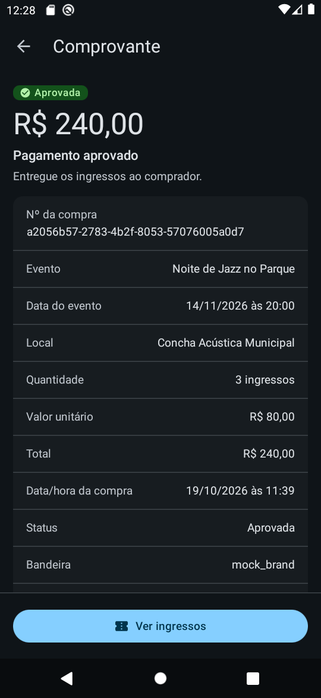
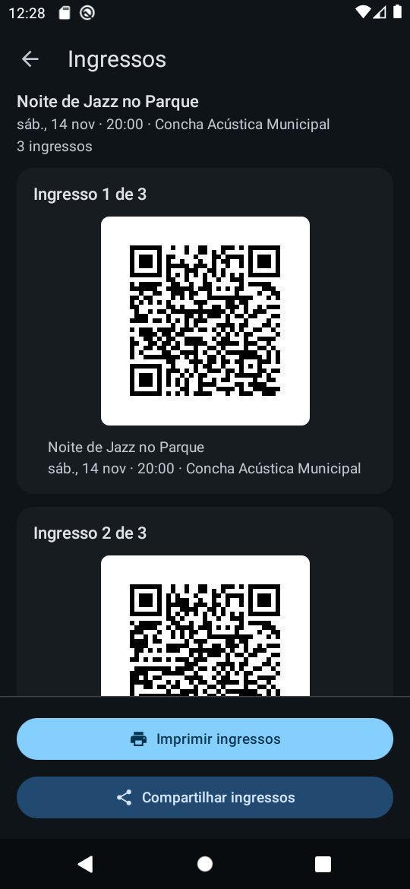

# Bilheteria

> App Android nativo (Kotlin, Compose, Coroutines/Flow) de venda de ingressos para eventos locais,
> com pagamento pelo ecossistema Cielo Smart / Cielo LIO. Case técnico ([case_android.md](case_android.md))
> construído com Spec-Driven Development, Clean Architecture modular e agentes de IA guiados por harness.

**Status:** fundação pronta (000); venda de ingressos (001) e QR Code do ingresso (002, opcional no case) implementados. Plano: [roadmap](docs/roadmap.md).
Uso de IA no processo: [docs/ai/](docs/ai/README.md).
**Licença:** Apache 2.0 ([LICENSE](LICENSE)) · © 2026 Rafael Oliveira.

## Comece por aqui
| Você é… | Leia, nesta ordem | Tempo |
|---|---|---|
| Quem vai avaliar o case | [roadmap](docs/roadmap.md) → [docs/ai/](docs/ai/README.md) → [docs/specs/](docs/specs/) → [docs/adr/](docs/adr/) | 20 min |
| Quem vai mudar código | [ARCHITECTURE.md](ARCHITECTURE.md) → [CONTRIBUTING.md](CONTRIBUTING.md) | 30 min |
| Quem vai revisar PR | [Guia de code review](docs/code-review.md) | 10 min |
| Agente de IA | [AGENTS.md](AGENTS.md) | — |

## Requisitos do case
Mapa do [case_android.md](case_android.md) para a entrega. Rastreabilidade completa (BR → AC → teste) em
[docs/specs/001-venda-de-ingressos](docs/specs/001-venda-de-ingressos/spec.md) e
[docs/specs/002-qr-code-ingresso](docs/specs/002-qr-code-ingresso/spec.md) (`tasks.md` de cada uma).

| Requisito do case | Situação | Onde está |
|---|---|---|
| Listagem de eventos disponíveis | ✅ Implementado | AC-01..03, AC-22..24; catálogo em JSON local, filtro por mês |
| Seleção de quantidade por evento | ✅ Implementado | AC-04..06 (mínimo 1, máximo 10 por compra) |
| Pagamento via integração com a Cielo | ✅ Implementado | Deep Link `lio://` ([ADR-0010](docs/adr/0010-integracao-cielo-smart-por-deep-link.md)); validado no `lio-emulator` |
| Registrar resultado (aprovada, negada, cancelada) | ✅ Implementado | AC-09..11; falhas técnicas viram "Falhou" |
| Comprovante / resumo da compra | ✅ Implementado | AC-16; histórico de compras (AC-18..21) |
| QR Code do ingresso (opcional) | ✅ Implementado | [Spec 002](docs/specs/002-qr-code-ingresso/spec.md): um QR Code por ingresso da compra **aprovada**, na tela Ingressos (a partir do comprovante e do histórico); imprimir na impressora do terminal (`lio://print`) e compartilhar pelo menu do Android; AC-29..44. Limites na seção "QR Code do ingresso" |
| Tratamento explícito de erros de integração e pagamento | ✅ Implementado | Matriz de erros do [plano §5](docs/specs/001-venda-de-ingressos/plan.md); AC-12..15, AC-25..27 |
| Evitar duplicidade de cobrança em reenvio de ação | ✅ Implementado | Uma compra aberta por vez (BR-10), compra gravada antes de pagar, `reference` única, consulta à Cielo antes de recobrar (BR-25); AC-08, AC-14, AC-15. Exceção aceita: aprovação tardia (Q14) |
| Código organizado e de fácil manutenção | ✅ Implementado | Clean Architecture modular, sensores no `verify.sh` ([ARCHITECTURE.md](ARCHITECTURE.md)) |
| Testes automatizados para cenários críticos | ✅ Implementado | Os 28 ACs da 001 e os 16 da 002 têm teste; `verify.sh full` verde; cobertura por camada (Kover) |
| Uso de IA documentado | ✅ Documentado | [docs/ai/](docs/ai/README.md): restrições, log por etapa e chamadas por tarefa |
| README: execução, decisões, bibliotecas, integração Cielo, trade-offs, mais tempo | ✅ Neste README | Seções abaixo |
| Documentação do harness (specs, ADRs, resultados) | ✅ Implementado | [docs/specs/](docs/specs/), [docs/adr/](docs/adr/), [docs/harness/](docs/harness/) |

**Limites verificados:** o pagamento foi testado no `lio-emulator` (AVD Android 10), não em um terminal Cielo físico; "Negada" não é
simulável no emulador (coberta por teste unitário); TalkBack e Android 11+ ficaram para depois. Detalhes em
[Trade-offs](#trade-offs) e [O que faria com mais tempo](#o-que-faria-com-mais-tempo).

## O app
Capturas no AVD Android 10 com o `lio-emulator` da Cielo (tema escuro; dados fictícios do emulador). As duas últimas são da spec 002: o comprovante aprovado com "Ver ingressos" e a tela de ingressos com o QR Code.
| Eventos à venda | Filtro por mês | Compra | Comprovante | Histórico | Comprovante com ingressos | Ingressos (QR Code) |
|:--:|:--:|:--:|:--:|:--:|:--:|:--:|
|  |  |  |  |  |  |  |

## Além dos requisitos do case
Pontos que o case não pede e que fazem parte da entrega. O que ficou de fora de propósito está dito em cada linha e no
[ADR-0009](docs/adr/0009-escopo-de-case-itens-de-producao-fora.md).

| Tema | O que o projeto tem | Onde ver |
|---|---|---|
| **Segurança** | OWASP MASVS como baseline e matriz de cobertura; sem permissão `INTERNET` e `allowBackup=false`; `lio://` só para pacote da allowlist, com intent explícita; resposta da Cielo tratada como entrada não confiável (parser defensivo, limite de tamanho, conferência de `reference` e valor); `FileProvider` não exportado; R8 e `isDebuggable=false` no release; Gitleaks, OSV-Scanner, mobsfscan e zizmor no CI | [guia](docs/harness/guides/security.md) · [MASVS](docs/security/masvs-matrix.md) · [programa de varredura](docs/security/README.md) |
| **Tratamento de dados** | Dados classificados em cada spec (público, interno, PCI, PII, segredo): o app nunca recebe PAN, CVV nem trilha e não coleta PII; `toString()` mascarado e logs só com tipo de evento; dinheiro em centavos (`Long`); credenciais fora do repositório; tudo local (catálogo em JSON, compras em Room) | spec §8 de cada feature · [constitution](docs/constitution.md) Art. V |
| **Acessibilidade** | Requisito, não melhoria: anotada por tela e estado na UI Spec (ordem de leitura, rótulos falados como "100 reais", títulos, regiões vivas, foco), alvos de toque ≥ 48 dp, contraste calculado, fonte até 200% (as ações passam a rolar com a lista a partir de 150%), QR Code lido sem expor o conteúdo. TalkBack em aparelho **não** foi testado | UI Spec §4.6 de cada tela · [ui-design.md](docs/harness/guides/ui-design.md) |
| **Design** | Design system `Ds*` sobre Material 3 com tokens no formato DTCG, tema claro e escuro, paleta própria "Ciano Smart" (semelhante à Cielo Smart, sem copiar marca), catálogo de componentes, prancha HTML com protótipo clicável por feature | [docs/design/](docs/design/README.md) · pranchas em `docs/specs/*/design/` |
| **Adaptação de tela** | Layout compacto (terminal e celular) com largura máxima de conteúdo, tema escuro, fonte ampliada e barra de ações que rola; layout adaptativo por `WindowSizeClass` ficou fora (o terminal tem tela fixa, ADR-0009 S9) | UI Specs |
| **Robustez** | Compra gravada antes do pagamento, uma compra aberta por vez, recuperação por consulta à Cielo, aprovação tardia tratada, impressão retomável; estados de erro explícitos em toda tela, sem estado preso | [plano §5 (matriz de erros)](docs/specs/001-venda-de-ingressos/plan.md) |
| **Observabilidade** | `Logger` sobre Timber, ativo só em debug, sem dado sensível, com IDs de evento fixos. Crashlytics e analytics ficaram fora de propósito (ADR-0009 S1) | [ADR-0007](docs/adr/0007-stack-de-bibliotecas-observabilidade-e-politicas-de-qualidade.md) |
| **Qualidade e testes** | Testes por critério de aceite (o nome cita o `AC-xx`, e um sensor cobra); fakes em vez de mocks; cobertura mínima por camada (Kover); detekt, ktlint, Android Lint e Konsist (regras de arquitetura) | [testing.md](docs/harness/guides/testing.md) · [sensores](docs/harness/sensors/README.md) |
| **Processo** | Spec-Driven Development com ADRs, rastreabilidade BR → AC → teste, Conventional Commits e hooks de commit | [AGENTS.md](AGENTS.md) · [CONTRIBUTING.md](CONTRIBUTING.md) |
| **CI/CD** | `ci.yml` (autoteste do harness, `verify.sh standard` no PR e `full` na `main`), `security.yml`, `release.yml` (APK de debug a cada push na `main`; GitHub Release a cada tag `v*`), Dependabot com espera para versões novas | [`.github/`](.github/) |

## Rodando localmente
### Requisitos
| Ferramenta | Versão | Observação |
|---|---|---|
| JDK | 21 (Temurin) | O Gradle provisiona a toolchain 17 dos módulos sozinho (foojay) |
| Android SDK | Platform 37, Build-Tools 36 | `android sdk install platforms/android-37.0 build-tools/36.0.0 platform-tools emulator` |
| Android CLI | `android info` | Opcional; instala SDK, cria AVD e inspeciona telas |

### Build e verificação
```bash
git config core.hooksPath .githooks      # hooks de commit (uma vez)
echo "sdk.dir=$HOME/Library/Android/sdk" > local.properties   # caminho do SDK (não versionado)
./gradlew :app:assembleDebug             # APK em app/build/outputs/apk/debug/
scripts/harness/verify.sh standard       # o que o CI roda em todo PR (full na main)
```

### Emulador e emulador Cielo
O emulador Cielo (`lio-emulator.apk`) é oficial para Android 7 ou 10
([doc oficial](https://docs.cielo.com.br/cielo-smart/docs/baixando-o-emulador-cielo)); a impressão do ingresso por imagem só funciona no
emulador a partir do Android 11 (com `MANAGE_EXTERNAL_STORAGE` ao app Cielo, ver [QR Code do ingresso](#qr-code-do-ingresso)). Os demais fluxos rodam no Android 10.
```bash
android sdk install cmdline-tools/latest "system-images/android-29/google_apis/arm64-v8a"  # x86_64 em Intel
echo no | ~/Library/Android/sdk/cmdline-tools/latest/bin/avdmanager create avd \
  -n Bilheteria_API29 -k "system-images;android-29;google_apis;arm64-v8a" -d pixel_5
android emulator start Bilheteria_API29
adb -s emulator-5554 install lio-emulator.apk                          # emulador Cielo
ANDROID_SERIAL=emulator-5554 ./gradlew :app:installDebug               # o app (id com sufixo .debug)
```
O passo a passo do pagamento no emulador está em [Integração Cielo](#integração-cielo).

### APK pronto
**[Baixar o APK da última versão](https://github.com/rafaeldso/bilheteria-cielo-smart/releases/latest)** (GitHub Release;
arquivo `.apk` em *Assets*). É um APK de **debug**, assinado com chave efêmera (sem loja, [ADR-0009](docs/adr/0009-escopo-de-case-itens-de-producao-fora.md)).
Para pagar, instale também o `lio-emulator.apk` da Cielo em um AVD Android 7 ou 10 (seção acima); sem ele o app abre, mas o
pagamento não completa.

Cada push na `main` publica o APK de debug como artefato do workflow `release`; cada tag `v*` cria
uma GitHub Release com o APK anexado.

## Onde está cada coisa
| Pergunta | Resposta |
|---|---|
| Como o código está organizado? | [ARCHITECTURE.md](ARCHITECTURE.md) |
| O que o app deve fazer? | [docs/specs/](docs/specs/) (uma pasta por feature) |
| Por que foi decidido assim? | [docs/adr/](docs/adr/) |
| O que ficou fora por ser um case? | [ADR-0009](docs/adr/0009-escopo-de-case-itens-de-producao-fora.md) |
| Como a IA foi usada | [docs/ai/](docs/ai/README.md) |
| Regras que nunca quebramos | [constitution.md](docs/constitution.md) |
| Como os agentes de IA trabalham aqui | [docs/harness/](docs/harness/README.md) |

## Integração Cielo
O app pede o pagamento ao app da Cielo por **Deep Link** (`lio://payment`), sem SDK, e recebe o resultado em
`order://response`. Motivos e alternativas: [ADR-0010](docs/adr/0010-integracao-cielo-smart-por-deep-link.md).
- **Compra no Room antes do pagamento** (`Pending`, `reference` UUID v4): se o processo morrer, a reabertura consulta
  `lio://orders` (paginado) e decide pelo pagamento encontrado (BR-15, BR-25).
- **Resposta validada**: `reference` e valor precisam bater com a compra; respostas forjadas são descartadas. Um pagamento
  aprovado depois de "não encontrado" vira venda aprovada (BR-29). Callback e recuperação são serializados por um lock.
- **Dados de cartão** (`bin`, `mask`, `document`) nunca chegam ao modelo, ao banco nem aos logs.
- **Credenciais**: propriedades Gradle `cielo.clientId` e `cielo.accessToken` (fora do repositório); sem elas o build usa
  valores fictícios, aceitos pelo `lio-emulator`. O gateway só abre o `lio://` em pacote da allowlist, com intent explícita.
- **Testar no emulador**: instale o `lio-emulator.apk` no AVD Android 10 (seção acima) e o app com
  `./gradlew :app:installDebug`. Fatos verificados e limitações (por exemplo, "Negada" não é simulável):
  [README do data](feature/ticketing/data/README.md).

### Trade-offs
- A disponibilidade de ingressos é o catálogo menos as compras aprovadas **neste aparelho** (Q11); não há backend.
- Aprovação tardia sem aviso ao operador e sem prazo máximo (Q14); risco de cobrança dupla aceito. Aviso, prazo e estorno
  ficam para uma spec futura.
- Fora de foco por ora: testes de UI Compose e de screenshot, TalkBack, e a ordenação do `orders` em terminal real. A impressão do QR Code foi verificada no AVD Android 11, não em terminal real.

## QR Code do ingresso
Spec [002](docs/specs/002-qr-code-ingresso/spec.md) (tamanho M): cada ingresso de uma compra **aprovada** tem um QR Code com `bilheteria:1:<reference>:<n>`,
derivado da compra (nada é gravado), sem dado de cartão, da transação nem PII. Compra negada, cancelada ou que falhou não tem QR Code.
- **Gerar e mostrar:** ZXing core (só no módulo `data`) e o componente `DsQrCode`; preto sobre branco nos dois temas. Funciona offline.
- **Imprimir:** `lio://print` com uma imagem por ingresso (384 px), um de cada vez; se faltar papel no meio, "Tentar novamente"
  **retoma** do primeiro ingresso não impresso. Não imprime com compra aberta.
- **Compartilhar:** menu do Android com as imagens (`FileProvider` privado, sem permissão de armazenamento); o app não pede nem guarda o destinatário.
- **Limites verificados** ([research.md](docs/specs/002-qr-code-ingresso/research.md)): o app Cielo lê a imagem por caminho, então precisa de
  acesso ao armazenamento compartilhado (`MANAGE_EXTERNAL_STORAGE`, Android 11+). No emulador Android 11 imprime com esse acesso concedido;
  no AVD Android 10 dá `EACCES` e o app mostra "Não foi possível imprimir". O emulador 1.61.8 não roda `lio://print` no Android 14+. Impressão e
  legibilidade do QR impresso em terminal real: **não verificadas**. Sem validação do QR Code na entrada (fora do escopo).

## Decisões arquiteturais
Cada decisão tem um ADR em [docs/adr/](docs/adr/). As que mais moldam o app:
| Decisão | Resumo | ADR |
|---|---|---|
| Spec-Driven Development | Nada de código sem spec aprovada; BR/AC rastreáveis até os testes (`check-traceability.sh`) | [0001](docs/adr/0001-adotar-spec-driven-development.md) |
| Harness para agentes de IA | Instruções, hooks e sensores decidem o que está pronto, não a IA | [0002](docs/adr/0002-adotar-harness-engineering-para-agentes-de-ia.md), [0004](docs/adr/0004-adotar-workflows-agenticos-orquestrados.md) |
| Clean Architecture modular | `app`, `core/*` e `feature/<nome>/{api,domain,data,ui}`; domain em Kotlin puro; UDF com um `UiState` e um `onEvent` ([ARCHITECTURE.md](ARCHITECTURE.md)) | [0003](docs/adr/0003-stack-de-sensores-de-qualidade.md) |
| Pagamento por Deep Link, Room como fonte da verdade | Compra gravada antes de abrir a Cielo; recuperação por consulta; sem SDK | [0010](docs/adr/0010-integracao-cielo-smart-por-deep-link.md) |
| Escopo de case | Itens de produção (Crashlytics, assinatura, baseline profiles) ficam fora | [0009](docs/adr/0009-escopo-de-case-itens-de-producao-fora.md) |
| Cobertura do `ui` | Compose, previews e código gerado do Hilt fora do Kover; 85% sobre a lógica | [0011](docs/adr/0011-cobertura-do-ui-exclui-composables-e-previews.md) |
| QR Code derivado, impresso por imagem e compartilhado por `FileProvider` | QR não persistido (`reference` + ordem); uma imagem por ingresso no `MediaStore`; retomada após falha; resposta de impressão separada da de pagamento | [0012](docs/adr/0012-qr-code-do-ingresso-impressao-por-imagem-e-compartilhamento.md) |

## Bibliotecas externas
Versões estáveis, todas no [catálogo](gradle/libs.versions.toml) (política do [ADR-0007](docs/adr/0007-stack-de-bibliotecas-observabilidade-e-politicas-de-qualidade.md)).
| Biblioteca | Para quê | Por quê |
|---|---|---|
| Jetpack Compose (BOM) + Material 3 | UI declarativa e design system `Ds*` | Padrão atual do Android; previews por estado |
| Navigation Compose (rotas type-safe) | Navegação entre as 5 telas | Rotas tipadas, argumentos só como IDs |
| Hilt | Injeção de dependência | Padrão do Android; dispatchers e relógio injetáveis, testes simples |
| Kotlin Coroutines + Flow | Assíncrono e UDF | Padrão da linguagem; `StateFlow` por tela |
| Room | Compras (fonte da verdade do pagamento) | Transações e `Flow`; sobrevive à morte do processo |
| kotlinx.serialization | JSON do catálogo e da Cielo | Sem reflexão, menos regras de R8 |
| kotlinx-collections-immutable | `UiState` estável | Evita recomposição desnecessária |
| core-splashscreen | Splash nativa | API oficial |
| Timber | Logs (só em debug) | Sem dado sensível, atrás de um `Logger` |
| desugar_jdk_libs | `java.time` com `minSdk 24` | Terminais Cielo rodam Android 7.1+ |
| ZXing core | QR Code do ingresso | Madura, Java puro, sem câmera nem permissão; o leitor do próprio pacote prova a ida e volta nos testes |
| JUnit 5, MockK, Turbine, Robolectric | Testes | Fakes e Flow; Robolectric só onde há Room/Android |
| Kover, detekt, compose-rules, Spotless, Konsist | Sensores de qualidade | Fazem o `verify.sh` decidir "pronto" |

Rede (Retrofit/OkHttp) e imagens (Coil) fazem parte da stack de referência, mas não entraram: o catálogo é um JSON local e o
pagamento é por Deep Link.

## O que faria com mais tempo
- **Validar o QR Code** na entrada do evento (leitura, uso único): exige estado compartilhado entre aparelhos, ou seja, backend (spec 002, Q5).
- **Imprimir no terminal real:** a impressão por imagem foi verificada no emulador Android 11; resta validar o acesso do app Cielo ao arquivo num terminal de verdade (seção abaixo).
- **Credenciais Cielo por configuração gerenciada** (MDM/Cielo Store) em vez de `BuildConfig` ([roadmap F1](docs/roadmap.md)).
- **Verificar em terminal real:** a ordenação do `orders` (a recuperação supõe ordem crescente) e a visibilidade de pacotes no Android 11+.
- **Aprovação tardia:** aviso ao operador, prazo máximo e estorno (hoje a venda é aprovada em silêncio, Q14).
- **Acessibilidade:** TalkBack em dispositivo e testes de UI Compose e de screenshot das previews.
- **Journeys J7 e J9** executadas no AVD; backend para disponibilidade compartilhada entre aparelhos (hoje é por aparelho, Q11).
- **Produção:** itens do [ADR-0009](docs/adr/0009-escopo-de-case-itens-de-producao-fora.md) (Crashlytics, assinatura, baseline profiles).

## Uso de IA
O case avalia **como** a IA foi usada. Ferramenta: Claude Code, com subagentes em modelo menor por padrão. O que a orienta e a limita (regras, hooks,
sensores) está em [docs/ai/](docs/ai/README.md); o registro por etapa, em [log.md](docs/ai/log.md); os prompts e as chamadas por tarefa, em
[prompts.md](docs/ai/prompts.md). Onde a IA entrou no projeto (sem detalhar cada ponto):

| Uso | Como foi no projeto | Onde ver |
|---|---|---|
| **Fluxos agênticos e skills** | `feature-flow` classifica a demanda e encadeia as fases (specificar, desenhar, planejar, tarefas, implementar, fechar) com checkpoint humano em cada uma; 22 skills (`sdd-*`, `implement-task`, `implement-parallel`, `review-changes`, `verify-on-device`, `session-handoff` e outras) e 9 subagentes: revisores somente leitura, worker e especialistas. Quem implementa não aprova | [workflows](docs/harness/workflows/README.md) · [.claude/skills](.claude/skills) · [ADR-0004](docs/adr/0004-adotar-workflows-agenticos-orquestrados.md) |
| **Harness (restrições)** | `AGENTS.md` como fonte única, hooks que bloqueiam segredo, arquivo gerado, push e comando destrutivo, sensor rápido a cada edição, `verify.sh` que decide "pronto" no lugar da IA; erros recorrentes viram guia ou sensor (steering loop) | [harness](docs/harness/README.md) · [ADR-0002](docs/adr/0002-adotar-harness-engineering-para-agentes-de-ia.md) |
| **Design com IA** | A IA faz o papel de designer: três direções visuais para escolha, UI Spec por tela e estado, prancha HTML com protótipo clicável e revisão por um subagente antes da aprovação humana (heurísticas, acessibilidade, dados sensíveis) | [ADR-0008](docs/adr/0008-fase-de-design-com-ia-e-ponte-design-codigo.md) · [docs/design/](docs/design/README.md) |
| **Resumo de código** | Skill `summarize`: README de cada módulo, explicação de fluxo e descrição de PR com ordem de revisão, sempre ancorados no código | [módulos](feature/ticketing/data/README.md) · [documentation.md](docs/harness/guides/documentation.md) |
| **Onboarding acelerado** | Skill `onboarding` (tour do repositório, "onde mudo X?", fluxo de uma feature) e trilha de onboarding com glossário do domínio | [docs/onboarding/](docs/onboarding/README.md) |
| **Code review e security scanning** | `review-changes` roda revisores em paralelo (arquitetura, testes, Compose, segurança, consistência), até 2 rodadas; `security-scan` e `security-reviewer` somam os scanners determinísticos; fluxo em camadas do editor ao PR. Os workflows de revisão por IA no PR existem, mas ficaram **desativados** (exigem chave paga, ADR-0009 S4) | [ADR-0006](docs/adr/0006-code-review-e-security-scanning-com-ia.md) · [code-review.md](docs/code-review.md) · [docs/security/](docs/security/README.md) |
| **Verificação em dispositivo** | `device-tester` e a skill `verify-on-device` instalam o app no emulador, percorrem Journeys, capturam tela e a árvore de acessibilidade; foram essenciais para achar a aprovação tardia (BR-29) e o limite da impressão (spec 002) | [research da 002](docs/specs/002-qr-code-ingresso/research.md) |
| **CI/CD** | Os mesmos sensores que o agente roda localmente rodam no CI; a IA não é gate de merge | [`.github/workflows/`](.github/workflows) |
| **Especificação assistida** | O agente faz perguntas com recomendação, o humano decide e aprova; mudança de comportamento vira nova versão da spec, nunca divergência silenciosa | [docs/specs/](docs/specs/) |
