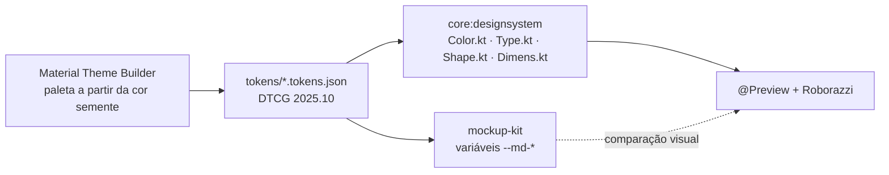

# Design

> Fonte da verdade visual do app e ponte entre o design e o código Compose.
> Decisão: [ADR-0008](../adr/0008-fase-de-design-com-ia-e-ponte-design-codigo.md) · Regras para o agente:
> [ui-design.md](../harness/guides/ui-design.md) · Pesquisa: [research.md](research.md).

## O que tem aqui
| Caminho | O que é | Vira no código |
|---|---|---|
| [DESIGN.md](DESIGN.md) | Identidade visual e regras de design legíveis por agentes (cor, tipo, forma, voz, do/don't) | Decisões do `core:designsystem` |
| [tokens/](tokens/) | Design tokens no formato **DTCG 2025.10** (`*.tokens.json`) | `Color.kt`, `Type.kt`, `Shape.kt`, `Dimens.kt` em `core:designsystem` |
| [components.md](components.md) | Catálogo de componentes `Ds*`: anatomia, variantes, estados, a11y | Composables públicos de `core:designsystem` / `core:ui` |
| [mockup-kit/template.html](mockup-kit/template.html) | Prancha de revisão: telas por estado, anotações, protótipo clicável | Referência visual das telas antes do Compose |
| [research.md](research.md) | Pesquisa de mercado que embasou o ADR | — |

Por feature, o design fica junto da spec:
```
docs/specs/NNN-nome/
  spec.md          # o quê e por quê (estados de UI na seção 6)
  ui-spec.md       # como a tela é: telas SCR-xx, estados, componentes, textos, a11y, aprovação
  design/
    mockups.html   # prancha gerada do mockup-kit (versão aprovada fica congelada)
```

## Hierarquia de verdade
1. **Spec** (`spec.md`): comportamento, regras e estados. Design não cria regra de negócio.
2. **Design system** (este diretório): tokens e componentes. Tela não cria token nem cor solta.
3. **UI Spec + prancha aprovada**: como cada estado aparece.
4. **Depois de implementado:** `@Preview` + screenshot Roborazzi passam a ser a referência visual;
   mudança visual exige nova versão da UI Spec e regravação do screenshot no mesmo PR.

## Fluxo dos tokens até o Compose

- Hoje a conversão tokens → Kotlin e tokens → CSS do kit é feita pelo agente, à mão, no mesmo PR.
  Mudou um token? Atualize os três lugares juntos (JSON, kit, `core:designsystem`).
- **Backlog do steering loop:** gerar `Color.kt`/`Type.kt` e o CSS do kit com Style Dictionary v5
  (lê DTCG e gera Compose). É dependência Node no build: exige aprovação e ADR antes de adotar.
- Cores semânticas além do Material 3 (`success`, `warning`) ficam numa `ExtendedColors` com
  `CompositionLocal` no `core:designsystem`, nunca em `Color(0xFF…)` na feature.

## Estado atual
Os tokens são **placeholder** (paleta teal, tipografia Roboto) só para o kit funcionar. Antes da
primeira feature com UI, rode a etapa "Direção visual" da skill `sdd-design`: o agente propõe 2–3
direções em pranchas, você escolhe uma e os tokens são regerados no Material Theme Builder.

## Ferramentas (todas gratuitas)
| Etapa | Ferramenta padrão | Alternativa opcional |
|---|---|---|
| Paleta | Material Theme Builder | — |
| Exploração visual | Pranchas do kit geradas pelo agente | Google Stitch (cota diária, experimental) |
| Telas e protótipo | Prancha HTML do kit, no navegador ou como link privado | Figma/Penpot se houver designer humano (ADR) |
| Implementação guiada por imagem | Agente com a UI Spec + prancha | Gemini no Android Studio: "Match UI to Target Image" |
| Verificação | `@Preview` + Roborazzi, `android studio render-compose-preview`, `android screen capture` | — |

## Como ver uma prancha
- **No computador:** abra o arquivo `mockups.html` no navegador (precisa de internet só para as fontes).
- **Por link (inclusive no celular):** peça ao agente para publicá-la como artifact privado do Claude;
  comentários no link chegam ao agente como pedidos de ajuste.
