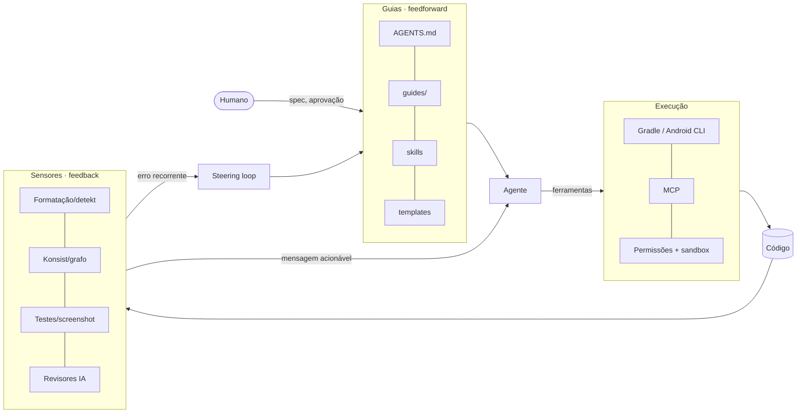

# Harness de IA

> Harness = tudo ao redor do modelo que aumenta a chance de acerto na primeira
> tentativa (**guias**) e detecta automaticamente o que escapou (**sensores**),
> operando por uma **camada de execução** segura. Decisão: [ADR-0002](../adr/0002-adotar-harness-engineering-para-agentes-de-ia.md).

## Estrutura
| Pasta | Conteúdo |
|---|---|
| [guides/](guides/) | Regras por área, lidas pelo agente antes de agir |
| [templates/](templates/) | Código de referência (padrão a copiar) |
| [sensors/](sensors/README.md) | Catálogo de sensores: o que verifica, quando roda, como corrigir |
| [execution/](execution/README.md) | Ferramentas, permissões, sandbox, Android CLI, MCP |
| [workflows/](workflows/README.md) | Papéis dos agentes, pipelines, paralelismo, handoff, cenários de avaliação |
| [steering-loop.md](steering-loop.md) | Como o harness evolui + registro de incidentes |
| [bootstrap.md](bootstrap.md) | Checklist para ativar o harness quando o projeto Android for criado |
| [../security/](../security/README.md) | Code review & security scanning: camadas, gates, triagem, MASVS, política de IA |
| [../design/](../design/README.md) | Design system (tokens DTCG, catálogo `Ds*`, `DESIGN.md`) e kit de prancha da fase Desenhar |

Fora de `docs/`, o harness vive em: `AGENTS.md`, `CLAUDE.md`, `.claude/`
(skills, agents, rules, hooks), `.agents/` (skills portáveis), `.gemini/`,
`scripts/harness/`, `config/`, `quality/`, `.githooks/`, `.github/`.

## Os três tipos de controle

### 1. Guias (feedforward): antes da ação
| Controle | Tipo | Arquivo |
|---|---|---|
| Instruções do projeto | inferencial | `AGENTS.md` (+ `CLAUDE.md` importando) |
| Regras inegociáveis | inferencial | `docs/constitution.md` |
| Guias por área | inferencial | `docs/harness/guides/*.md` |
| Fluxos repetíveis | inferencial | `.claude/skills/*/SKILL.md`, skills do Android CLI |
| Código de referência | inferencial | `docs/harness/templates/` |
| Specs e planos | inferencial | `docs/specs/NNN-*/` |
| Convention plugins | computacional | `build-logic/` (o agente não consegue configurar errado o que já vem pronto) |
| Documentação oficial sob demanda | computacional | `android docs <consulta>` |

### 2. Sensores (feedback): depois da ação
| Sensor | Tipo | Quando |
|---|---|---|
| `lint-file.sh` (padrões proibidos) | computacional | A cada edição (hook) |
| Spotless/ktlint, detekt, Konsist | computacional | Hook `Stop`, pre-commit, CI |
| Testes unitários, Android Lint | computacional | `verify.sh standard`, CI |
| Roborazzi, Kover, grafo de módulos, build release | computacional | `verify.sh full`, CI |
| Rastreabilidade AC ↔ teste | computacional | Fase 6, CI |
| Revisores (arquitetura, segurança, testes, UI, consistência) | inferencial | Fechamento de M/G, PR |

Detalhes e mensagens de correção: [sensors/README.md](sensors/README.md).

### 3. Execução
Permissões, hooks, sandbox, Android CLI e MCP: [execution/README.md](execution/README.md).

## Princípios
1. **Shift left.** Feedback mais barato primeiro: editor → hook → pre-commit → CI.
2. **Computacional antes de inferencial.** Se dá para verificar com regra
   determinística, não dependa de LLM para isso.
3. **Mensagens escritas para o agente.** Toda falha diz *o que*, *onde* e *como corrigir*.
4. **Fonte única.** Uma regra vive em um lugar; os demais apontam para ele.
5. **Divulgação progressiva.** `AGENTS.md` curto, guias sob demanda; contexto é recurso escasso.
6. **Harnessability.** Tipos fortes, módulos com fronteiras claras e convention
   plugins tornam o código verificável. Projetamos para isso desde o início.
7. **O humano dirige o loop.** Erro recorrente não pede mais supervisão; pede
   um guia ou sensor melhor ([steering-loop.md](steering-loop.md)).

## Métricas de saúde do harness
| Métrica | Como medir | Meta |
|---|---|---|
| Taxa de "verde na primeira" | PRs de IA que passam no CI sem correção | ↑ ao longo do tempo |
| Reincidência | Mesmo erro registrado 2+ vezes no steering loop | 0 após correção do harness |
| Achados na revisão humana | Comentários de PR que um sensor poderia ter pego | ↓ |
| Tempo do `verify.sh fast` | Saída do script | < 60 s |
| Sensores silenciosos | Regras que nunca dispararam em 3 meses | Revisar relevância |
