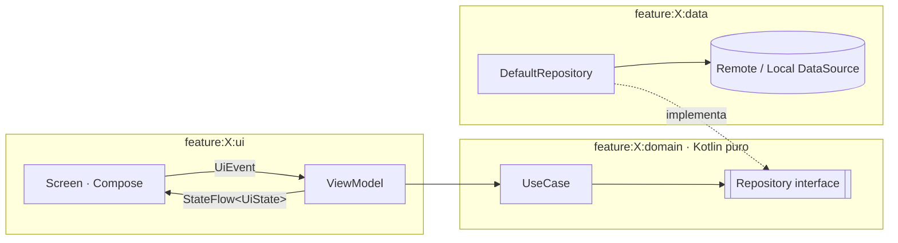
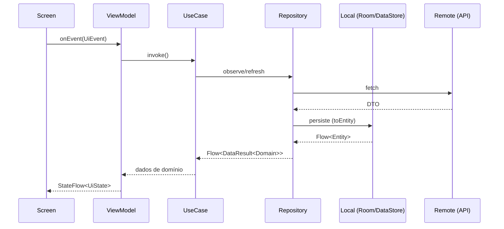
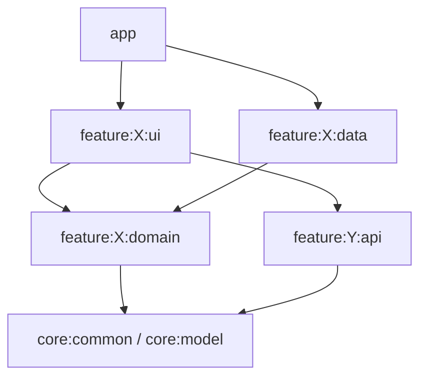

# Guia: Arquitetura e Modularização

> Baseado no [Guide to app architecture](https://developer.android.com/topic/architecture),
> nas [recomendações oficiais](https://developer.android.com/topic/architecture/recommendations),
> no [guia de modularização](https://developer.android.com/topic/modularization),
> em [offline-first](https://developer.android.com/topic/architecture/data-layer/offline-first)
> e no [Now in Android](https://github.com/android/nowinandroid).
> Implementa a Constitution Art. II e III.
> Verificado por: S-06 Konsist (`quality/architecture-tests`), S-12 module graph assertion,
> S-04/S-05 detekt, S-01 `lint-file.sh`, S-16 `architecture-reviewer`.
> Ver também: [compose-ui.md](compose-ui.md) · [error-handling.md](error-handling.md) · [gradle.md](gradle.md).

## Princípios
1. **Separação de responsabilidades.** Activities e composables só desenham e
   repassam eventos. Eles são efêmeros: o sistema os destrói por rotação,
   mudança de configuração, falta de memória ou morte do processo.
2. **UI derivada de modelo de estado.** A tela é função de um `UiState` imutável e
   persistente ao ciclo de vida (UDF: estado desce, eventos sobem).
3. **Fonte única da verdade (SSOT).** Cada dado tem um único dono (o repositório)
   e só ele o altera. Os demais apenas observam.
4. **Regra de dependência.** Dependências apontam para o domain, que não conhece
   Android, frameworks nem detalhes de I/O.
5. **Main-safety.** Toda função `suspend` pública pode ser chamada da main thread.
   Quem bloqueia a thread troca o dispatcher.
6. **Simplicidade (Art. VII).** Nenhuma camada, módulo ou abstração sem uma
   necessidade presente na spec.

## Camadas

Dependências apontam **para o domain**. O domain não conhece Android, data nem UI.

| Camada | Contém | Pode depender de | Não pode |
|---|---|---|---|
| **domain** | Modelos de domínio, interfaces de repositório, use cases, erros de domínio | `core:common`, `core:model`, `javax.inject` | `android.*`, `androidx.*`, Retrofit, OkHttp, Room, Hilt Android, DTOs |
| **data** | Repositórios, data sources, DTOs, entidades Room, mappers, módulos de DI | domain, `core:network`, `core:database`, `core:datastore`, `core:security` | UI, ViewModel, Compose |
| **ui** (presentation) | `UiState`, `UiEvent`, `ViewModel`, `Route`, `Screen`, componentes, navegação | domain, `core:designsystem`, `core:ui`, `feature:*:api` | `feature:*:data`, DTOs, entidades Room, Retrofit |

A UI **nunca** depende do módulo `data`, nem para DI. Cada `data` registra seus
próprios bindings (`@InstallIn`) e o `app` agrega o grafo (ver [Módulos](#módulos)).

## Fluxo de dados (UDF + SSOT)

| Regra | Detalhe |
|---|---|
| Estado | `ViewModel` expõe **um** `StateFlow<UiState>`. Para fontes reativas, use `stateIn(viewModelScope, SharingStarted.WhileSubscribed(5_000), initial)`, que sobrevive à rotação sem manter o upstream ativo em background. |
| Coleta na UI | Sempre `collectAsStateWithLifecycle()`. Nunca `collectAsState()` nem `launch` coletando fora do ciclo de vida. |
| Eventos VM → UI | Prefira modelar como estado (ex.: `isSaved = true`, consumido via `onEvent`). Use `Channel` em `effects` só se a spec exigir. |
| Process death | Argumentos de navegação e entrada do usuário que precisam sobreviver vão para o `SavedStateHandle`. Dados do repositório são recarregados, não salvos no bundle. |
| Leitura vs. escrita | Leituras observáveis expõem `Flow`. Operações únicas (submit, pagamento) são `suspend` e retornam `DataResult`. |

## Módulos
```
app/                         # Application, MainActivity, NavHost, agregação do grafo de DI
build-logic/convention/      # convention plugins (único lugar com configuração Gradle)
core/
  common/                    # Kotlin puro: DataResult/AppError, qualifiers de dispatcher e escopo, utilitários
  model/                     # modelos compartilhados entre features (Kotlin puro), se houver
  designsystem/              # tema, tokens, componentes base (Compose), sem regra de negócio
  ui/                        # componentes de UI compartilhados com lógica de apresentação
  network/                   # cliente HTTP, interceptors, TLS/pinning, mapeamento de erro HTTP
  database/                  # Room, DAOs, migrações
  datastore/                 # DataStore (preferências / proto), criptografia quando aplicável
  security/                  # criptografia, Keystore, detecção de root/tamper, mascaramento
  analytics/                 # interface de eventos + implementação (sem PII)
  testing/                   # utilitários genéricos: MainDispatcherExtension, regras, builders
feature/<nome>/
  api/                       # contrato público: rota de navegação, interfaces expostas a outras features
  domain/                    # Kotlin puro (módulo JVM)
  data/                      # Android library
  ui/                        # ViewModel + Compose (Route, Screen, componentes, previews)
quality/
  architecture-tests/        # Konsist: regras de camadas, nomes e estrutura
  detekt-rules/              # regras detekt próprias do projeto
```

| Módulo | Plugin | Visibilidade padrão | Depende de |
|---|---|---|---|
| `feature:X:api` | `app.jvm.library` | `public` (é o contrato) | `core:model`, `core:common`, `kotlinx.serialization`. Nada de Compose, Hilt ou domain de outra feature. |
| `feature:X:domain` | `app.jvm.library` | `public` para modelos e use cases | `feature:X:api` (se necessário), `core:common`, `core:model` |
| `feature:X:data` | `app.android.feature.data` | **`internal`** (DTO, API, data source, repositório, módulo de DI) | `feature:X:domain`, `core:network`/`database`/`datastore`/`security` |
| `feature:X:ui` | `app.android.feature.ui` | `internal`, exceto o ponto de entrada de navegação | `feature:X:domain`, `feature:*:api`, `core:designsystem`, `core:ui` |
| `app` | `app.android.application` | — | todos os `feature:*:{ui,data}` e `core:*` necessários |

### Regras de dependência entre módulos

- `feature:X:*` **nunca** depende de `feature:Y:{domain,data,ui}`. Só de `feature:Y:api`.
- `feature:X:domain` é módulo JVM puro (`app.jvm.library`).
- `core:*` nunca depende de `feature:*`.
- `app` é o único que conhece todas as implementações: agrega o grafo de DI e a navegação.
- Altura máxima do grafo: 6 (module graph assertion, ver [gradle.md](gradle.md#regras-do-grafo-de-módulos-module-graph-assertion)).
- Criar módulo ou mudar contrato público de `:api` exige aprovação (ver `AGENTS.md`).

### Comunicação entre features
| Necessidade | Como fazer |
|---|---|
| Navegar para outra feature | Rota `@Serializable` declarada em `feature:Y:api`. `feature:X:ui` recebe um callback (`onOpenY: (YRoute) -> Unit`) e o `app` liga as rotas no `NavHost`. Uma feature não instancia telas de outra. |
| Consumir dado de outra feature | Interface mínima em `feature:Y:api` (ex.: `interface ActiveMerchantProvider`), implementada em `feature:Y:data` e ligada por `@Binds`. O consumidor depende só do `:api`. |
| Modelo usado por várias features | Mover para `core:model` apenas quando houver **dois ou mais** consumidores reais. |
| Deep link | Declarado no módulo de navegação da feature. Os argumentos são validados como entrada não confiável (ver [security.md](security.md)). |

## Padrões obrigatórios
| Elemento | Padrão | Sensor |
|---|---|---|
| Use case | `class GetBalanceUseCase @Inject constructor(...)` com **um** `operator fun invoke`. Uma ação de negócio por classe, sufixo `UseCase`, sem estado mutável. Referencia a `BR-xx` que implementa. | S-06 |
| Repositório | Interface no domain (`BalanceRepository`), implementação `internal` no data com prefixo `Default` (`DefaultBalanceRepository`). Retorna tipos de domínio dentro de `DataResult`/`Flow`, nunca DTO nem entidade. | S-06 |
| Data source | `BalanceRemoteDataSource` / `BalanceLocalDataSource`, `internal`. Uma fonte por classe. Só o repositório os usa. | S-16 |
| Mapper | Funções de extensão `internal` em `mapper/`: `BalanceDto.toDomain()`, `BalanceEntity.toDomain()`, `Balance.toEntity()`. | S-06 (AP-06) |
| ViewModel | Consome **use cases**, nunca repositório nem data source. Um `StateFlow<UiState>` (`uiState`) e um `fun onEvent(event: UiEvent)`. Sem `Context`, `Resources`, `View` ou `NavController`. | S-06 (AP-04) |
| UiState | `sealed interface` ou `data class` imutável, exatamente como na spec. Coleções imutáveis. | S-19 |
| Erros | `DataResult<T>` + `AppError`, conforme [error-handling.md](error-handling.md). Exceções técnicas não saem do data. | S-04, S-16 |
| Dinheiro e tempo | `Money` (`BigDecimal`) / centavos em `Long`; `Instant` para tempo. Nunca `Double`. Relógio injetado quando a regra depende de "agora". | S-01 (AP-08) |
| Concorrência | Dispatchers injetados (`@IoDispatcher`, `@DefaultDispatcher`). Ver [Concorrência e ciclo de vida](#concorrência-e-ciclo-de-vida). | S-01, S-04 (AP-01, AP-02) |
| DI | Hilt. `@Module` em `di/` de cada módulo `data`/`ui`, com bindings por `@Binds` (`@Provides` só para tipos de terceiros). Ver [Injeção de dependência](#injeção-de-dependência). | S-16 |

## Concorrência e ciclo de vida
| Escopo | Use para | Não use para |
|---|---|---|
| `viewModelScope` | Carregar e observar dados da tela; ações do usuário | Trabalho que precisa terminar mesmo se o usuário sair da tela |
| Escopo de aplicação injetado (`@ApplicationScope CoroutineScope`, com `SupervisorJob`) | Operações que sobrevivem à tela, mas não ao processo (ex.: concluir uma escrita local iniciada) | Trabalho que precisa sobreviver à morte do processo |
| WorkManager | Trabalho **garantido** e diferível: sincronização, envio de pendências, upload | Resposta imediata à UI |
| `LaunchedEffect` (na `Route`) | Efeitos de UI: navegação, snackbar | Lógica de negócio ou chamadas de rede |

- Funções `suspend` são main-safe. O repositório/data source faz `withContext(ioDispatcher)`.
- Trabalho de CPU pesado (parsing grande, criptografia) usa `@DefaultDispatcher`.
- `CancellationException` sempre é relançada (`suspendRunCatching`).
- `Flow` frio nas camadas inferiores. Ele só vira quente (`stateIn`/`shareIn`) no
  ViewModel ou em um escopo explicitamente injetado.
- Proibido: `GlobalScope`, `runBlocking` em produção, `Dispatchers.*` fora do
  `DispatchersModule`, `Thread.sleep`, `delay` como sincronização.

## Dados e persistência
1. **Offline-first quando a spec pedir:** o banco local (Room) é a SSOT. A UI
   observa o local e o repositório sincroniza o remoto em background. Sem esse
   requisito, o remoto é a fonte e o cache é detalhe de implementação do repositório.
2. **Escritas:** escolha e documente no `plan.md` a estratégia (online-only,
   fila local com WorkManager ou otimista com rollback) e o tratamento de conflito.
3. **DataStore** para preferências e pequenos estados. Nunca `SharedPreferences` novo.
   Dados sensíveis passam por `core:security` (ver [security.md](security.md)).
4. **Migrações de banco** são versionadas, testadas (`MigrationTestHelper`) e exigem
   aprovação. `fallbackToDestructiveMigration` é proibido em release.
5. **Dados de cartão** nunca são persistidos. Use apenas token ou PAN mascarado (Art. V.2).

## Injeção de dependência
| Componente Hilt | Escopo | Use para |
|---|---|---|
| `SingletonComponent` | `@Singleton` | Clientes HTTP, banco, DataStore e repositórios **com estado ou cache em memória** |
| `ViewModelComponent` | `@ViewModelScoped` | Dependências compartilhadas por um único ViewModel |
| Sem escopo | — | Padrão para use cases, mappers e repositórios sem estado (mais barato) |

- Injeção por construtor sempre. Field injection só em classes do framework (`@AndroidEntryPoint`).
- `Lazy<T>`/`Provider<T>` para dependências caras que não são usadas no startup.
- Nada de service locator nem `EntryPointAccessors` em código de feature.
- Em testes, `@TestInstallIn` substitui módulos. Fakes ficam em `testFixtures` do
  domain da feature (ou em `feature:X:testing`), nunca em `core:testing`, que não
  pode depender de feature.

## Desempenho, startup e build
- `Application.onCreate` só inicializa o essencial. O resto é lazy ou fica em WorkManager.
- Nada de I/O na main thread: StrictMode e LeakCanary ativos no `debug`
  ([kotlin-style.md](kotlin-style.md#recursos-do-sistema-e-vazamentos-de-memória)).
- Recursos (strings, drawables) ficam no módulo que os usa (`nonTransitiveRClass`),
  e `core:designsystem` só guarda o compartilhado.
- Regras R8 de reflexão/serialização ficam no `consumer-rules.pro` do módulo que as
  exige, nunca concentradas no `app`. O build release (S-13) valida.
- Módulos pequenos e coesos melhoram o build incremental: prefira `implementation`
  a `api` nas dependências Gradle.

## SOLID aplicado
| Princípio | Como se manifesta aqui |
|---|---|
| **S**RP | Um use case por ação; `Screen` só desenha; `ViewModel` só orquestra estado; data source por origem. |
| **O**CP | Novos comportamentos por novas implementações de interfaces (estratégias), não por `when` crescente em código central. |
| **L**SP | Fakes de teste implementam a mesma interface e respeitam o contrato (inclusive erros). |
| **I**SP | Interfaces pequenas em `:api` e no domain; nada de "god repositories". |
| **D**IP | Domain define interfaces; data implementa; Hilt liga. Nenhuma camada alta instancia classes concretas de baixo. |

## Pacotes
`<base.package>.feature.<nome>.<camada>.<subpacote>`, ex.:
`<base.package>.feature.balance.domain.usecase`. O `<base.package>` será definido na
criação do projeto e registrado em `quality/architecture-tests`.

| Camada | Subpacotes |
|---|---|
| api | `navigation`, `model` (se expuser contrato de dados) |
| domain | `model`, `repository`, `usecase`, `error` |
| data | `remote` (API, DTO, data source), `local` (DAO, entity, data source), `mapper`, `repository`, `di` |
| ui | raiz da tela (`UiState`, `UiEvent`, `ViewModel`, `Route`, `Screen`), `components`, `navigation`, `di` |

## Checklist de revisão
- [ ] Domain sem `android.*`/`androidx.*`; use cases com um `invoke`.
- [ ] Nenhuma dependência `feature → feature` fora de `:api`; UI não enxerga `data`.
- [ ] DTO/entidade não saem do data; implementações `internal`.
- [ ] ViewModel com um `StateFlow`, um `onEvent`, consumindo use cases e com dispatchers injetados.
- [ ] UI coleta com `collectAsStateWithLifecycle`; estado crítico sobrevive à morte do processo.
- [ ] SSOT definida; estratégia de escrita e sincronização documentada no `plan.md`.
- [ ] Escopos Hilt justificados; nenhum `@Singleton` sem estado.
- [ ] `verify.sh fast` (Konsist) e, em M/G, `verify.sh full` (grafo de módulos e R8) passando.
