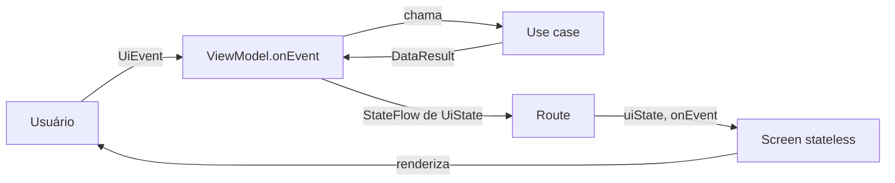

# Guia: Presentation e Jetpack Compose

> Constitution Art. II.4–5 (UDF, state hoisting) e Art. VI.2 (acessibilidade é requisito).
> Baseado em [UI layer](https://developer.android.com/topic/architecture/ui-layer),
> [State hoisting](https://developer.android.com/develop/ui/compose/state-hoisting),
> [Compose performance](https://developer.android.com/develop/ui/compose/performance)
> e [Compose accessibility](https://developer.android.com/develop/ui/compose/accessibility).
> **Verificado por:** S-06 Konsist, S-08 Android Lint (regras Compose), S-10 Roborazzi,
> S-19 `compose-ui-reviewer`. **Anti-padrões:** AP-04, 05, 13, 22, 23, 26–32.
> **Skills oficiais úteis:** `adaptive`, `edge-to-edge`, `jetpack-compose-performance`, `navigation-3`.
> Na dúvida sobre uma API, rode `android docs <consulta>` antes de escrever.
> **Design aprovado:** a tela implementa a `ui-spec.md` da feature e os tokens de
> [docs/design/](../../design/README.md); regras da fase de design em [ui-design.md](ui-design.md).

## 1. Estrutura de uma tela
```
feature/<nome>/ui/src/main/kotlin/.../ui/
  <Nome>UiState.kt      # sealed interface / data class @Immutable, exatamente como na spec
  <Nome>UiEvent.kt      # sealed interface com as ações do usuário da spec
  <Nome>ViewModel.kt    # StateFlow<UiState> + onEvent(event)
  <Nome>Route.kt        # stateful: ViewModel, ciclo de vida, efeitos e navegação
  <Nome>Screen.kt       # stateless: (uiState, onEvent, modifier) → UI + @Preview por estado
  components/           # composables internos da tela (private/internal)
  navigation/           # rota e extensão de grafo (implementa o contrato do :api)
```
Referência para copiar: [FeatureViewModel.kt](../templates/kotlin/FeatureViewModel.kt)
e [FeatureScreen.kt](../templates/kotlin/FeatureScreen.kt).



## 2. Regras de arquitetura da UI
1. **Route vs Screen.** Só a `Route` conhece o ViewModel, coleta estado e executa
   efeitos. A `Screen` recebe `uiState` e `onEvent: (UiEvent) -> Unit` e é
   testável e pré-visualizável isoladamente (AP-05).
2. **Coleta ciente do ciclo de vida:** `collectAsStateWithLifecycle()` na `Route`.
   Nunca `collectAsState()` nem `collect` solto em `LaunchedEffect` (AP-26).
3. **Todo estado da spec é renderizado explicitamente:** `when` exaustivo, sem
   `else`, cobrindo Loading, Empty, Error e Content. Nada de tela em branco (AP-30).
4. **Sem lógica de negócio em composables.** Regras, validação e decisões ficam no
   ViewModel/use case. Dinheiro e data chegam prontos no `UiState` ou passam por um
   formatador de `core:ui` (locale `pt-BR`, nunca `String.format` manual).
5. **Nada roda durante a composição:** sem lançar coroutine, ler `StateFlow.value`
   ou operar `Flow` no corpo do composable (AP-27). A carga inicial é disparada pelo
   ViewModel (`init` ou `stateIn`), não por `LaunchedEffect(Unit)`.
6. **Eventos únicos (navegar, snackbar, haptics) são estado**, não `SharedFlow`/
   `Channel` (AP-23): o `UiState` carrega o efeito pendente, a `Route` o executa e
   envia um evento de consumo (ver seção 3).
7. **API de composable:** parâmetros obrigatórios → `modifier: Modifier = Modifier`
   (primeiro opcional, aplicado só no nó raiz) → demais opcionais → lambda de
   conteúdo por último. Callbacks nomeados no imperativo do usuário
   (`onConfirmClick`, `onAmountChange`), nunca `onEvent` em componentes reutilizáveis (AP-29).
8. **Estado puramente visual** (expandido, aba selecionada, scroll) fica no
   composable com `rememberSaveable`/`rememberLazyListState`. Estado que influencia
   regra ou precisa sobreviver à morte do processo vai para o ViewModel com
   `SavedStateHandle` (AP-32).

## 3. ViewModel
```kotlin
@HiltViewModel
class PaymentViewModel @Inject constructor(
    private val confirmPayment: ConfirmPaymentUseCase,
    private val savedStateHandle: SavedStateHandle,
) : ViewModel() {

    private val _uiState = MutableStateFlow(PaymentUiState())
    val uiState: StateFlow<PaymentUiState> = _uiState.asStateFlow()

    fun onEvent(event: PaymentUiEvent) {
        when (event) {
            is PaymentUiEvent.AmountChanged -> _uiState.update { it.copy(amount = event.value) }
            PaymentUiEvent.ConfirmClicked -> confirm()
            PaymentUiEvent.NavigationHandled -> _uiState.update { it.copy(navigateTo = null) }
        }
    }

    private fun confirm() {
        _uiState.update { it.copy(isSubmitting = true) }
        viewModelScope.launch {
            when (val result = confirmPayment(_uiState.value.amount)) {
                is DataResult.Success -> _uiState.update {
                    it.copy(isSubmitting = false, navigateTo = PaymentDestination.Receipt(result.value.id))
                }
                is DataResult.Failure -> _uiState.update {
                    it.copy(isSubmitting = false, error = result.error.toUiError())
                }
            }
        }
    }
}
```
- **Um único `StateFlow<UiState>` público e um único `onEvent`** (AP-04). Nada de
  `MutableStateFlow` exposto ou funções públicas avulsas.
- Atualize estado com `_uiState.update { }` (atômico), nunca `value = value.copy(...)`.
- Estado derivado de flows do domínio: `combine(...).stateIn(viewModelScope,
  SharingStarted.WhileSubscribed(5_000), initial)` (AP-22).
- Sem `Context`, `Resources`, `NavController`, `Activity` ou tipos de `android.view`.
  Mensagens são `@StringRes`/enums mapeados na UI, nunca `String` resolvida no ViewModel.
- Dispatchers injetados (AP-01); trabalho pesado fica no data/domain, não no ViewModel.
- `SavedStateHandle` para argumentos e entrada do usuário. **Nunca** PAN, CVV ou
  trilha (AP-33).

Execução do efeito na `Route`:
```kotlin
@Composable
fun PaymentRoute(
    onNavigateToReceipt: (ReceiptId) -> Unit,
    modifier: Modifier = Modifier,
    viewModel: PaymentViewModel = hiltViewModel(),
) {
    val uiState by viewModel.uiState.collectAsStateWithLifecycle()
    val currentOnNavigate by rememberUpdatedState(onNavigateToReceipt)

    LaunchedEffect(uiState.navigateTo) {
        when (val destination = uiState.navigateTo) {
            is PaymentDestination.Receipt -> {
                currentOnNavigate(destination.id)
                viewModel.onEvent(PaymentUiEvent.NavigationHandled)
            }
            null -> Unit
        }
    }
    PaymentScreen(uiState = uiState, onEvent = viewModel::onEvent, modifier = modifier)
}
```

## 4. Efeitos colaterais
| Necessidade | API | Observação |
|---|---|---|
| Reagir a mudança de estado (navegar, snackbar) | `LaunchedEffect(key)` | Chave = o dado que dispara; nunca `Unit` para carga de dados |
| Callback que pode mudar entre recomposições | `rememberUpdatedState` | Evita reiniciar o efeito |
| Ação disparada por clique que precisa de coroutine | `rememberCoroutineScope` | Ex.: animar scroll, abrir sheet |
| Registrar/limpar listener | `DisposableEffect` | Sempre com `onDispose` |
| Converter estado Compose em `Flow` | `snapshotFlow` | Ex.: posição de scroll para analytics |

Efeitos ficam na `Route` ou em componentes de infraestrutura; a `Screen` só emite eventos.
Em previews, `LocalInspectionMode.current` desliga efeitos que dependem de runtime.

## 5. Design system e tema
1. **Só componentes e tokens de `core:designsystem`** (cores, tipografia, formas,
   espaçamentos, elevação). Nada de `Color(0xFF…)`, `dp`/`sp` mágicos ou
   `TextStyle` ad hoc na feature (AP-13). Faltou token? Proponha no design system.
2. **Tema claro e escuro** obrigatórios; cores sempre semânticas (`primary`,
   `onSurface`, `error`), nunca valores fixos por modo. Cor dinâmica (Material You)
   só se o design system habilitar.
3. **Strings** em `strings.xml` via `stringResource`; plurais com
   `pluralStringResource`. Nada de texto hardcoded nem concatenação de frases.
4. **Ícones** do design system ou vetoriais (`ImageVector`/`painterResource`);
   nada de PNG por densidade para ícone.

### Componentes reutilizáveis
| Onde | O que | Visibilidade |
|---|---|---|
| `core:designsystem` | Componentes genéricos sem regra de negócio (botões, campos, cards, estados de loading/erro/vazio, top bar) e tokens | `public` |
| `core:ui` | Componentes de domínio compartilhados sem depender de feature (ex.: `AmountText`, `MaskedPanText`, formatadores) | `public` |
| `feature:X:ui/components` | Componentes usados só pela feature | `internal`/`private` |

- **Promova** para `core:*` quando o segundo módulo precisar do componente (mova, não copie).
- **API do componente:** recebe dados prontos e callbacks específicos (`onClick`,
  `onValueChange`), `modifier: Modifier = Modifier`, slots (`@Composable () -> Unit`) para
  conteúdo variável. Nunca recebe `ViewModel`, `UiState` de tela ou `onEvent` (AP-29).
- **Acessibilidade embutida:** o componente já entrega semântica, área de toque de 48dp e
  estados (habilitado, erro, carregando); quem usa não precisa repetir.
- Cada componente do design system tem previews (claro/escuro, fonte 2x, estados) e
  screenshot test (S-10). Prefira os componentes do Material 3 como base, customizando
  via tema, a reescrevê-los.

## 6. Layout, insets e telas adaptáveis
1. **Edge-to-edge** é o padrão (obrigatório com `targetSdk` 35+): `enableEdgeToEdge()`
   na Activity e insets tratados por `Scaffold` (`innerPadding`) ou `WindowInsets`
   (`safeDrawing`, `systemBars`, `ime`). Nada de conteúdo sob barra de status ou
   teclado; formulários usam `imePadding()`.
2. **Sem tamanhos de tela fixos.** Layout responde a `WindowSizeClass`
   (compact/medium/expanded), não a orientação ou modelo de aparelho. Considere
   tablets, dobráveis, multi-window e terminais com telas fora do padrão.
3. **Rotação e mudança de configuração** não perdem estado nem refazem requisição.
4. Listas longas usam `LazyColumn`/`LazyVerticalGrid`; nunca `Column` com
   `verticalScroll` para coleções de tamanho variável.
5. **Responsivo por construção:** larguras com `fillMaxWidth`/`weight`/`widthIn(max = …)`
   (conteúdo legível em telas largas), nunca largura fixa de tela. Padrões canônicos de
   `material3-adaptive` (list-detail, supporting pane) e `NavigationSuiteScaffold`
   (barra inferior ↔ rail) em vez de `if` por orientação.

## 7. Performance de recomposição
1. **Parâmetros estáveis:** `UiState` imutável (`val`, `data class`, `@Immutable`),
   coleções `ImmutableList` de `kotlinx.collections.immutable` (AP-28). Com strong
   skipping (padrão no compilador Compose do Kotlin 2.x), tipo instável ainda
   recompõe quando a instância muda.
2. **Listas lazy** com `key = { it.id }` estável e `contentType` quando há tipos de
   item distintos. Nunca use o índice como chave.
3. **Leia estado o mais tarde possível:** valores que mudam a cada frame (scroll,
   animação) em lambdas (`Modifier.offset { }`, `graphicsLayer { }`, `drawBehind { }`),
   não no corpo do composable.
4. **`remember`** para cálculo custoso; **`derivedStateOf`** quando um estado que
   muda muito gera um resultado que muda pouco (ex.: "mostrar botão de voltar ao topo").
5. **Sem escrita retroativa** (alterar estado já lido na mesma composição) e sem
   ordenação/filtragem/formatação de listas na composição: isso é trabalho do ViewModel.
6. **Meça antes de otimizar:** Layout Inspector (contagem de recomposição),
   relatórios do compilador Compose e Macrobenchmark. Meça em build `release`; o
   `debug` não representa a performance real. Mudanças no `build-logic/` (stability
   config, baseline profile) exigem aprovação.

## 8. Navegação
- Rotas **type-safe** (`@Serializable`) declaradas no módulo `:api` da feature; a
  feature expõe só a extensão de grafo e callbacks (`onNavigateToX`). Uma feature
  nunca importa a tela de outra.
- Passe **IDs**, nunca objetos inteiros ou dados sensíveis, como argumento de rota.
  O destino busca o dado no repositório.
- O `ViewModel` é escopado à entrada de navegação (`hiltViewModel()` na `Route`).
- Deep links validam e sanitizam todos os parâmetros (AP-37).

## 9. Segurança na UI
Detalhes em [security.md](security.md).
- Telas com dados de cartão aplicam `FLAG_SECURE` e ocultam conteúdo em
  "Recentes" (AP-35).
- PAN só mascarado (`**** 1234`) e com descrição falada adequada; CVV nunca é
  exibido após a digitação nem mantido em `rememberSaveable`/`SavedStateHandle`.
- Campos sensíveis: teclado numérico, sem sugestões/autocorreção e com
  transformação visual de senha quando aplicável. Confirme a API do campo seguro
  com `android docs` antes de usar.
- Nenhum dado sensível em `testTag`, `contentDescription` detalhada, previews ou
  fixtures de screenshot.

## 10. Acessibilidade (requisito, Constitution Art. VI.2)
| Tema | Regra |
|---|---|
| Rótulos | `contentDescription` em ícone/imagem informativo; `null` em decorativo. Botão com texto não precisa de descrição extra |
| Toque | Área mínima de 48×48dp (`Modifier.minimumInteractiveComponentSize()`) |
| Papéis e estado | `clickable(role = Role.Button)`, `toggleable`/`selectable` com `stateDescription` quando o estado não é óbvio (AP-31) |
| Estrutura | `semantics { heading() }` em títulos; `mergeDescendants = true` em cards clicáveis; ordem de leitura lógica (`traversalIndex` só se necessário) |
| Feedback | Erros de formulário anunciados (`liveRegion = LiveRegionMode.Polite` ou `error(...)` no campo) e foco movido para o primeiro campo inválido |
| Texto | Fonte ampliada até 200% sem cortar conteúdo (`fontScale = 2f` em preview); tamanhos em `sp` via tipografia do tema |
| Contraste | WCAG AA: 4,5:1 para texto, 3:1 para texto grande e componentes. Informação nunca transmitida só por cor |
| Dados financeiros | Valores e dados mascarados com leitura natural: "final 1234", não "asterisco asterisco…" (`clearAndSetSemantics { contentDescription = … }`) |
| Movimento | Animações não essenciais respeitam a preferência de reduzir animações do sistema |

Valide com TalkBack, Switch Access e o Accessibility Scanner nos fluxos críticos.

## 11. Previews e testes de UI
1. **Um `@Preview` por estado da spec**, com dados de `PreviewParameterProvider` ou
   objetos `preview*` fictícios (nunca dados reais). Previews `private`, envolvidos
   no tema do design system.
2. **Variações obrigatórias** no estado principal: claro/escuro (`@PreviewLightDark`)
   e fonte ampliada (`@PreviewFontScale` ou `fontScale = 2f`). Telas adaptáveis
   também em `@PreviewScreenSizes`.
3. **Previews alimentam o S-10 (Roborazzi).** Mudança visual intencional regrava o
   screenshot no mesmo PR (`recordRoborazziDebug`); ver [testing.md](testing.md).
4. **Testes de Compose** localizam nós por semântica (texto, `contentDescription`,
   papel), como o usuário e o TalkBack enxergam. `testTag` só quando não houver
   semântica natural.
5. Testes de UI testam a `Screen` com `UiState` fixo e verificam o `UiEvent`
   emitido; a lógica é coberta nos testes do ViewModel (Turbine). Nome cita o
   `AC-xx`.

## 12. Checklist antes de pedir revisão (S-19)
- [ ] Todo estado da spec com ramo no `when` e `@Preview` (claro/escuro, fonte 2x)
- [ ] `Screen` stateless; efeitos e navegação só na `Route`; `collectAsStateWithLifecycle`
- [ ] ViewModel com um `StateFlow`, um `onEvent`, sem tipos Android, sem PAN/CVV em `SavedStateHandle`
- [ ] Só tokens e componentes do design system; strings em recursos
- [ ] Componente usado por 2+ módulos promovido a `core:*`, sem `ViewModel`/`onEvent` na API
- [ ] Edge-to-edge, insets e teclado tratados; layout testado em tela compacta e expandida
- [ ] Listas com `key` estável; `UiState` imutável; nada de trabalho pesado na composição
- [ ] A11y: rótulos, 48dp, headings, papéis, contraste, leitura de dados mascarados
- [ ] Telas com dado de cartão com `FLAG_SECURE`
- [ ] `verify.sh standard` passando (e screenshots regravados, se houve mudança visual)
