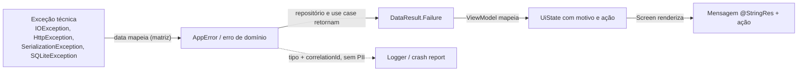

# Guia: Tratamento de Erros

> Constitution Art. VI.3: erros são tratados explicitamente e mapeados para estados
> de UI. Nada de falhas silenciosas. A matriz de erros de cada feature vive no
> `plan.md` (seção 5) e é a fonte da verdade para o mapeamento.
> Baseado em [Coroutines best practices](https://developer.android.com/kotlin/coroutines/coroutines-best-practices),
> [Coroutine exceptions](https://kotlinlang.org/docs/exception-handling.html),
> [UI events](https://developer.android.com/topic/architecture/ui-layer/events) e
> [Data layer](https://developer.android.com/topic/architecture/data-layer).
> **Verificado por:** S-04 detekt (`TooGenericExceptionCaught`, `SwallowedException`),
> S-09 rastreabilidade, S-16 `architecture-reviewer`, S-17 `security-reviewer`,
> S-18 `test-reviewer`. **Anti-padrões:** AP-16, 23, 43, 47.
> **Código de referência:** [CoreCommon.kt](../templates/kotlin/CoreCommon.kt),
> [FeatureData.kt](../templates/kotlin/FeatureData.kt),
> [FeatureViewModel.kt](../templates/kotlin/FeatureViewModel.kt).

## Fluxo


## Princípios
1. **Falha esperada é valor, não exceção.** Entre camadas, falhas trafegam como
   `DataResult.Failure(AppError)`. Exceções técnicas não saem do data (AP-43).
2. **Cancelamento não é erro.** `CancellationException` é sempre relançada (AP-16).
3. **Erros são finitos e nomeados pela regra de negócio** (`AccountBlocked`,
   `InsufficientBalance`), nunca pelo detalhe técnico (`Http422`).
4. **Toda variante tem destino.** Cada erro chega a um estado de UI com mensagem e,
   quando fizer sentido, ação (tentar novamente, editar, contatar suporte).
5. **Observável sem vazar dados.** Registre tipo, operação e correlação; nunca
   payload, PAN ou PII ([security.md](security.md)).

## Taxonomia de falhas
| Categoria | Exemplos | Tratamento |
|---|---|---|
| **Recuperável (infraestrutura)** | Sem conexão, timeout, 5xx, 429 | `AppError.Network.*`; UI com retry; retry automático só se a operação for idempotente |
| **Negócio** | Saldo insuficiente, cartão bloqueado, limite excedido | Erro de domínio da feature (`sealed interface XxxError : AppError`); mensagem específica e ação de correção |
| **Validação de entrada** | CPF inválido, valor fora da faixa | Resultado do use case/validador, nunca exceção; erro no campo (ver [Validação](#validação-de-entrada)) |
| **Sessão/autorização** | 401, token revogado | `AppError.Auth.*`, tratado centralmente (ver [Erros globais](#erros-globais-e-sessão)) |
| **Inesperada (bug ou contrato quebrado)** | JSON fora do contrato, `IllegalStateException`, enum desconhecido | `AppError.Unknown` na UI **e** crash report não fatal; nunca silenciar |
| **Cancelamento** | Usuário saiu da tela, escopo cancelado | Relançar; não é estado de UI nem log de erro |

## Responsabilidade por camada
| Camada | Faz | Não faz |
|---|---|---|
| **Data source** | Chama API/Room/DataStore; deixa a exceção técnica subir | Mapear para UI; logar payload |
| **Repositório (data)** | Captura exceções **específicas**, mapeia pela matriz do plano para `AppError`; registra erros inesperados | Retornar `Throwable`, `HttpException` ou DTO de erro; `catch` genérico sem relançar cancelamento |
| **Use case (domain)** | Aplica regra de negócio; produz erros de negócio e de validação; propaga `DataResult` | `try/catch` de exceção técnica; conhecer HTTP |
| **ViewModel** | Converte `AppError` em motivo de UI (`enum`/`sealed`) no `UiState` | Resolver `String`, usar `Context`, navegar para login por conta própria |
| **UI (Compose)** | Renderiza o estado de erro com `@StringRes`, ação e acessibilidade | Decidir regra; mostrar mensagem crua do backend |
| **Borda global (app)** | Sessão expirada, manutenção, `UncaughtExceptionHandler` do crash reporter | Engolir crash para "não fechar o app" |

## Modelo de erro (`core:common`)
Use exatamente os tipos de [CoreCommon.kt](../templates/kotlin/CoreCommon.kt):
`DataResult<T>` (`Success`/`Failure`) e `AppError`.

- **Não misture** `kotlin.Result`, `Either` e exceções no mesmo fluxo. `kotlin.Result`
  só aparece **dentro** do repositório, via `suspendRunCatching`, e é convertido em
  `DataResult` antes de sair.
- **Erros transversais** (`Network`, `Auth`, `Unknown`) vivem em `core:common`.
  Precisa de um novo (ex.: `Network.Server`, `Network.TooManyRequests`)? Proponha a
  adição em `core:common`; não crie variantes equivalentes por feature.
- **Erros de feature** são `sealed interface XxxError : AppError` no `domain` da
  feature, com `data object` ou `data class` contendo **apenas dados seguros**
  (ex.: `data class LimitExceeded(val limit: Money)`). Nunca `Throwable`, mensagem do
  backend, PAN ou PII como campo.
- **Exaustividade:** `AppError` é uma `interface` aberta para permitir extensão por
  feature, então um `when` sobre ela precisa de um `else`. Regra:
  `when` exaustivo **sem `else`** sobre o `sealed` da feature e sobre os grupos de
  `core:common` (`AppError.Network`, `AppError.Auth`); o único `else` permitido é o
  ramo final que leva ao erro genérico.

## Mapeamento no data
Padrão do [FeatureData.kt](../templates/kotlin/FeatureData.kt): `withContext(ioDispatcher)`
→ `suspendRunCatching { remote.fetch().toDomain() }` → `fold` para `DataResult`.

1. **O mapper fica dentro do `try`.** Falhas de parsing (`SerializationException`,
   `NumberFormatException`, `DateTimeParseException`) são contrato quebrado:
   viram `AppError.Unknown` e são reportadas, não derrubam o app.
2. **Ordem importa:** `SocketTimeoutException` é subclasse de `IOException`; trate o
   mais específico primeiro.
3. **Código de negócio do backend acima do status HTTP.** Se a API devolve um corpo
   de erro com código (`{"code": "INSUFFICIENT_BALANCE"}`), mapeie pelo código; use o
   status HTTP só como fallback. Código desconhecido → `AppError.Unknown` + report.
4. **Leia o corpo de erro com cuidado:** limite de tamanho, parse tolerante e nunca
   o registre em log.
5. **Constantes nomeadas** para status (`HTTP_LOCKED = 423`), nada de número mágico.

```kotlin
private fun Throwable.toPaymentError(): AppError = when (this) {
    is SocketTimeoutException -> AppError.Network.Timeout
    is IOException -> AppError.Network.Offline
    is HttpException -> when (errorCode()) {           // parses the error body safely
        "INSUFFICIENT_BALANCE" -> PaymentError.InsufficientBalance
        "CARD_BLOCKED" -> PaymentError.CardBlocked
        else -> if (code() == HTTP_UNAUTHORIZED) AppError.Auth.SessionExpired else AppError.Unknown
    }
    else -> AppError.Unknown
}
```

## Coroutines e Flow
1. **`CancellationException` sempre relançada.** Use `suspendRunCatching` do
   `core:common`, nunca `runCatching` em código `suspend` (AP-16).
2. **Cuidado com `withTimeout`:** `TimeoutCancellationException` **é** uma
   `CancellationException`. Ela atravessa `suspendRunCatching` e, dentro de
   `viewModelScope.launch`, encerra a coroutine em silêncio, deixando a tela presa em
   Loading. Prefira `withTimeoutOrNull` e mapeie `null` para `AppError.Network.Timeout`:
   ```kotlin
   val dto = withTimeoutOrNull(TIMEOUT) { remote.fetch() }
       ?: return DataResult.Failure(AppError.Network.Timeout)
   ```
3. **Flows expõem `Flow<DataResult<T>>`** e não terminam por exceção. Use `catch`
   **antes** de `stateIn`/`collect` (ele só captura o que vem de cima) e emita uma falha:
   ```kotlin
   override fun observeTransactions(): Flow<DataResult<List<Transaction>>> =
       dao.observeAll()
           .map<_, DataResult<List<Transaction>>> { rows -> DataResult.Success(rows.map { it.toDomain() }) }
           .catch { error -> emit(DataResult.Failure(error.toAppError())) }
           .flowOn(ioDispatcher)
   ```
   Uma exceção que chega ao `stateIn` mata o fluxo; a tela deixa de atualizar sem aviso.
4. **Chamadas paralelas independentes:** `supervisorScope` + `async`, tratando cada
   resultado. Com `coroutineScope`, a falha de uma cancela as demais (útil quando
   todas são obrigatórias).
5. **`CoroutineExceptionHandler` não é tratamento de erro.** Só em bordas (escopo de
   aplicação, workers) para registrar o inesperado; nunca para substituir o mapeamento.
6. **WorkManager:** falha recuperável → `Result.retry()` (com backoff configurado);
   erro definitivo → `Result.failure()`; nunca `success()` para esconder falha.

## Retry, idempotência e operações financeiras
| Operação | Retry automático | Regra |
|---|---|---|
| Leitura (`GET`, consulta de saldo/extrato) | Permitido: no máximo 3 tentativas, backoff exponencial com jitter, só para `Offline`/`Timeout`/5xx/429 | Respeitar `Retry-After` em 429/503 |
| Escrita idempotente (com `Idempotency-Key`) | Permitido com a **mesma** chave | A chave é gerada uma vez por intenção do usuário, não por tentativa |
| Escrita não idempotente (pagamento, estorno, transferência) | **Proibido** | Retry só por ação explícita do usuário, e só depois de confirmar o status |

- **Timeout em operação financeira é resultado desconhecido, não falha.** Nunca
  mostre "pagamento não realizado" após timeout. Modele um estado de "em
  processamento"/"verificando status", consulte o status da transação e só então
  mostre sucesso ou falha, conforme a spec.
- **Evite envio duplo:** o `UiState` tem `isSubmitting`; o botão fica desabilitado
  enquanto houver requisição em andamento.
- Retry de UI ("Tentar novamente") reenvia a **mesma** intenção; não crie uma nova
  transação.

## Erros globais e sessão
- **401 / sessão expirada** é tratado de forma central: o `Authenticator` do OkHttp
  tenta renovar o token; se falhar, o gerenciador de sessão publica o evento e o
  `app` navega para o login. A feature recebe `AppError.Auth.SessionExpired` só para
  sair do Loading, sem navegar por conta própria.
- **Condições de app inteiro** (manutenção, versão obsoleta, conta bloqueada
  globalmente) também ficam na borda global, se a spec as definir.
- **Conectividade:** não use "estou online?" como pré-condição para chamar a rede; a
  exceção da chamada é a fonte da verdade. Monitorar conectividade serve para
  banner/reconexão, quando a spec pedir.

## Apresentação na UI
Escolha a forma conforme o contexto (e conforme a seção 6 da spec):

| Situação | Forma | Exemplo |
|---|---|---|
| Sem nenhum conteúdo para mostrar | Estado de tela `Error` (tela cheia) com ação | Falha ao carregar o saldo pela primeira vez |
| Já há conteúdo e a atualização falhou | Manter o conteúdo e mostrar erro transitório (snackbar/banner) | Pull-to-refresh offline: mantém o extrato anterior |
| Entrada inválida | Erro no campo, junto do campo | "CPF inválido" |
| Exige decisão ou bloqueia o fluxo | Dialog | Cartão bloqueado: "Falar com a central" |

- **Mensagens:** o ViewModel expõe um motivo (`enum`/`sealed`), a UI resolve o
  `@StringRes`. Nunca exiba `exception.message`, mensagem crua do backend ou código
  técnico (`HTTP 500`). Se a spec pedir, mostre um **código de protocolo** para o
  suporte (o `correlationId`, nunca dado do cliente).
- **Texto útil:** diga o que houve e o que fazer ("Sem conexão. Verifique a internet
  e tente novamente."), sem culpar o usuário nem usar jargão.
- **Acessibilidade:** erro anunciado (`liveRegion = LiveRegionMode.Polite` ou
  `Modifier.semantics { error(...) }` no campo) e foco no primeiro campo inválido
  ([compose-ui.md](compose-ui.md)).
- **Um `@Preview` por estado de erro** relevante da matriz.

```kotlin
// UI layer: maps the ViewModel reason to resources; no String in the ViewModel.
@StringRes
private fun ErrorReason.messageRes(): Int = when (this) {
    ErrorReason.OFFLINE -> R.string.balance_error_offline
    ErrorReason.ACCOUNT_BLOCKED -> R.string.balance_error_account_blocked
    ErrorReason.GENERIC -> R.string.common_error_generic
}
```

## Validação de entrada
- Validação é regra de negócio: fica no domain (use case ou validador) e devolve um
  resultado tipado por campo (ex.: `sealed interface CpfValidation { Valid; Invalid(reason) }`).
- `require`/`check` servem para **invariantes de programação** (bug), não para
  entrada do usuário.
- Valide também no servidor; a validação local é para feedback rápido, não para
  segurança.

## Observabilidade
| Registrar | Nunca registrar |
|---|---|
| Tipo do erro (`PaymentError.CardBlocked`), operação, status HTTP | Corpo de request/response, headers de auth |
| `correlationId` / `X-Request-Id` | URL com query string, `exception.message` vinda do servidor |
| Contagem de tentativas, duração | PAN, CVV, trilha, CPF, nome, e-mail, token |

### Stack e responsabilidade com os dados
Decisão: [ADR-0007](../../adr/0007-stack-de-bibliotecas-observabilidade-e-politicas-de-qualidade.md)
(solução gratuita).

| Sinal | Ferramenta | Acesso |
|---|---|---|
| Logs locais | Timber | `Logger` de `core:common` |
| Crash, não fatais, ANR, breadcrumbs | Firebase Crashlytics | `CrashReporter` de `core:common` |
| Startup, traces de rede e de tela | Firebase Performance Monitoring | `PerformanceTracer` de `core:common` |

- Features **nunca** importam Firebase ou Timber: só as interfaces de `core:common`
  (troca de fornecedor sem tocar feature; fakes nos testes).
- Observabilidade nasce com o app: a primeira release já tem crash, ANR e startup.
- **Com responsabilidade:** coleta só após o consentimento exigido pela spec
  (`setCrashlyticsCollectionEnabled`/`setPerformanceCollectionEnabled`); `setUserId` só com
  ID opaco; custom keys por allowlist; traces de rede sem query string nem path com dado
  pessoal; nenhum payload. Breadcrumb registra a ação (`"confirm_payment_clicked"`), nunca o valor digitado.
- Toda falha registrada leva `correlationId` para cruzar com o backend.
- Use o logger do projeto ([security.md](security.md)), nunca `Log.*`/`println`.
- **`AppError.Unknown` e falhas de contrato** → crash report **não fatal** pelo
  wrapper do projeto, com exceção sanitizada. Erros esperados (`Offline`, erros de
  negócio) não viram não fatal: geram ruído e escondem bugs reais. Use métrica ou
  breadcrumb.
- Não instale `UncaughtExceptionHandler` que impede o crash: o app fica em estado
  inconsistente e o problema some do monitoramento.

## Testes
Ver [testing.md](testing.md). Mínimo exigido (AP-47):
- **Repositório:** um teste por linha da matriz (MockWebServer ou fake do data
  source), incluindo JSON inválido → `AppError.Unknown`.
- **Cancelamento:** cancelar a coroutine propaga `CancellationException` e não vira
  `Failure`.
- **ViewModel:** cada `AppError` da matriz gera o `UiState` esperado (Turbine), e o
  retry sai do erro e volta para Loading → Content.
- **UI:** screenshot/preview de cada estado de erro.
- Nome cita o AC: `` `AC-05 - dado timeout no pagamento quando confirmar entao exibe verificando status` ``.

## Exemplo de matriz (no plan.md, seção 5)
| Origem | Condição | Erro de domínio | UiState | Apresentação | Ação | Observabilidade |
|---|---|---|---|---|---|---|
| Rede | Sem conexão | `AppError.Network.Offline` | `Error(OFFLINE)` | Tela cheia (ou snackbar se houver conteúdo) | Tentar novamente | Métrica |
| Rede | Timeout em leitura | `AppError.Network.Timeout` | `Error(OFFLINE)` | Idem | Tentar novamente | Métrica |
| Rede | Timeout em pagamento | `PaymentError.StatusUnknown` | `VerifyingStatus` | Tela de processamento | Consultar status | Log com `correlationId` |
| HTTP 401 | Sessão expirada | `AppError.Auth.SessionExpired` | — | Navegação central para login | — | Métrica |
| Negócio | `INSUFFICIENT_BALANCE` | `PaymentError.InsufficientBalance` | `Error(INSUFFICIENT)` | Erro no campo valor | Editar valor | Métrica |
| Contrato | JSON inválido | `AppError.Unknown` | `Error(GENERIC)` | Tela cheia | Tentar novamente | Não fatal |
| Desconhecido | Qualquer outra | `AppError.Unknown` | `Error(GENERIC)` | Tela cheia | Tentar novamente | Não fatal |

## Checklist de revisão
- [ ] Nenhuma exceção técnica, DTO de erro ou `Throwable` sai do data
- [ ] `catch` específicos; genérico só em borda, relançando `CancellationException`
- [ ] Sem `runCatching` em `suspend`; sem `withTimeout` capturado como erro comum
- [ ] Flows terminam com `catch` antes de `stateIn`; nenhuma exceção chega ao coletor
- [ ] Toda linha da matriz tem `UiState`, apresentação, ação e teste
- [ ] `when` sem `else`, exceto o ramo final para o erro genérico
- [ ] Operação financeira sem retry automático; timeout tratado como status desconhecido
- [ ] Mensagens via `@StringRes`; nada de texto do backend ou código técnico na tela
- [ ] Logs e crash reports sem PII, PAN ou payload; erro inesperado reportado como não fatal
