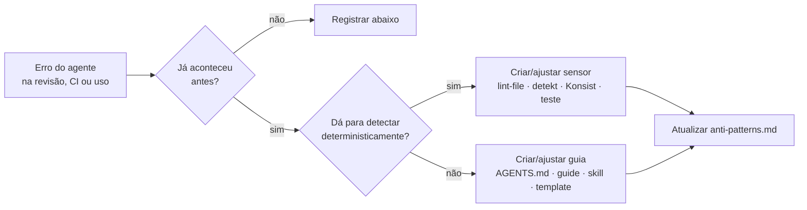

# Steering Loop: evolução do harness

> O papel do humano não é supervisionar mais; é melhorar o harness para que o
> erro não se repita (Constitution Art. VIII.4).

## Onde corrigir
| Sintoma | Melhor alavanca |
|---|---|
| Agente não sabia a regra | Guia da área (ou `AGENTS.md` se for global e curta) |
| Agente sabia, mas errou mesmo assim | Sensor computacional |
| Fluxo de vários passos feito na ordem errada | Skill |
| Padrão de código copiado errado | Template em `docs/harness/templates/` |
| Configuração errada de build | Convention plugin |
| Ação perigosa | Permissão ou hook `PreToolUse` |
| Contexto demais / regra ignorada | Encurtar `AGENTS.md`, mover detalhe para guia |

## Manutenção periódica (mensal)
- Remover regras obsoletas ou duplicadas; conferir links.
- Sensores que nunca disparam: ainda são relevantes?
- `AGENTS.md` acima de ~200 linhas: mover detalhes para guias.
- Atualizar skills oficiais: `android skills update`.
- Toda mudança em hooks/scripts do harness: rodar `scripts/harness/selftest.sh` (sensor dos sensores).

## Registro
| Data | Ocorrência | Causa | Ação no harness | AP | Status |
|---|---|---|---|---|---|
| 2026-10-16 | Criação do harness | — | Estrutura inicial (ADR-0002) | AP-01…AP-18 | ✅ |
| 2026-10-16 | `guard-bash` bloqueou heredoc que só escrevia `local.properties` no `.gitignore` (falso positivo) | Regex analisava o corpo do heredoc | Regra passa a checar só as linhas de comando; caso adicionado ao `selftest.sh` | — | ✅ |
| 2026-10-16 | `selftest.sh`: segredo `API_KEY = "..."` não detectado | Regex sensível a maiúsculas | `lint-file.sh` com `GREP_FLAGS=-i` na regra de segredos | — | ✅ |
| 2026-10-16 | `selftest.sh`: PAN `4111…` em produção não detectado | Filtro exigia > 2 dígitos distintos | Filtro reduzido para > 1 (exclui só sequências repetidas) | AP-07 | ✅ |
| 2026-10-16 | Risco de o harness pesar no dia a dia (Gradle no `Stop` + pre-commit duplicados) | Mesmo nível em dois momentos | Nível `light`, pre-commit sem Gradle, `HARNESS_STOP_LEVEL`, S-02 incremental, seção de desempenho no gradle.md | — | ✅ |
| 2026-10-16 | Ferramentas pagas no CI (`dependency-review-action` em repositório privado, licença do `gitleaks-action`) | Escolha inicial | Trocadas por OSV-Scanner e Gitleaks CLI | — | ✅ |
| 2026-10-16 | Sem orquestração, workers, estado entre sessões e skills portáveis | Harness cobria só guias/sensores | Workflows agênticos (ADR-0004): 7 skills, 3 subagentes, `.claude/rules/`, `progress.md`, `.agents/skills`, `ai-review.yml`; `selftest.sh` valida frontmatter | — | ✅ |
| 2026-10-17 | `guard-bash` bloqueou download com `curl -o arquivo` seguido de pipe para `shasum` (falso positivo: "shasum" começa com "sh"); também bloqueia comando cujo texto apenas *cita* o padrão | Regex de "script baixado" sem limite de palavra e aplicada ao comando inteiro | Aprovado pelo humano: a regra exige `sh`/`bash`/`zsh` como palavra inteira; `selftest.sh` ganhou dois casos (pipe para `bash -s` bloqueia; pipe para `shasum` permite). Texto que apenas cita o padrão continua bloqueando (risco aceito: usar Edit/Write para texto) | — | ✅ |
