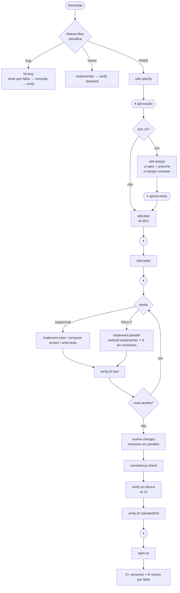

# Workflows agênticos

> Como agentes, skills, subagentes, sensores e humanos trabalham juntos neste projeto.
> O [harness](../README.md) define *o que* orienta e verifica o agente; este documento
> define *quem faz o quê e em que ordem*. Decisão: [ADR-0004](../../adr/0004-adotar-workflows-agenticos-orquestrados.md).

## Princípios
1. **Workflow antes de autonomia.** Caminhos previsíveis (pipelines com checkpoints) para
   o que é repetível; autonomia do agente só dentro de cada passo.
2. **Separação de papéis.** Quem implementa não aprova o próprio trabalho: workers
   escrevem, revisores somente leem, sensores decidem, o humano aprova checkpoints.
3. **Contexto é recurso escasso.** Divulgação progressiva (AGENTS.md → regra por caminho
   → guia → skill → template); saída volumosa vai para subagentes, só o resumo volta.
4. **Estado em arquivos, não na conversa.** `spec.md`, `tasks.md` e `progress.md` permitem
   retomar em outra sessão, outro agente ou outra ferramenta.
5. **Portabilidade.** Instruções em `AGENTS.md` e skills no padrão aberto *Agent Skills*
   (`SKILL.md`), lidos por Claude Code, Gemini no Android Studio, Codex, Copilot e Cursor.
6. **Custo proporcional.** Modelo e esforço escolhidos pela natureza da tarefa, não pelo hábito.

## Papéis
| Papel | Quem | Pode escrever? | Responsabilidade |
|---|---|---|---|
| Humano (Tech Lead/PO) | Você | Sim | Aprovar spec, plano, tarefas, merges e PR; decidir trade-offs |
| Orquestrador | Sessão principal + skill `feature-flow` | Sim | Classificar, rotear, delegar, integrar, manter `progress.md` |
| Worker | `android-implementer` (worktree) | Sim, só a tarefa | Implementar uma tarefa `[P]` com testes e sensor verde |
| Especialista | `build-doctor`, `device-tester`, `Explore` | Não | Absorver saída volumosa (build, logcat, busca) e devolver resumo |
| Revisor | `architecture-`, `security-`, `test-`, `compose-ui-reviewer`, `ui-design-reviewer`, `spec-consistency-analyzer` | Não | Avaliar contra guias/constitution e emitir veredito |
| Designer | Sessão principal + skill `sdd-design` | Sim, só `ui-spec.md`, prancha e `docs/design/` | Propor telas, estados, textos e a11y; o humano aprova |
| Sensor | `verify.sh`, hooks, CI | — | Verdade determinística sobre o código |

## Padrões de orquestração utilizados
Nomenclatura de *Building effective agents* (Anthropic), adotada pelo mercado.

| Padrão | Onde aparece |
|---|---|
| Prompt chaining (com portões) | Fases do SDD: specify ⏸ design ⏸ plan ⏸ tasks ⏸ implement ⏸ close |
| Routing | `feature-flow` classifica Isento/P/M/G/bug; `review-changes` escolhe revisores pelo diff |
| Parallelization | Revisores em paralelo; tarefas `[P]` em `implement-parallel` |
| Orchestrator-workers | `implement-parallel` → `android-implementer` em git worktrees |
| Evaluator-optimizer | `review-changes`: revisa → corrige → revisa só quem reprovou (máx. 2 rodadas); `sdd-design` ↔ `ui-design-reviewer` (máx. 2); hook `Stop` com `verify.sh` (máx. 3) |

## Pipelines

### Catálogo de skills por momento
| Momento | Skill | Disparo |
|---|---|---|
| Entrada | `feature-flow` | Automático ou `/feature-flow <demanda>` |
| Especificar / esclarecer | `sdd-specify` | Automático |
| Desenhar (telas, protótipo, direção visual) | `sdd-design` | Automático após aprovar spec com UI |
| Planejar | `sdd-plan`, `create-adr` | Automático após aprovação |
| Quebrar | `sdd-tasks` | Automático após aprovação |
| Estruturar | `android-feature-scaffold` | Quando o plano cria módulo |
| Implementar | `implement-task`, `compose-screen`, `write-tests` | Automático |
| Paralelizar | `implement-parallel` | **Só manual** (`/implement-parallel`) |
| Verificar | `verify`, `verify-on-device` | Automático |
| Revisar | `review-changes`, `consistency-check` | Automático no fechamento |
| Bug | `fix-bug` | Automático |
| Continuidade | `session-handoff` | Antes de `/clear`, ao retomar |
| Entender / documentar | `onboarding`, `summarize` | Automático; `/onboarding tour` para pessoa nova |
| Entregar | `open-pr` | **Só manual** (`/open-pr`) |
| Evoluir o harness | `harness-improve` | Quando um erro se repete |

Skills com efeito colateral relevante (merge de worktrees, commits, PR) têm
`disable-model-invocation: true`: só rodam quando o humano chama.

## Roteamento de modelo e esforço
| Trabalho | Modelo | Esforço | Por quê |
|---|---|---|---|
| Spec, plano, ADR, orquestração | o mais capaz disponível (sessão principal) | alto | Erro aqui se multiplica em todas as fases |
| Implementar tarefa bem especificada | `sonnet` (`android-implementer`) | alto | Tarefa delimitada, custo menor, paralelizável |
| Revisão | `sonnet` (revisores) | alto | Guias e checklists explícitos; esforço alto compensa o modelo menor |
| Diagnóstico de build, device | `sonnet` | médio | Leitura volumosa, raciocínio moderado |
| Busca ampla no código | `Explore` (embutido) | baixo | Só localizar; não revisar |
| Tarefas mecânicas (renomear, formatar, resumir log) | `haiku` | baixo | Sem decisão de design |

### Modelo de topo exige aprovação
- **Nenhum subagente usa `model: inherit` nem `opus`** no frontmatter: com `inherit`, uma
  sessão principal em Opus faria cada revisor rodar em Opus sem ninguém decidir isso.
- Antes de usar modelo de topo (Opus) ou esforço `max` num subagente, ou de sugerir
  trocar a sessão para ele, o agente **para e pede aprovação**, dizendo por quê (ex.:
  revisão de segurança de fluxo de pagamento, bug sem causa após duas tentativas) e o
  custo esperado (quantos agentes, que volume de leitura).
- Escalone só pelo problema: falha real do modelo menor (achado perdido, diagnóstico
  errado) é o gatilho, não "para garantir".

### Desperdício de tokens
- Delegue só quando o paralelismo ou o isolamento do contexto compensam o custo de
  recontextualizar o subagente; tarefa pequena faz-se na sessão principal.
- `review-changes` roteia revisores pelo diff: não rode os cinco quando só mudou um teste.
- Prompt de delegação com escopo de arquivos e IDs; nada de "leia o projeto inteiro".
- Saída volumosa (build, logcat) nunca volta inteira: só causa e correção.

Ajuste no frontmatter de `.claude/agents/*.md` (`model`, `effort`) conforme custo/qualidade
observados; registre a mudança no [steering loop](../steering-loop.md).

## Higiene de contexto
- **Uma feature por sessão.** Entre features: `session-handoff save` → `/clear`.
- **Compactar com intenção:** antes de `/compact`, salve o handoff; depois, `session-handoff resume`.
- **Saída longa nunca na sessão principal:** build/logcat → `build-doctor`/`device-tester`;
  busca ampla → `Explore`.
- **Regras por caminho** (`.claude/rules/`) só apontam para o guia da camada; o guia é a fonte única.
- **Subagentes não herdam a conversa:** todo prompt de delegação traz spec, IDs, escopo de
  arquivos e proibições (as skills `implement-parallel` e `review-changes` já fazem isso).

## Trabalho paralelo
- Requer repositório git. Cada worker roda em worktree temporário (`isolation: worktree`).
- Paralelize só tarefas `[P]` com arquivos disjuntos; máximo 4 por lote.
- A integração é sequencial e verificada (`verify.sh fast` após cada merge).
- Várias features ao mesmo tempo: uma sessão por feature, cada uma em seu worktree
  (`git worktree add ../Cielo-NNN feat/NNN-nome`).

## Mesma estrutura em outras ferramentas
| Ferramenta | Instruções | Skills | Observação |
|---|---|---|---|
| Claude Code | `CLAUDE.md` → importa `AGENTS.md`; `.claude/rules/` | `.claude/skills/` | Subagentes, hooks e permissões só aqui |
| Gemini no Android Studio | `AGENTS.md` | `.agents/skills/` | `.aiexclude` protege segredos |
| Gemini CLI | `AGENTS.md` via `.gemini/settings.json` | `.agents/skills/` | Lê só `name`/`description` do frontmatter |
| Codex | `AGENTS.md` | `.agents/skills/` | — |
| GitHub Copilot | `AGENTS.md` | `.agents/skills/` ou `.claude/skills/` | — |
| Cursor | `AGENTS.md` | — | — |

`.agents/skills` é um link simbólico para `.claude/skills`: **uma única cópia** de cada skill.
Campos de frontmatter específicos do Claude Code (`disable-model-invocation`, `argument-hint`)
são ignorados pelas outras ferramentas. Skills oficiais do Android (`android skills add`) caem
no mesmo diretório; não reutilize nomes delas nas skills do projeto.

## Agentes no CI
`.github/workflows/ai-review.yml` roda uma revisão agêntica no PR **somente** quando o rótulo
`ai-review` é aplicado (controle de custo), com permissões mínimas e sem segredos de
assinatura. Ela complementa, nunca substitui, os sensores do `ci.yml` e a revisão humana.

## Medição
Além das [métricas do harness](../README.md#métricas-de-saúde-do-harness):
| Métrica | Como medir | Meta |
|---|---|---|
| Tarefas `[P]` concluídas por workers sem retrabalho | Relatórios de `implement-parallel` | ↑ |
| Rodadas de `review-changes` até APROVADO | Saída da skill | ≤ 1 em média |
| Retomadas sem perda de contexto | `progress.md` suficiente para `resume` | 100% |
| Cenários de avaliação passando | [scenarios.md](scenarios.md) | 100% após mudar o harness |
