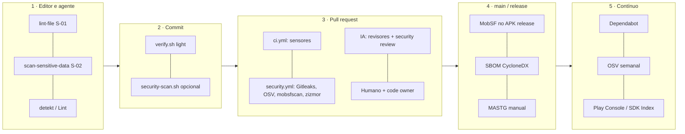

# Code Review & Security Scanning

> Programa de revisão de código e varredura de segurança, com IA, do projeto Android.
> Decisão: [ADR-0006](../adr/0006-code-review-e-security-scanning-com-ia.md) (estende o
> [ADR-0003](../adr/0003-stack-de-sensores-de-qualidade.md)). Regras de segurança do código:
> [guia de segurança](../harness/guides/security.md). Como revisar PR: [code-review.md](../code-review.md).

## Princípio: defesa em camadas, do mais barato ao mais caro
Nenhuma ferramenta sozinha cobre um app de pagamentos. Cada camada pega uma classe de
problema que a anterior não vê, e **o que é determinístico nunca depende de LLM**.

| Camada | O que pega | Ferramentas | Bloqueia? |
|---|---|---|---|
| 1. Editor/agente | Padrões proibidos, PAN/CPF/segredos, smells, regras de plataforma | S-01, S-02, detekt (S-04/S-05), Android Lint + `android-security-lints` (S-08) | Sim (hook) |
| 2. Commit | O mesmo, nos arquivos staged | `verify.sh light`; `security-scan.sh` se instalado | Sim |
| 3. PR: computacional | Segredos no histórico, CVEs, vulnerabilidades mobile no fonte, workflows inseguros | Gitleaks (S-14), OSV-Scanner (S-15), mobsfscan (S-22), zizmor (S-21), verificação de dependências (S-24) | Sim (job obrigatório) |
| 3. PR: inferencial | Falhas de lógica, autorização, fluxo de dados sensíveis, desvio da spec, código de IA suspeito | Revisores `.claude/agents` (S-16…S-20), Claude security review (S-26), Code Review gerenciado (S-27, opcional) | **Não**: a IA comenta, o humano decide |
| 3. PR: humano | Intenção, design, risco de negócio | 1 aprovação + code owner | Sim |
| 4. Release | O que só aparece no binário: manifest final mesclado, R8, bibliotecas nativas, permissões de SDKs | MobSF estático (S-23), SBOM (S-25), checklist MASTG | Sim, para `HIGH`+ |
| 5. Contínuo | CVE nova em dependência antiga, SDK com problema de política | Dependabot, OSV agendado, Play SDK Index | Abre PR/issue |

## Onde cada coisa vive
| Arquivo | Papel |
|---|---|
| [REVIEW.md](../../REVIEW.md) | Instruções **só de revisão** para qualquer revisor de IA de PR (severidade, o que ignorar, o que sempre checar) |
| [SECURITY.md](../../SECURITY.md) | Política de divulgação de vulnerabilidades (quem reporta, como, prazos) |
| [landscape.md](landscape.md) | Pesquisa de mercado: o que é usado, o que escolhemos e por quê |
| [masvs-matrix.md](masvs-matrix.md) | Cada controle MASVS → sensor automático, revisor de IA ou teste manual |
| [triage.md](triage.md) | Severidade unificada, SLAs, falso positivo, exceções e registro de risco aceito |
| [ai-review.md](ai-review.md) | Política de uso de IA em revisão: confiança, prompt injection, dados, custo, métricas |
| `.github/workflows/security.yml` | Scanners computacionais de segurança (PR, `main`, semanal) |
| `.github/workflows/ai-review.yml` | Revisão agêntica geral (rótulo `ai-review`) |
| `.github/workflows/ai-security-review.yml` | Revisão de segurança por IA (caminhos sensíveis ou rótulo `security-review`) |
| `.github/security/` | Instruções de varredura e de filtro de falso positivo para a IA |
| `scripts/harness/security-scan.sh` | Mesmos scanners do CI, rodando local (pula os não instalados) |
| `.claude/skills/security-scan/` | Skill: roda os scanners, interpreta, aciona o `security-reviewer` |

## Gates (o que impede o merge)
| Gate | Condição de falha | Dono da correção |
|---|---|---|
| `ci / verify` | Qualquer sensor do `verify.sh` | Autor |
| `security / secrets` | Qualquer achado do Gitleaks | Autor + rotação do segredo (ver [triage.md](triage.md#segredo-vazado)) |
| `security / dependencies` | Qualquer vulnerabilidade conhecida sem exceção com prazo em `osv-scanner.toml` | Autor ou plataforma |
| `security / sast-mobile` | Achado `ERROR` do mobsfscan | Autor |
| `security / workflows` | Achado do zizmor | Plataforma |
| `security / binary` (release) | Achado `high` do MobSF sem exceção | Segurança |
| Revisão humana | Comentário `issue (blocking)` aberto | Autor |

Achados de IA nunca são gate automático: viram comentário, e o revisor humano decide
se bloqueia ([ai-review.md](ai-review.md#regras-de-confiança)).

## Fluxo de uma mudança sensível
1. O agente implementa; hooks rodam S-01/S-02 a cada edição.
2. Antes de concluir: `scripts/harness/verify.sh standard` e, se tocou rede, storage,
   auth, manifest, cripto ou dados de cartão/PII, a skill `security-scan`.
3. PR aberto: `ci.yml` e `security.yml` rodam; `ai-security-review.yml` roda sozinho
   porque o diff tocou caminho sensível.
4. Revisor humano lê os achados da IA, classifica com Conventional Comments e aprova.
5. Achado que uma regra determinística pegaria vira sensor (`harness-improve`).
