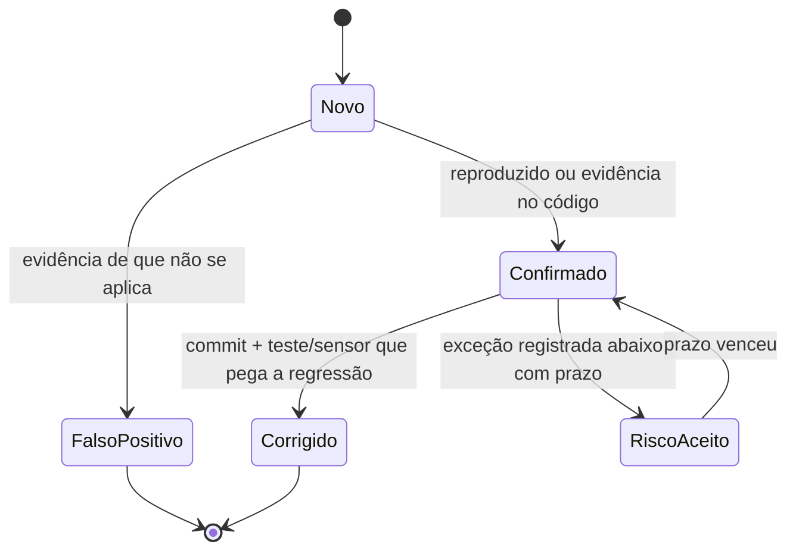

# Triagem de achados

> Como classificar, priorizar e fechar um achado de qualquer origem (scanner, revisor de IA,
> humano, pentest, relato externo via [SECURITY.md](../../SECURITY.md)).

## Severidade unificada
Cada ferramenta tem sua escala. Esta tabela traduz todas para a escala do projeto, que é a
mesma usada pelos revisores (`.claude/agents/*-reviewer.md`) e pelo [REVIEW.md](../../REVIEW.md).

| Projeto | Conventional Comments | Claude Code Review | CVSS / OSV | mobsfscan / MobSF | Gitleaks / zizmor |
|---|---|---|---|---|---|
| **Bloqueante** | `issue (blocking)` | 🔴 Important | ≥ 7.0 | `ERROR` / `high` | qualquer achado |
| **Importante** | `suggestion (blocking)` | 🔴 Important | 4.0–6.9 | `WARNING` / `warning` | — |
| **Sugestão** | `suggestion (non-blocking)`, `nitpick` | 🟡 Nit | < 4.0 | `INFO` / `info` | — |

Ajustes de contexto (sempre registrados no comentário ou na exceção):
- **Sobe um nível** se envolve PAN, CVV, trilha, PIN, token de sessão ou chave (PCI/LGPD).
- **Desce um nível** se o código vulnerável não é alcançável no app (ex.: CVE numa função
  da biblioteca que o app não usa), **com evidência** (`arquivo:linha` ou análise de uso).

## SLA de correção
| Severidade | Em PR | Já em `main` | Em produção |
|---|---|---|---|
| Bloqueante | Antes do merge | 2 dias úteis | Hotfix; incidente aberto |
| Importante | Antes do merge, ou exceção registrada | 15 dias | Próxima release |
| Sugestão | A critério do autor | Backlog | Backlog |

## Ciclo de vida

## Falso positivo
1. Prove: cite `arquivo:linha` e explique por que o padrão não é explorável.
2. **Scanner determinístico:** a supressão é pontual (uma linha ou um arquivo), nunca uma
   regra inteira, e cita o motivo no próprio código. Pela Constitution Art. VIII.3, toda
   supressão exige aprovação humana explícita no PR. Baselines continuam proibidos.
3. **IA:** responda no comentário com a evidência. Se a mesma classe de falso positivo
   aparecer 2+ vezes, adicione-a em `.github/security/false-positive-filtering.txt` ou na
   seção "Não reporte" do [REVIEW.md](../../REVIEW.md) e registre no
   [steering loop](../harness/steering-loop.md).

## Segredo vazado
Remover do código **não** resolve: o segredo está no histórico e possivelmente em forks e caches.
1. **Revogue/rotacione** imediatamente no provedor (antes de qualquer outra coisa).
2. Avise o code owner de segurança; avalie uso indevido nos logs do provedor.
3. Remova do código e mova para o mecanismo correto (secrets do CI, Keystore).
4. Reescrever o histórico só com decisão do time (afeta todos os clones).

## Dependência vulnerável
1. Existe versão corrigida? Atualize (Dependabot costuma já ter aberto o PR).
2. Não existe? Avalie alcançabilidade; mitigue (desabilitar recurso, trocar biblioteca) ou
   registre risco aceito com prazo curto.
3. Dependência transitiva: force a versão via `constraints` no convention plugin, nunca
   no módulo.

## Registro de riscos aceitos
Toda exceção tem dono, prazo e aprovação. Vencido o prazo, o achado volta a bloquear.
Exceções Bloqueantes exigem aprovação do code owner de segurança.

| ID | Achado (ferramenta/regra) | Local | Severidade | Justificativa | Mitigação | Dono | Aprovado por | Expira em |
|---|---|---|---|---|---|---|---|---|
| — | *(nenhum)* | | | | | | | |
