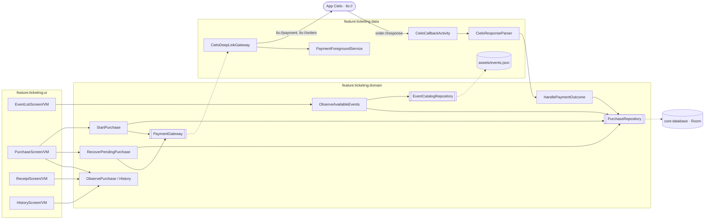
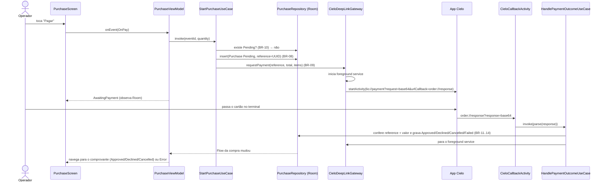

# Plano Técnico: Venda de ingressos com pagamento Cielo Smart

| Campo | Valor |
|---|---|
| **Spec** | [spec.md](spec.md) (versão 1.2.0) · [ui-spec.md](ui-spec.md) (0.4.2) · [research.md](research.md) |
| **Status** | Aprovado (2026-10-17) · ADR: [0010](../../adr/0010-integracao-cielo-smart-por-deep-link.md) |
| **Tamanho** | G |

> Este plano descreve **como** a spec será implementada. Fatos da integração Cielo vêm do
> [research.md](research.md), incluindo a verificação na fonte (§12). O que só o emulador responde está
> marcado **validar no emulador** e tem tarefa própria no `tasks.md`.

## 1. Constitution Check
| Artigo | Conforme? | Observação |
|---|---|---|
| I — Spec como fonte da verdade | ✅ | Todo componente abaixo cita a `BR-xx` que implementa; testes por `AC-xx` (seção 10) |
| II — Arquitetura | ✅ | Clean + UDF; domain JVM puro; integração Cielo isolada atrás de interface de domínio (exigência da própria Cielo: camada de abstração) |
| III — Stack | ✅ | Só bibliotecas da stack de referência (ADR-0007); entradas novas no catálogo listadas na §2, todas pré-aprovadas pela tabela do ADR. Nenhuma dependência fora da tabela |
| IV — Testes | ✅ | Cada AC com teste nomeado; domain e ViewModel em JVM; Room e UI com Robolectric; nada depende de rede, relógio real ou ordem |
| V — Segurança e Privacidade | ✅ com nota | App nunca recebe PAN/CVV (a Cielo captura); resposta bruta nunca logada nem persistida (§7). Credenciais Cielo fora do repositório (propriedade Gradle local), mas embutidas no APK: risco aceito e explicado (§7, §11) |
| VI — Qualidade | ✅ | Erros explícitos (§5); a11y anotada na UI Spec; observabilidade reduzida a `Logger` por ADR-0009 (S1) |
| VII — Simplicidade | ✅ | Uma feature (`ticketing`), sem backend, sem rede HTTP; módulos só os exigidos pela arquitetura |
| VIII — Harness de IA | ✅ | Sensores do D0 valem para todos os módulos novos; implementação em tarefas `[P]` por worker isolado |

Nenhum ❌. Duas decisões valem além da feature e viram ADR na aprovação deste plano: **ADR-0010** (integração Cielo
por Deep Link com callback, recuperação por `reference` e foreground service) e a nota de credenciais (§7) dentro dele.

## 2. Visão da Solução
O catálogo de eventos vem de um JSON em `assets/` (decisão do roadmap). As compras ficam no Room, que é a **fonte única
da verdade** do fluxo: a compra é gravada como `Pending` **antes** de abrir o pagamento, e o resultado da Cielo atualiza
esse registro. As telas observam o banco. Assim, rotação, morte do processo e retorno tardio da Cielo convergem
para o mesmo lugar, sem estado perdido em memória.

A Cielo é acessada só por Deep Link (`lio://payment`, `lio://orders`), atrás da interface de domínio `PaymentGateway`.
O resultado volta por intent em `order://response`, recebido por uma Activity de callback que entrega a resposta a
um use case. Como só pode existir **uma** compra `Pending` por vez (BR-10), a correlação entre resposta e compra é
inequívoca, e ainda é conferida por `reference` e valor.

**Módulos e arquivos afetados** (pacote base `com.rafaeloliveira.bilheteria`):

| Camada | Módulo | Arquivos principais | Novo / Alterado |
|---|---|---|---|
| api | `feature:ticketing:api` | `navigation/TicketingRoutes.kt` (`EventListRoute`, `PurchaseRoute(eventId)`, `ReceiptRoute(purchaseId)`, `PurchaseHistoryRoute`) | Novo |
| domain | `feature:ticketing:domain` | `model/` (Event, AvailableEvent, EventMonth, Purchase, PurchaseStatus, PurchaseReference, Money, TransactionData, PaymentOutcome), `repository/` (EventCatalogRepository, PurchaseRepository), `payment/PaymentGateway.kt`, `usecase/` (§4), `error/TicketingError.kt` | Novo |
| data | `feature:ticketing:data` | `catalog/` (asset data source + DTO + mapper), `purchase/` (DefaultPurchaseRepository), `cielo/` (CieloDeepLinkGateway, CieloRequestEncoder, CieloResponseParser, CieloCallbackActivity, PaymentForegroundService, CieloCredentials), `di/`, `src/main/assets/events.json`, `AndroidManifest.xml` | Novo |
| data (core) | `core:database` | `BilheteriaDatabase`, `PurchaseEntity`, `PurchaseDao`, `schemas/` | Novo (ADR-0007: Room em `core:database`) |
| ui | `feature:ticketing:ui` | `events/`, `purchase/`, `receipt/`, `history/` (UiState, UiEvent, ViewModel, Route, Screen, previews), `navigation/TicketingNavGraph.kt`, `res/values/strings.xml` | Novo |
| ui (core) | `core:designsystem` | Tema com a paleta A (tokens), `DsQuantityStepper`, `DsProgressIndicator`, `DsStatusBadge`, `DsListItem`, `DsSummaryCard`, `DsKeyValueList`, `DsEmptyState`, `DsErrorState`, `DsLoadingSkeleton`, `DsFilterChip`, `DsTopAppBar`, `DsButton`, `DsIconButton` | Alterado |
| app | `app` | `NavHost` com o grafo da feature; `<queries>`; ligação de módulos | Alterado |
| build | `build-logic`, `gradle/libs.versions.toml` | `app.android.room` (KSP Room + schema), plugin de serialization nas features; catálogo | Alterado |

**Entradas novas no catálogo** (todas na stack de referência do ADR-0007, sem aprovação extra):
Navigation Compose, `kotlinx-serialization-json` + plugin, Room (runtime, ktx, compiler), `kotlinx-collections-immutable`,
`desugar_jdk_libs` (`java.time` com `minSdk 24`), `hilt-navigation-compose`, Robolectric, Compose UI Test (BOM),
`junit-vintage-engine` (só para Robolectric/Compose em `:ui`, como manda o testing.md). Versões consultadas na fonte
oficial no momento da tarefa.

## 3. Arquitetura
### Componentes


### Fluxo principal (pagamento)


### Recuperação (BR-15, BR-25)
```mermaid
sequenceDiagram
    participant VM as PurchaseViewModel / app start
    participant RP as RecoverPendingPurchaseUseCase
    participant R as PurchaseRepository
    participant G as Gateway
    participant C as App Cielo
    participant H as HandlePaymentOutcomeUseCase
    VM->>RP: invoke() (abertura do app com Pending, ou resposta ilegível)
    RP->>R: marca Pending como Recovering
    RP->>G: requestLookup(page = 0)
    G->>C: lio://orders?request=base64(pageSize=5,page=0)&urlCallback=order://response
    C-->>H: results[] + totalPages (via callback, sem abrir tela)
    H->>G: pede as ÚLTIMAS páginas (a listagem vem do mais antigo para o mais recente), de trás para frente
    H->>R: achou o reference com pagamento statusCode 1/0 e amount = total → Approved
    H->>R: achou o reference sem pagamento → Failed (nada cobrado; retry seguro)
    H->>R: não achou nas 4 últimas páginas (20 pedidos mais recentes) → Failed + "não encontrado"
```
Validado no emulador (research §13): a listagem responde sem abrir tela, vem em ordem crescente de criação, e o `status` do
pedido não é confiável (`ENTERED` mesmo pago); por isso a decisão usa o pagamento (`statusCode` e `amount`). A numeração da
página na resposta parece começar em 1: o gateway lê `totalPages` e calcula as páginas pedidas sem supor a base, conferido na T25.

## 4. Contratos
### Domain
```kotlin
// model
@JvmInline value class Money(val cents: Long)                       // BR-06: nunca Double
@JvmInline value class PurchaseReference(val value: String)         // UUID v4; enviado como `reference` (BR-08)

data class Event(val id: String, val name: String, val startsAt: Instant, val venue: String,
                 val unitPrice: Money, val totalTickets: Int)
data class AvailableEvent(val event: Event, val available: Int)     // BR-17
data class EventMonth(val year: Int, val month: Int)                // BR-22..24

enum class PurchaseStatus { Pending, Recovering, Approved, Declined, Cancelled, Failed }
enum class FailureReason { TerminalAppUnavailable, Generic, Authentication, NotFound }
data class TransactionData(val orderId: String, val authCode: String, val nsu: String, val brand: String?)
data class Purchase(
    val id: String, val reference: PurchaseReference, val eventId: String,
    val eventName: String, val eventStartsAt: Instant, val venue: String,  // snapshot para o comprovante
    val unitPrice: Money, val quantity: Int, val total: Money,
    val status: PurchaseStatus, val failureReason: FailureReason?, val transaction: TransactionData?,
    val createdAt: Instant, val updatedAt: Instant,
)

/**
 * Resultado de uma chamada à Cielo, já interpretado (o data faz o parse).
 * Mapeamento dos códigos documentado aqui e no parser (spec Q8, opção A):
 * código 1 = Cancelled; código 3 = Declined ("erro no pagamento" é o único código sobre o pagamento em si);
 * códigos 2, 4 e desconhecidos = Failed, porque indicam problema do lado do app, não do cartão.
 */
sealed interface PaymentOutcome {
    val reference: PurchaseReference?
    data class Approved(override val reference: PurchaseReference?, val amount: Money, val transaction: TransactionData) : PaymentOutcome // amount = payments[].amount (paidAmount vem 0)
    data class Declined(override val reference: PurchaseReference?) : PaymentOutcome
    data class Cancelled(override val reference: PurchaseReference?) : PaymentOutcome
    data class Failed(override val reference: PurchaseReference?, val reason: FailureReason) : PaymentOutcome
    data object Unreadable : PaymentOutcome { override val reference: PurchaseReference? = null }
    data class LookupPage(val page: Int, val totalPages: Int, val matches: List<PaymentOutcome>) : PaymentOutcome {
        override val reference: PurchaseReference? = null
    }
}

// repository
interface EventCatalogRepository { fun observeEvents(): Flow<DataResult<List<Event>>> }
interface PurchaseRepository {
    fun observePurchase(id: String): Flow<DataResult<Purchase>>
    fun observeHistory(): Flow<DataResult<List<Purchase>>>              // BR-18: só Approved/Declined/Cancelled
    fun observeOpenPurchase(): Flow<DataResult<Purchase?>>             // Pending ou Recovering (no máximo 1)
    fun observeApprovedQuantities(): Flow<DataResult<Map<String, Int>>> // BR-17
    suspend fun createPending(purchase: Purchase): DataResult<Unit>    // falha se já houver aberta (BR-10)
    suspend fun update(purchase: Purchase): DataResult<Unit>
    suspend fun findOpen(): DataResult<Purchase?>
}
interface PaymentGateway {
    suspend fun requestPayment(purchase: Purchase): DataResult<Unit>   // Failure(TicketingError.TerminalAppUnavailable)
    suspend fun requestLookup(page: Int): DataResult<Unit>
    fun finish()                                                       // para o foreground service
}

// error
sealed interface TicketingError : AppError {
    data object CatalogUnavailable : TicketingError
    data object PurchaseAlreadyOpen : TicketingError       // BR-10
    data object TerminalAppUnavailable : TicketingError    // AC-12
    data object StorageFailure : TicketingError
}

// use cases (um operator invoke cada)
class ObserveAvailableEventsUseCase   // BR-01, BR-02, BR-17, BR-22: data futura (Clock) e disponíveis > 0, ordenado por data
class GroupEventsByMonthUseCase       // BR-22..24: agrupa, lista meses com evento e normaliza mês selecionado ("Todos" se esgotou)
class QuantityLimits                  // BR-05..07: função pura max = min(10, disponíveis)
class StartPurchaseUseCase            // BR-08..10
class HandlePaymentOutcomeUseCase     // BR-11..14, BR-25, parte do BR-15 (lookup)
class RecoverPendingPurchaseUseCase   // BR-15, BR-25
class ObservePurchaseUseCase          // BR-16, BR-19
class ObserveOpenPurchaseUseCase      // BR-10, BR-15: compra Pending/Recovering ou null (adicionado no lote D, 2026-10-18)
class ObservePurchaseHistoryUseCase   // BR-18, BR-20, BR-21
```

### Data
- **Catálogo:** `assets/events.json`, lista de `EventDto(id, name, startsAt: ISO-8601 com offset, venue, priceCents, totalTickets)`.
  Parse com `kotlinx.serialization` dentro do `suspendRunCatching` (falha de parse = `CatalogUnavailable`, AC-03).
  Datas fictícias de nov/2026 a mar/2027, 3+ meses (BR-22..24).
- **Cielo, saída** (`CieloRequestEncoder`): JSON da §12 do research (`accessToken`, `clientID`, `reference`, `items[{name, quantity,
  sku=eventId, unitOfMeasure="unidade", unitPrice=centavos}]`, `value`=total em centavos como string; sem `paymentCode`, Q7) →
  Base64 → `lio://payment?request=…&urlCallback=order://response`. `Intent(ACTION_VIEW)` com `FLAG_ACTIVITY_NEW_TASK`;
  `resolveActivity == null` ou `ActivityNotFoundException` → `TerminalAppUnavailable` (AC-12).
- **Cielo, entrada** (`CieloCallbackActivity`, exported, intent-filter `VIEW`/`DEFAULT` (sem `BROWSABLE`: link de navegador/QR não aciona o callback; confirmar na T25), scheme `order`, host `response`,
  `launchMode="singleInstance"` e `taskAffinity=""` (mobsfscan/StrandHogg 2.0), sem UI): lê `response` → Base64 → `CieloResponseParser` → `HandlePaymentOutcomeUseCase` → traz a
  `MainActivity` de volta → `finish()`. Parser tolerante (`ignoreUnknownKeys`), lê **só** `id`, `reference`, `status`, `payments[].amount`,
  `payments[].{authCode, cieloCode, brand, paymentFields.statusCode}`, e `code` no erro. Classificação pelo JSON, não pelo `responsecode`.
- **Foreground service** (`PaymentForegroundService`, `exported=false`, `foregroundServiceType="dataSync"`): iniciado antes do
  deep link, parado no `finish()` do gateway. Notificação sem valor nem dados do comprador.
- **Manifest (data):** `<queries>` com `com.ads.lio.uriappclient`, `br.com.cielosmart.orderservice` e intent `VIEW` scheme `lio`; `<meta-data cs_integration_type=uri>`;
  permissões `FOREGROUND_SERVICE` e `FOREGROUND_SERVICE_DATA_SYNC`. Sem `INTERNET`.
- **Credenciais** (`CieloCredentials`): `clientId` e `accessToken` lidos de propriedades Gradle `cielo.clientId`/`cielo.accessToken`
  (`~/.gradle/gradle.properties` ou `-P`, nunca versionadas) para `BuildConfig` do `feature:ticketing:data`, com valores fictícios
  como padrão para o emulador (Q12).
- **Persistência (`core:database`, Room v1):** tabela `purchase`

| Coluna | Tipo | Observação |
|---|---|---|
| `id` (PK) | TEXT | = `reference` (UUID) |
| `event_id`, `event_name`, `event_starts_at`, `venue` | TEXT/INTEGER | snapshot do evento |
| `unit_price_cents`, `quantity`, `total_cents` | INTEGER | |
| `status`, `failure_reason` | TEXT | enum por nome |
| `cielo_order_id`, `auth_code`, `nsu`, `brand` | TEXT? | só após aprovação |
| `created_at`, `updated_at` | INTEGER | epoch ms |

Índice parcial lógico: no máximo uma linha com `status IN (Pending, Recovering)`, garantido na transação do `createPending`.
Sem migração (v1); `exportSchema = true`. Nenhum dado de cartão; backup desligado no app (`allowBackup=false`, já no D0).

### Presentation
```kotlin
sealed interface EventListUiState {
    data object Loading : EventListUiState
    data class Content(val months: ImmutableList<MonthOption>, val selectedMonth: EventMonth?,     // null = "Todos"
                       val groups: ImmutableList<MonthGroup>) : EventListUiState
    data object Empty : EventListUiState
    data object Error : EventListUiState
}
sealed interface EventListUiEvent {
    data object OnRetry : EventListUiEvent
    data class OnEventSelected(val id: String) : EventListUiEvent
    data class OnMonthSelected(val month: EventMonth?) : EventListUiEvent
    data object OnOpenHistory : EventListUiEvent
}

sealed interface PurchaseUiState {
    data object Loading : PurchaseUiState                           // lendo compra aberta e evento; sem "Pagar" (BR-10)
    data class Editing(val event: EventSummary, val quantity: Int, val canDecrement: Boolean, val canIncrement: Boolean,
                       val limitHint: LimitHint?, val total: Money) : PurchaseUiState
    data class AwaitingPayment(val event: EventSummary, val quantity: Int, val total: Money) : PurchaseUiState
    data class Recovering(val event: EventSummary, val quantity: Int, val total: Money) : PurchaseUiState
    data class Error(val event: EventSummary, val quantity: Int, val total: Money, val reason: PurchaseErrorReason) : PurchaseUiState
    data object Unavailable : PurchaseUiState                       // BR-27: evento não carrega e não há compra aberta
    data class Completed(val purchaseId: String) : PurchaseUiState  // sinal de navegação para a SCR-03
}
enum class PurchaseErrorReason { NoCieloApp, Generic, Authentication, RecoveryNotFound, RecoveryFailed }  // RecoveryFailed: BR-26
data class EventSummary(val id: String, val name: String, val startsAt: Instant, val venue: String, val unitPrice: Money,
                        val available: Int?)            // null quando o resumo vem do snapshot da compra
sealed interface LimitHint { data class MaxPerPurchase(val max: Int) ; data class OnlyAvailable(val available: Int) }
sealed interface PurchaseUiEvent {
    data object OnIncrement : PurchaseUiEvent ; data object OnDecrement : PurchaseUiEvent
    data object OnPay : PurchaseUiEvent ; data object OnRetry : PurchaseUiEvent
}
// OnPaymentResult(response) da spec é a entrada do CieloCallbackActivity → HandlePaymentOutcomeUseCase; a tela reage pelo Room.

sealed interface ReceiptUiState {
    data object Loading : ReceiptUiState                            // carregamento interno, sem prancha (dura um frame)
    data class Approved(val receipt: ReceiptData) : ReceiptUiState
    data class Declined(val receipt: ReceiptData) : ReceiptUiState
    data class Cancelled(val receipt: ReceiptData) : ReceiptUiState
    data object Error : ReceiptUiState                              // BR-28
}
sealed interface ReceiptUiEvent { data object OnNewSale : ReceiptUiEvent ; data object OnRetry : ReceiptUiEvent }
// ReceiptData: valores crus (Money, Instant) formatados pela tela; ReceiptTransaction(brand?, authCode, nsu) só em Approved.
// HistoryItem(id, eventName, createdAt, quantity, total, status); MonthOption(month), MonthGroup(month, events).

sealed interface PurchaseHistoryUiState {
    data object Loading : PurchaseHistoryUiState
    data class Content(val items: ImmutableList<HistoryItem>) : PurchaseHistoryUiState
    data object Empty : PurchaseHistoryUiState
    data object Error : PurchaseHistoryUiState
}
sealed interface PurchaseHistoryUiEvent {
    data object OnRetry : PurchaseHistoryUiEvent
    data class OnPurchaseSelected(val id: String) : PurchaseHistoryUiEvent
}
```
Navegação é estado quando o destino vem de um resultado assíncrono: `PurchaseUiState.Completed(purchaseId)` leva a `Route` a
navegar num `LaunchedEffect` com `popUpTo<PurchaseRoute> { inclusive = true }`. O estado deriva do Room, então o consumo é
a saída da compra da pilha, sem evento interno (decisão 2026-10-18; requisito da T24 e Journey da T25). Navegação por clique
(`OnEventSelected`, `OnOpenHistory`, `OnPurchaseSelected`, `OnNewSale`, "Voltar para eventos") não muda o estado: a `Route`
chama o callback. Argumentos de rota são só IDs. O `SavedStateHandle` da compra guarda `eventId` (rota), a quantidade e o
`purchaseId` da tentativa atual. Todas as declarações do `ui` são `internal`; os `sealed interface *UiState` têm `@Immutable`.

`ReceiptUiState.Loading` e `PurchaseUiState.Loading` não estão na seção 6 da spec: são o carregamento local. **Decisões
(2026-10-17 e 2026-10-18):** aceitos como detalhe técnico, sem AC. `ReceiptUiState.Loading` também cobre a compra ainda em
andamento; falha, registro inexistente ou `Failed` vão para `ReceiptUiState.Error` (BR-28).

## 5. Tratamento de Erros
| Erro técnico | Erro de domínio | Estado de UI | Ação do usuário |
|---|---|---|---|
| Asset ausente, `SerializationException`, data inválida no JSON | `TicketingError.CatalogUnavailable` | `EventListUiState.Error` | Tentar de novo |
| `SQLiteException` ao ler compras | `TicketingError.StorageFailure` | `PurchaseHistoryUiState.Error` / erro na lista (disponíveis) | Tentar de novo |
| `SQLiteException` ao gravar a compra antes do pagamento | `StorageFailure` | `PurchaseUiState.Error(Generic)`; o pagamento **não** é aberto | Tentar pagar de novo |
| Já existe compra aberta | `PurchaseAlreadyOpen` | Mantém `AwaitingPayment`/`Recovering` (BR-10) | — |
| `ActivityNotFoundException` / sem resolvedor para `lio://` | `TerminalAppUnavailable` | `Error(NoCieloApp)`; compra `Failed` | Tentar de novo |
| Retorno `{code:1}` | `PaymentOutcome.Cancelled` | `ReceiptUiState.Cancelled` | Nova venda |
| Retorno `{code:3}` | `PaymentOutcome.Declined` | `ReceiptUiState.Declined` | Nova venda |
| Retorno `{code:2}`, `{code:4}`, código desconhecido | `PaymentOutcome.Failed(Generic/Authentication)` | `Error(Generic/Authentication)` | Tentar pagar de novo |
| Base64/JSON ilegível, campos obrigatórios ausentes | `PaymentOutcome.Unreadable` | `Recovering` → consulta (BR-25) | — |
| Aprovado com `reference` ou `payments[].amount` diferentes da compra aberta | descartado + log de segurança | Sem mudança (continua aguardando/recuperando) | — |
| Callback sem compra aberta | descartado + log | — | — |
| Consulta sem o `reference` em 4 páginas | `PaymentOutcome` → `Failed(NotFound)` | `Error(RecoveryNotFound)` | Tentar pagar de novo |
| Falha ao ler a compra aberta, ou `recoverPending()` com `Failure` | `StorageFailure` / falha do gateway | `Error(RecoveryFailed)` (BR-26) | Consultar de novo (repete leitura e consulta; nunca paga) |
| Catálogo ilegível, evento inexistente ou esgotado, sem compra aberta | `CatalogUnavailable` / ausência | `PurchaseUiState.Unavailable` (BR-27) | Voltar para eventos |
| `SQLiteException` ou registro inexistente ao abrir o comprovante; compra `Failed` | `StorageFailure` | `ReceiptUiState.Error` (BR-28) | Tentar de novo |

Nenhum retry automático de pagamento (escrita não idempotente, error-handling.md): só por ação do operador e só depois da
consulta quando o resultado é desconhecido.

## 6. Alternativas Consideradas
| Alternativa | Prós | Contras | Motivo da decisão |
|---|---|---|---|
| SDK Integração Local (`order-manager`) | API tipada com listeners | Descontinuado; `.m2` local (`mavenLocal`, proibido no projeto); a política da Cielo exige a camada de abstração `lio://` | **Deep Link** |
| Resultado mantido só em memória no ViewModel | Simples | Perde o resultado em morte do processo; abre caminho para cobrança dupla | **Room como SSOT** com `Pending` antes do deep link |
| DataStore para compras | Leve | Consultas (histórico, soma por evento, compra aberta) e transação ficam manuais | **Room** (stack, `core:database`) |
| Recuperação por `lio://order` (consulta avulsa) | 1 chamada | Exige `orderId` ou `authCode`+`cieloCode`, que não existem antes do retorno | **`lio://orders` + filtro por `reference`** |
| Sem foreground service | Menos código e permissões | A FAQ da Cielo o exige para o retorno não se perder | **Foreground service `dataSync`** durante o pagamento |
| Duas features (`events`, `checkout`) | Separação maior | Contratos `:api` extras para um único fluxo; mais módulos | **Uma feature `ticketing`** |
| Room dentro de `feature:ticketing:data` | Menos um módulo | Contraria a stack do ADR-0007 (Room em `core:database`) | **`core:database`** |

## 7. Segurança (OWASP MASVS + STRIDE)
**Controles MASVS aplicáveis:**
- [x] **MASVS-STORAGE:** só dados de compra e transação (bandeira, autorização, NSU); nada de cartão; resposta bruta da Cielo nunca persistida; `allowBackup=false`.
- [ ] MASVS-CRYPTO: não se aplica (nenhum dado exige cifra local).
- [x] **MASVS-AUTH:** credenciais `clientID`/`accessToken` fora do repositório; ver nota abaixo.
- [x] **MASVS-NETWORK:** o app não faz rede (sem permissão `INTERNET`); a comunicação é a da Cielo.
- [x] **MASVS-PLATFORM:** Activity de callback exportada só com o intent-filter `order://response`, sem UI, valida tudo como entrada não confiável; serviço `exported=false`; `<queries>` mínimo; intent para a Cielo com pacote resolvido e conferido contra allowlist.
- [x] **MASVS-CODE:** parser tolerante e limitado (tamanho máximo da resposta), R8 no release, dependências da stack.
- [ ] MASVS-RESILIENCE: não exigido pela spec.
- [x] **MASVS-PRIVACY:** sem PII do comprador; logs sem PAN, `bin`, `mask`, `document`, token ou resposta bruta.

**Nota sobre credenciais:** a integração exige mandar `accessToken` no deep link, então ele precisa estar no app. Fica fora do
repositório (Art. V.4) e não é logado, mas é extraível do APK, como em qualquer app de terminal que use o deep link. Para o case,
com valores fictícios no emulador, o risco é aceito e documentado no ADR-0010; em produção, o caminho seria provisionar o
token por MDM/configuração gerenciada da Cielo Store.

**Threat model (STRIDE):**

| Ameaça | Cenário | Mitigação | Prova |
|---|---|---|---|
| Spoofing | App malicioso no aparelho envia `order://response` com "aprovado" falso | Só aplica resultado se houver compra aberta **e** `reference` e `payments[].amount` baterem com ela; caso contrário descarta e loga | Testes do `HandlePaymentOutcomeUseCase` (respostas forjadas) |
| Spoofing (**risco aceito**, 2026-10-18) | App malicioso envia `order://response` com **erro** (`{code:1..4}`), que pela API da Cielo não traz `reference`, durante um pagamento em andamento: a compra é encerrada como Cancelada/Negada/Falhou enquanto a Cielo ainda pode cobrar | Nenhuma no código. Exige app malicioso instalado no terminal (aparelho gerenciado, loja restrita). A consulta pela listagem não distingue "em andamento" de "cancelado", então não mitiga. Alternativa avaliada e não adotada: aceitar aprovação tardia por `reference` + valor em compra já encerrada | Decisão humana no `review-changes` do lote C; reavaliar se a verificação no emulador (T25) mostrar outro cenário |
| Tampering | Resposta adulterada/corrompida | Parser estrito nos campos usados; ilegível → `Recovering` + consulta (BR-25), nunca `Approved` | AC-14, testes do parser |
| Repudiation | Operador contesta uma venda | Compra registrada com `reference`, horário e dados da transação; histórico | AC-18 |
| Information disclosure | Outro app intercepta o `lio://payment` (contém o token); resposta com `bin`/`mask` vazando em log | Intent explícita para o pacote resolvido em allowlist (`com.ads.lio.uriappclient` no terminal, `br.com.cielosmart.orderservice` no emulador, research §13); parser descarta campos sensíveis; detekt `SensitiveDataInLog` | Teste do gateway; sensor S-05 |
| Denial of service | Respostas gigantes ou em loop no callback | Limite de tamanho da resposta; callback sem compra aberta é ignorado | Teste do parser |
| Elevation of privilege | Callback abrir telas internas com dados forjados | Callback não navega por parâmetro; só grava resultado validado e traz a `MainActivity` | Revisão (`security-reviewer`) |

## 8. Observabilidade
- **Logs** (`Logger`, só debug por ADR-0009): `purchase_started(reference)`, `payment_outcome(type, reference)`,
  `lookup_page(page, found)`, `callback_discarded(reason)`. Nunca valores de cartão, token, resposta bruta, nome de comprador.
- **Analytics:** nenhum (ADR-0009, S1).
- **Crash/erros:** sem crash reporter (S1); erros inesperados vão para `Logger.error` com tipo e `reference`.

## 9. Rollout
- **Feature flag:** nenhuma (app novo).
- **Migrações:** nenhuma (Room v1, schema exportado).
- **Compatibilidade:** `minSdk 24` cobre os terminais (Android 7.1+) e o emulador Cielo (7 e 10). `targetSdk 36` exige `<queries>`
  (Android 11+) e o tipo `dataSync` declarado (Android 14+); os terminais vão até o Android 12, então `POST_NOTIFICATIONS` não é
  pedido (a notificação do serviço é técnica).
- **Rollback:** reverter o PR; não há dados remotos.

## 10. Estratégia de Testes
| Nível | Escopo | Ferramentas | ACs cobertos |
|---|---|---|---|
| Unitário (domain) | Disponibilidade, filtro de data, agrupamento por mês, limites de quantidade, `StartPurchase` (inclusive BR-10), `HandlePaymentOutcome` (mapeamento de códigos, falsificação, valor divergente), `RecoverPendingPurchase` (achou/não achou/paginação) | JUnit 5, MockK, fakes de repositório e gateway, `Clock` fixo | AC-01, 02, 04–15, 17, 22–24 |
| Unitário (data) | `CieloRequestEncoder` (JSON e URI), `CieloResponseParser` com JSONs da doc da Cielo (sucesso, erro, listagem, ilegível, campos sensíveis ignorados), mapper do catálogo | JUnit 5, fixtures em `src/test/resources` | AC-07, 09–15 |
| Unitário (presentation) | 4 ViewModels: estados, eventos, `SavedStateHandle`, navegação como estado | JUnit 5, Turbine, `MainDispatcherExtension` | AC-01–24 (lado de UI) |
| Integração (data) | `PurchaseDao`/repositório: compra aberta única, histórico ordenado e filtrado, soma de aprovadas | Room in-memory + Robolectric | AC-08, 17, 18, 20 |
| UI (componente) | Telas stateless por estado (Loading/Content/Empty/Error, Editing/limite, comprovante) e a11y básica | Compose UI Test + Robolectric | AC-02, 03, 06, 16, 19, 20, 21 |
| Fluxo crítico (dispositivo) | Journey no AVD Android 10 com `lio-emulator`: aprovado, cancelado, erro, app fechado | `verify-on-device` (Android CLI) | AC-07, 09, 10, 13, 15 |

Nome de todo teste cita o `AC-xx` (S-09). Cobertura pelos limites do testing.md (domain 90%, ui 85%, data 75%).

## 11. Riscos
| Risco | Probabilidade | Impacto | Mitigação |
|---|---|---|---|
| ~~Emulador recusar credenciais fictícias~~ | — | — | **Resolvido na T01:** aceitas (research §13) |
| ~~Pacote do emulador diferente~~ | — | — | **Resolvido na T01:** `br.com.cielosmart.orderservice`, na allowlist |
| Ordenação e base de página do `lio://orders` | Baixa | Médio | **T01:** sem tela, ordem crescente → varrer as últimas páginas; base da página conferida na T25 |
| "Negada" não demonstrável no emulador | Certa (T01: "Erro" = código 2) | Baixo | Regra coberta por teste unitário; limitação no README |
| ~~Unidade de `unitPrice`~~ | — | — | **Resolvido na T01:** centavos |
| `ReceiptUiState.Loading` / `PurchaseUiState.Loading` fora da spec | — | Baixo | Aceitos como detalhe técnico (2026-10-17, 2026-10-18) |
| Datas fixas no JSON envelhecerem (evento "passado" some da lista) | Média | Médio | Datas de nov/2026 a mar/2027; README explica como editar o JSON |
| Token extraível do APK | Alta (é inerente) | Baixo no case | Explicado no ADR-0010; valores fictícios; melhoria futura F1 no roadmap (configuração gerenciada) |
