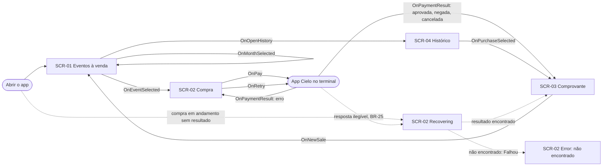

# UI Spec: Venda de ingressos com pagamento Cielo Smart

| Campo | Valor |
|---|---|
| **Spec** | [spec.md](spec.md) (versão: 1.3.0) |
| **Status** | Aprovada |
| **Versão** | 0.4.4 |
| **Fidelidade** | Prancha hi-fi + protótipo (G) |
| **Prancha** | [design/mockups.html](design/mockups.html) · revisão local: http://127.0.0.1:8766/specs/001-venda-de-ingressos/design/mockups.html (`python3 -m http.server 8766` em `docs/`) |
| **Design system** | [DESIGN.md](../../design/DESIGN.md) v0.2.0 (direção A "Ciano Smart") · [components.md](../../design/components.md) |

> A UI Spec descreve **como** cada estado da spec aparece e se comporta. Não cria regra de negócio.
> Guia: [ui-design.md](../../harness/guides/ui-design.md).

## 1. Contexto de uso
- **Persona e tarefa principal:** operador da bilheteria vendendo ingressos ao público, um comprador por vez.
- **Ambiente:** balcão ou porta do evento, luz forte, fila, uma mão, interrupções; o app da Cielo assume a tela durante o pagamento.
- **Dispositivos:** terminal Cielo Smart (telas de 480×854 a 1440×720, [research.md](research.md) §9) e celular Android 7–10
  com o emulador Cielo. Classe de janela: **compact** apenas (layout adaptativo fora do escopo, ADR-0009 S9).
- **Métrica de UX:** da lista ao pagamento em 2 toques (evento → Pagar) quando a quantidade é 1.

## 2. Inventário de telas
| ID | Tela | Propósito | Histórias | Rota (`:api`) |
|---|---|---|---|---|
| SCR-01 | Eventos à venda | Listar eventos disponíveis por mês e dar acesso ao histórico | US-01, US-09 | `EventListRoute` |
| SCR-02 | Compra | Quantidade, total, pagamento, espera, recuperação e erros | US-02, US-03, US-06, US-07 | `PurchaseRoute(eventId)` |
| SCR-03 | Comprovante | Resultado da compra (fim da venda ou pelo histórico) | US-04, US-05, US-08 | `ReceiptRoute(purchaseId)` |
| SCR-04 | Histórico de compras | Compras registradas, da mais recente à mais antiga | US-08 | `PurchaseHistoryRoute` |

Os nomes de rota são provisórios; o `plan.md` define os módulos e contratos de `:api`.

## 3. Fluxo

"Voltar" (seta da top app bar e voltar do sistema) é navegação tratada na `Route`, não `UiEvent`.

## 4. Telas

### SCR-01 — Eventos à venda

#### 4.1 Estrutura
```
┌──────────────────────────────┐
│ Eventos à venda        [🧾]  │  DsTopAppBar + DsIconButton (histórico)
├──────────────────────────────┤
│ (✓Todos)(Nov)(Dez)(Jan 2027) │  DsFilterChip (filtro de mês, rolagem horizontal)
│ NOVEMBRO DE 2026             │  cabeçalho de mês fixo (sticky header)
│ 🎫 Noite de Jazz…   R$ 50,00 │  DsListItem (2 linhas)
│    sáb., 15 nov · 20:00 ·…   │
│                48 disponíveis│
│ 🎫 Stand-up…        R$ 60,00 │
└──────────────────────────────┘
```

#### 4.2 Estados
| Estado (`EventListUiState`) | AC | O que aparece | Foco/anúncio inicial |
|---|---|---|---|
| `Loading` | AC-01 | Skeleton de lista | "Carregando eventos" |
| `Content` | AC-01, AC-17, AC-22, AC-23, AC-24 | Filtro de mês + lista agrupada por mês com nome, data/hora, local, preço e disponíveis. Duas pranchas: "Todos" e mês filtrado | Título da tela |
| `Empty` | AC-02 | `DsEmptyState` sem ação | Título do estado |
| `Error` | AC-03 | `DsErrorState` + "Tentar de novo" | Alerta; foco no botão |

#### 4.3 Componentes
| Nº | Componente | Variante | Tokens relevantes | Observações |
|---|---|---|---|---|
| 1 | `DsListItem` | 2 linhas, ícone, trailing duplo | `secondaryContainer` (ícone), `labelLarge` | Clicável inteiro (`mergeDescendants`) |
| 2 | `AmountText` + texto de disponíveis | — | `labelMedium`, dígitos tabulares | Disponíveis = catálogo − aprovadas (BR-17) |
| 3 | `DsIconButton` | padrão | `onSurfaceVariant` | Rótulo "Histórico de compras" |
| 4 | `DsFilterChip` | seleção única | `secondaryContainer` (selecionado), `outlineVariant` | "Todos" + meses com evento disponível (BR-23) |
| 5 | Cabeçalho de mês | sticky header do `LazyColumn` | `labelMedium`, `surface` | Sem componente novo; heading nível 2 |
| — | `DsLoadingSkeleton`, `DsEmptyState`, `DsErrorState` | lista; sem ação; com ação | — | — |

#### 4.4 Conteúdo (strings)
| Chave | Texto (pt-BR) | Onde | Observação |
|---|---|---|---|
| `ticketing_events_title` | Eventos à venda | Top app bar | |
| `ticketing_events_history` | Histórico de compras | `contentDescription` do ícone | |
| `ticketing_events_filter_group` | Filtrar eventos por mês | Grupo de chips (a11y) | |
| `ticketing_events_filter_all` | Todos | Chip | |
| `ticketing_events_month_chip_format` | Nov · Jan 2027 | Chip | mês abreviado; ano só fora do ano corrente |
| `ticketing_events_month_header_format` | novembro de 2026 | Cabeçalho e rótulo falado do chip | mês por extenso |
| `ticketing_events_available` | %d disponível / %d disponíveis | Item | `plurals` |
| `ticketing_events_item_a11y` | %1$s, %2$s, %3$s, %4$s por ingresso, %5$s | Item (TalkBack) | data e valor por extenso |
| `ticketing_events_loading` | Carregando eventos | Skeleton (a11y) | |
| `ticketing_events_empty_title` | Nenhum evento à venda | Vazio | |
| `ticketing_events_empty_body` | Eventos com data futura e ingressos disponíveis aparecem aqui. | Vazio | |
| `ticketing_events_error_title` | Não foi possível carregar os eventos | Erro | |
| `ticketing_events_error_body` | Os dados dos eventos não puderam ser lidos. Tente de novo. | Erro | |
| `ticketing_common_retry` | Tentar de novo | Botão em `Error` da SCR-01 e da SCR-04 | `strings_common.xml`; SCR-02 e SCR-03 têm texto próprio (abaixo) |
| `ticketing_events_item_supporting_format` | %1$s · %2$s | Item | dia e hora · local |

#### 4.5 Interações
| Gesto | Elemento | `UiEvent` | Resultado | Feedback |
|---|---|---|---|---|
| Toque | Item de evento | `OnEventSelected(id)` | Abre SCR-02 com quantidade 1 | Ripple |
| Toque | Ícone de histórico | `OnOpenHistory` | Abre SCR-04 | Ripple |
| Toque | Chip de mês / "Todos" | `OnMonthSelected(month)` | Mostra só o mês (ou todos); o filtro se mantém ao voltar para a lista | Chip marcado com check |
| Toque | "Tentar de novo" | `OnRetry` | Volta a `Loading` | — |

#### 4.6 Acessibilidade
- **Ordem de leitura:** título → ação de histórico → filtro de mês → cabeçalho do mês → itens.
- **Rótulos falados:** item → "Noite de Jazz no Parque, sábado, 15 de novembro, às 20 horas, Concha Acústica Municipal, 50 reais por ingresso, 48 ingressos disponíveis".
- **Headings:** título da tela (nível 1); cabeçalhos de mês (nível 2); título dos estados vazio e erro.
- **Chips:** lidos como "dezembro de 2026, selecionado" (mês por extenso, estado anunciado).
- **Live regions / foco:** erro anunciado como alerta, foco em "Tentar de novo".
- **Fonte 200%:** nome e linha de data quebram em até 2 linhas; o trailing (preço/disponíveis) não trunca; os chips rolam na horizontal.
- **Contraste:** `onSurface`/`surface` 16,4:1 claro · 14,4:1 escuro; `onSurfaceVariant`/`surface` 8,9:1 · 10,9:1; `onErrorContainer`/`errorContainer` 13,3:1 · 7,2:1; borda do chip `outline`/`surface` 4,3:1 · 5,8:1 (≥ 3:1 de componente); chip selecionado `onSecondaryContainer`/`secondaryContainer` 13,2:1 · 7,1:1.

#### 4.7 Dados sensíveis na tela
Nenhum (dados de evento são públicos).

### SCR-02 — Compra

#### 4.1 Estrutura
```
┌──────────────────────────────┐
│ ← Compra                     │  DsTopAppBar (sem "voltar" em AwaitingPayment/Recovering)
├──────────────────────────────┤
│ Noite de Jazz no Parque      │  cabeçalho do evento
│ sáb., 15 nov · 20:00 · Concha│
│ R$ 50,00 por ingresso · 48 d.│
│ QUANTIDADE                   │
│ (  −  )      2      (  +  )  │  DsQuantityStepper (proposto)
│ ┌──────────────────────────┐ │
│ │ Total  R$ 100,00         │ │  DsSummaryCard
│ │ 2 ingressos × R$ 50,00   │ │
│ └──────────────────────────┘ │
│ [ Pagar R$ 100,00 no terminal]│  DsButton Filled (largura total)
└──────────────────────────────┘
```

#### 4.2 Estados
| Estado (`PurchaseUiState`) | AC | O que aparece | Foco/anúncio inicial |
|---|---|---|---|
| `Loading` | — | `DsLoadingSkeleton` do cabeçalho e do card; sem "Pagar". Dura enquanto a compra aberta e o evento são lidos (impede pagar antes de saber se há compra em andamento, BR-10) | "Carregando a compra" (status) |
| `Editing` | AC-04, AC-05, AC-06 | Evento, quantidade, total, "Pagar" | Nome do evento |
| `AwaitingPayment` | AC-07, AC-08 | "Conclua o pagamento no terminal", progresso, "Pagar" desabilitado | Status anunciado |
| `Recovering` | AC-14, AC-15 | "Confirmando o pagamento com a Cielo", progresso, sem ações. Usado na reabertura com compra sem resultado (BR-15) e na resposta ilegível (BR-25) | Status anunciado |
| `Error` | AC-12, AC-13, AC-15, AC-25 | Mensagem do tipo de erro, quantidade e total + "Tentar pagar R$ X de novo" (na consulta que falhou: "Consultar de novo") | Alerta; foco no botão |
| `Unavailable` | AC-26 | `DsErrorState`: "Evento indisponível" + "Voltar para eventos"; sem quantidade nem "Pagar" | Alerta; foco no botão |

`Completed(purchaseId)` não é tela: é o sinal para a Route abrir a SCR-03. A Route navega com
`popUpTo<PurchaseRoute> { inclusive = true }`, então voltar do comprovante não reabre a compra (T24).

O `Error` tem cinco variantes de mensagem (o tipo vem no `UiState`): app Cielo ausente, erro genérico (código 2
ou código desconhecido), autenticação (código 4), pagamento anterior não encontrado (BR-15) e consulta que não pôde ser concluída
(BR-26). Nesta última, "Consultar de novo" repete a consulta e nunca abre nova cobrança. Todas registram a tentativa como "Falhou" (spec, BR-14/BR-15) e mostram a
quantidade e o total da compra, que se repetem no botão de nova tentativa (prevenção de erro).
A resposta ilegível não é `Error`: vai para `Recovering` (BR-25).

#### 4.3 Componentes
| Nº | Componente | Variante | Tokens relevantes | Observações |
|---|---|---|---|---|
| 1 | Cabeçalho do evento (`Text`s) | — | `titleMedium`, `bodyMedium`/`onSurfaceVariant` | Não é componente novo |
| 2 | `DsQuantityStepper` | — | `secondaryContainer`, `surfaceContainerHigh`, `shape.full` | Aprovado; `Planejado` em [components.md](../../design/components.md) |
| 3 | `DsSummaryCard` | — | `primaryContainer`, `displaySmall`, `shape.large` | Informação dominante |
| 4 | `DsButton` | Filled, ícone, largura total, desabilitado | `primary` | Valor na frase; desabilitado em `AwaitingPayment` |
| — | `DsProgressIndicator` | linear indeterminado | `primary`, `secondaryContainer` | Aprovado; `Planejado` em [components.md](../../design/components.md) |
| — | `DsErrorState` | com ação | `errorContainer` | 4 variantes de texto |

#### 4.4 Conteúdo (strings)
| Chave | Texto (pt-BR) | Onde | Observação |
|---|---|---|---|
| `ticketing_purchase_title` | Compra | Top app bar | |
| `ticketing_purchase_back` | Voltar para eventos | `contentDescription` da seta | |
| `ticketing_purchase_unit_price` | %1$s por ingresso · %2$s | Cabeçalho | preço e disponíveis |
| `ticketing_purchase_unit_price_only` | %1$s por ingresso | Cabeçalho em `AwaitingPayment` e `Error` | o snapshot da compra não guarda o estoque; mostrar um número velho durante o pagamento seria errado (0.4.3) |
| `ticketing_purchase_event_when` / `_event_a11y` / `_total_spoken` | sáb., 15 nov · 20:00 · local / nome, data por extenso, local, preço / Total 100 reais, 2 ingressos de 50 reais | Cabeçalho e total (TalkBack) | texto falado sem "·" nem abreviações (0.4.3) |
| `ticketing_purchase_quantity` | Quantidade | Rótulo de seção | |
| `ticketing_purchase_quantity_group` | Quantidade de ingressos | Stepper (a11y, grupo) | |
| `ticketing_purchase_decrease` / `_increase` | Diminuir quantidade / Aumentar quantidade | Stepper (a11y) | |
| `ticketing_purchase_tickets` | %d ingresso / %d ingressos | Stepper, total | `plurals` |
| `ticketing_purchase_limit_max` | Máximo de %d ingressos por compra | Dica | |
| `ticketing_purchase_limit_available` | Só resta 1 ingresso / Só restam %d ingressos para este evento | Dica | `plurals` |
| `ticketing_purchase_total` | Total | Card | |
| `ticketing_purchase_total_detail` | %1$s × %2$s | Card | "2 ingressos × R$ 50,00" |
| `ticketing_purchase_pay` | Pagar %s no terminal | Botão | |
| `ticketing_purchase_awaiting_title` | Conclua o pagamento no terminal | `AwaitingPayment` | |
| `ticketing_purchase_awaiting_body` | %1$s · %2$s. Não feche o app até o resultado aparecer. | `AwaitingPayment` | |
| `ticketing_purchase_awaiting_button` | Aguardando pagamento… | Botão desabilitado | |
| `ticketing_purchase_awaiting_progress` | Aguardando o pagamento | Progresso (a11y) | |
| `ticketing_purchase_recovering_title` | Confirmando o pagamento com a Cielo | `Recovering` | |
| `ticketing_purchase_recovering_body` | Não recebemos uma confirmação clara deste pagamento. Antes de permitir uma nova cobrança, estamos consultando se ele já foi feito. | `Recovering` | |
| `ticketing_purchase_recovering_progress` | Consultando a Cielo | Progresso (a11y) | |
| `ticketing_purchase_error_summary` | %1$s · %2$s | `Error` | "2 ingressos · R$ 100,00" |
| `ticketing_purchase_retry_pay` | Tentar pagar %s de novo | Botão em `Error` | valor na frase |
| `ticketing_purchase_error_no_app_title` / `_body` | Pagamento Cielo indisponível neste aparelho / Instale ou atualize o app de pagamento da Cielo e tente de novo. Nenhum valor foi cobrado. | `Error` | AC-12 |
| `ticketing_purchase_error_generic_title` / `_body` | Não foi possível concluir o pagamento / A Cielo informou um erro e a venda não foi registrada. Você pode tentar de novo. | `Error` | código 2 ou desconhecido |
| `ticketing_purchase_error_auth_title` / `_body` | A Cielo não reconheceu este app / Erro de autenticação. Avise o responsável pelo terminal: tentar de novo só resolve depois que a configuração for corrigida. | `Error` | código 4 |
| `ticketing_purchase_error_not_found_title` / `_body` | Pagamento anterior não encontrado / A Cielo não tem registro do pagamento interrompido. Você pode tentar de novo. | `Error` | BR-15 |
| `ticketing_purchase_error_recovery_title` / `_body` | Não foi possível confirmar o pagamento / Ainda não sabemos se o pagamento anterior foi feito. Consulte de novo antes de cobrar outra vez. | `Error` | BR-26 |
| `ticketing_purchase_retry_recovery` | Consultar de novo | Botão em `Error` (BR-26) | |
| `ticketing_purchase_loading` | Carregando a compra | `Loading` (a11y) | |
| `ticketing_purchase_unavailable_title` / `_body` | Evento indisponível / Não foi possível carregar este evento ou os ingressos acabaram. | `Unavailable` | BR-27 |
| `ticketing_purchase_unavailable_back` | Voltar para eventos | Botão em `Unavailable` | |

#### 4.5 Interações
| Gesto | Elemento | `UiEvent` | Resultado | Feedback |
|---|---|---|---|---|
| Toque | "−" / "+" | `OnDecrement` / `OnIncrement` | Quantidade dentro de 1…min(10, disponíveis) | Número anunciado; botão no limite desabilitado |
| Toque | "Pagar …" | `OnPay` | Registra a compra e abre o app da Cielo | Vai para `AwaitingPayment` |
| Toque repetido | "Pagar" (já desabilitado) | `OnPay` | Ignorado (BR-10) | — |
| Retorno da Cielo | — | `OnPaymentResult(response)` | Comprovante (aprovada/negada/cancelada) ou `Error` | Navegação ou alerta |
| Toque | "Tentar pagar R$ X de novo" | `OnRetry` | Nova tentativa, com nova referência | Vai para `AwaitingPayment` |
| Toque | "Consultar de novo" | `OnRetry` | Repete a consulta (BR-26), sem cobrar | Vai para `Recovering` |
| Toque | "Voltar para eventos" | — (Route) | Volta a SCR-01 | — |
| Voltar do sistema | Em `AwaitingPayment` e `Recovering` | — (Route) | Ignorado: há pagamento aberto ou em verificação (BR-10, BR-15, BR-25) | — |

#### 4.6 Acessibilidade
- **Ordem de leitura:** título → cabeçalho do evento → quantidade → total → botão.
- **Rótulos falados:** stepper como grupo "Quantidade de ingressos"; número "2 ingressos" (região viva educada);
  total "Total 100 reais, 2 ingressos de 50 reais"; botão "Pagar 100 reais no terminal".
- **Headings:** título; títulos de `AwaitingPayment`, `Recovering` e `Error`.
- **Live regions / foco:** `AwaitingPayment` e `Recovering` como status (educado); `Error` como alerta, foco em "Tentar pagar R$ X de novo".
- **Fonte 200%:** a tela rola; o botão "Pagar" quebra em 2 linhas sem cortar o valor.
- **Contraste:** `onPrimary`/`primary` 6,4:1 claro · 7,8:1 escuro; `onPrimaryContainer`/`primaryContainer` 13,3:1 · 7,2:1; `onSecondaryContainer`/`secondaryContainer` 13,2:1 · 7,1:1; `onSurface`/`surfaceContainerHigh` 14,0:1 · 11,1:1; botão desabilitado segue o padrão M3 (38%), isento de contraste por ser inativo.

#### 4.7 Dados sensíveis na tela
Nenhum. O app não recebe nem exibe dados do cartão nesta tela.

### SCR-03 — Comprovante

#### 4.1 Estrutura
```
┌──────────────────────────────┐
│ Comprovante                  │  DsTopAppBar ("voltar" vindo do histórico ou em Error)
├──────────────────────────────┤
│ (✓ Aprovada)                 │  DsStatusBadge
│ R$ 100,00                    │  AmountText (destaque)
│ Pagamento aprovado           │
│ Entregue os ingressos…       │
│ Nº da compra      7F3K-9Q2L  │  DsKeyValueList
│ Evento   Noite de Jazz…      │
│ …                            │
│ [        Nova venda        ] │  DsButton Filled (só vindo da venda)
└──────────────────────────────┘
```

#### 4.2 Estados
| Estado (`ReceiptUiState`) | AC | O que aparece | Foco/anúncio inicial |
|---|---|---|---|
| `Approved` | AC-09, AC-16, AC-19 | Badge sucesso, total, campos da BR-16 + bandeira, autorização, NSU | Resultado anunciado |
| `Declined` | AC-11, AC-16 | Badge erro, total, campos da BR-16 (sem dados da transação) | Resultado anunciado |
| `Cancelled` | AC-10, AC-16 | Badge neutro, total, campos da BR-16 (sem dados da transação) | Resultado anunciado |
| `Loading` | — | `DsLoadingSkeleton`. Também cobre compra ainda `Em andamento` (o resultado está chegando) | "Carregando o comprovante" (status) |
| `Error` | AC-27 | `DsErrorState`: "Não foi possível abrir o comprovante" + "Tentar novamente" | Alerta; foco no botão |

A origem (fim da venda ou histórico) muda só a navegação: "voltar ao histórico" ou "Nova venda".

**`Error` vindo da venda (0.4.3):** não há resultado nem "Nova venda"; a top app bar mostra a seta "Voltar para eventos" (`ticketing_receipt_back_to_events`), que leva à SCR-01. Sem ela o operador só sairia pelo voltar do sistema, e a compra `Failed` mantém o `Error` indefinidamente.

#### 4.3 Componentes
| Nº | Componente | Variante | Tokens relevantes | Observações |
|---|---|---|---|---|
| 1 | `DsStatusBadge` + `AmountText` | sucesso / erro / neutro | `successContainer`, `errorContainer`, `surfaceContainerHighest` | Neutro já previsto no catálogo; classe `.status.neutral` nova no kit |
| 2 | `DsKeyValueList` | — | `surfaceContainerLow`, `shape.medium` | Campos da BR-16 |
| 3 | `DsButton` | Filled, largura total | `primary` | "Nova venda" |

#### 4.4 Conteúdo (strings)
| Chave | Texto (pt-BR) | Onde | Observação |
|---|---|---|---|
| `ticketing_receipt_title` | Comprovante | Top app bar | |
| `ticketing_receipt_back` | Voltar ao histórico | `contentDescription` | só vindo do histórico |
| `ticketing_receipt_back_to_events` | Voltar para eventos | `contentDescription` | só em `Error` vindo da venda (0.4.3) |
| `ticketing_receipt_approved_title` / `_body` | Pagamento aprovado / Entregue os ingressos ao comprador. | `Approved` | |
| `ticketing_receipt_declined_title` / `_body` | Pagamento negado / A Cielo não autorizou o pagamento. Se o comprador quiser, refaça a venda com outra forma de pagamento. | `Declined` | |
| `ticketing_receipt_cancelled_title` / `_body` | Pagamento cancelado / O pagamento foi cancelado no terminal. | `Cancelled` | |
| `ticketing_status_approved` / `_declined` / `_cancelled` | Aprovada / Negada / Cancelada | Badge e campo Status | compartilhado com SCR-04 |
| `ticketing_receipt_field_*` | Nº da compra · Evento · Data do evento · Local · Quantidade · Valor unitário · Total · Data/hora da compra · Status · Bandeira · Código de autorização · NSU | Lista | uma chave por campo |
| `ticketing_receipt_datetime_format` | 17/10/2026 às 14:32 | Data/hora da compra e Data do evento | data **absoluta** (`dd/MM/aaaa às HH:mm`): o comprovante pode ser reaberto dias depois; a Data do evento usa o mesmo formato (0.4.3), lida por extenso ("17 de outubro às 14:32") |
| `ticketing_receipt_new_sale` | Nova venda | Botão | |
| `ticketing_receipt_loading` | Carregando o comprovante | `Loading` (a11y) | |
| `ticketing_receipt_error_title` / `_body` | Não foi possível abrir o comprovante / Os dados desta compra não puderam ser lidos. | `Error` | BR-28 |
| `ticketing_receipt_retry` | Tentar novamente | Botão em `Error` | |

#### 4.5 Interações
| Gesto | Elemento | `UiEvent` | Resultado | Feedback |
|---|---|---|---|---|
| Toque | "Nova venda" | `OnNewSale` | Volta a SCR-01 (disponíveis atualizados) | — |
| Toque | "Tentar novamente" | `OnRetry` | Repete a leitura (BR-28) | Vai para `Loading` |
| Toque | Seta "Voltar para eventos" (`Error` vindo da venda) | — (navegação na `Route`) | Volta a SCR-01 | — |

#### 4.6 Acessibilidade
- **Ordem de leitura:** título → badge → total → título e texto do resultado → lista → botão.
- **Rótulos falados:** total por extenso ("100 reais"); cada linha da lista lida como par ("Nº da compra, 7F3K-9Q2L").
- **Headings:** título da tela; título do resultado.
- **Live regions / foco:** ao abrir pelo fim da venda (e só nele; vindo do histórico o bloco é silencioso), o bloco de resultado é anunciado: `Approved` como status (educado); `Declined` e `Cancelled` como alerta (assertivo), por exigirem atenção do operador.
- **Fonte 200%:** a lista empilha chave sobre valor quando não cabe; a tela rola.
- **Contraste:** `onSuccessContainer`/`successContainer` 13,0:1 claro · 7,1:1 escuro; `onErrorContainer`/`errorContainer` 13,3:1 · 7,2:1; neutro `onSurfaceVariant`/`surfaceContainerHighest` 7,2:1 · 7,2:1; lista `onSurface`/`surfaceContainerLow` 15,5:1 · 13,3:1.

#### 4.7 Dados sensíveis na tela
| Dado | Classificação (spec §8) | Como aparece | `FLAG_SECURE` |
|---|---|---|---|
| Bandeira, código de autorização, NSU | Interno (transação) | Texto, só em `Approved` | Não (sem dado PCI) |
| Número do cartão | PCI | **Não aparece** (spec Q10) | — |

### SCR-04 — Histórico de compras

#### 4.1 Estrutura
```
┌──────────────────────────────┐
│ ← Histórico de compras       │  DsTopAppBar
├──────────────────────────────┤
│ 3 COMPRAS                    │
│ ✓ Noite de Jazz…   R$ 100,00 │  DsListItem
│   hoje, 14:32 · 2 ingr. (Apr)│  + DsStatusBadge
│ ⊘ Stand-up…         R$ 60,00 │
└──────────────────────────────┘
```

#### 4.2 Estados
| Estado (`PurchaseHistoryUiState`) | AC | O que aparece | Foco/anúncio inicial |
|---|---|---|---|
| `Loading` | AC-18 | Skeleton de lista | "Carregando histórico" |
| `Content` | AC-18, AC-19 | Compras Aprovadas, Negadas e Canceladas, da mais recente à mais antiga | Título |
| `Empty` | AC-20 | `DsEmptyState` sem ação | Título do estado |
| `Error` | AC-21 | `DsErrorState` + "Tentar de novo" | Alerta; foco no botão |

#### 4.3 Componentes
| Nº | Componente | Variante | Tokens relevantes | Observações |
|---|---|---|---|---|
| 1 | `DsListItem` | 2 linhas, ícone do status, trailing duplo | `labelLarge` | Clicável inteiro |
| 2 | `DsStatusBadge` | sucesso / erro / neutro | ver SCR-03 | Cor + ícone + texto |

#### 4.4 Conteúdo (strings)
| Chave | Texto (pt-BR) | Onde | Observação |
|---|---|---|---|
| `ticketing_history_title` | Histórico de compras | Top app bar | |
| `ticketing_history_back` | Voltar para eventos | `contentDescription` da seta | |
| `ticketing_history_datetime_today` / `_yesterday` / `_other` | hoje às %s · ontem às %s · %1$s às %2$s (15/10 às 09:00) | Data no item | relativa (DESIGN.md §9); substitui a chave única `ticketing_history_datetime_format` (0.4.3) |
| `ticketing_history_count` | %d compra / %d compras | Rótulo de seção | `plurals` |
| `ticketing_history_item_a11y` | %1$s, %2$s, %3$s, %4$s, %5$s | Item (TalkBack) | evento, data/hora, ingressos, total, status |
| `ticketing_history_loading` | Carregando histórico | Skeleton (a11y) | |
| `ticketing_history_empty_title` / `_body` | Nenhuma compra registrada / Vendas aprovadas, negadas ou canceladas aparecem aqui. | Vazio | |
| `ticketing_history_error_title` / `_body` | Não foi possível carregar o histórico / As compras registradas não puderam ser lidas. Tente de novo. | Erro | |

#### 4.5 Interações
| Gesto | Elemento | `UiEvent` | Resultado | Feedback |
|---|---|---|---|---|
| Toque | Item de compra | `OnPurchaseSelected(id)` | Abre SCR-03 com "voltar ao histórico" | Ripple |
| Toque | "Tentar de novo" | `OnRetry` | Volta a `Loading` | — |

#### 4.6 Acessibilidade
- **Ordem de leitura:** título → rótulo de seção → itens.
- **Rótulos falados:** "Noite de Jazz no Parque, hoje às 14:32, 2 ingressos, 100 reais, Aprovada".
- **Headings:** título da tela; títulos dos estados vazio e erro.
- **Live regions / foco:** erro anunciado como alerta, foco em "Tentar de novo".
- **Fonte 200%:** nome quebra em 2 linhas; badge e total ficam no trailing.
- **Contraste:** `onSurface`/`surface` 16,4:1 claro · 14,4:1 escuro; badges como em SCR-03.

#### 4.7 Dados sensíveis na tela
Nenhum.

## 5. Mudanças no design system
### DsQuantityStepper (Aprovado em 2026-10-17 → `Planejado` no catálogo)
- **Problema:** escolher quantidade inteira com limites (BR-07); nenhum componente do catálogo faz isso, e um campo de texto numérico seria lento e sujeito a erro de digitação no balcão.
- **Anatomia:** container `surfaceContainerHigh` com `shape.full`; dois `DsIconButton` tonais (`secondaryContainer`, 48dp) com ícones `remove`/`add`; valor central em `headlineSmall`, dígitos tabulares.
- **Variantes e estados:** habilitado; botão no limite desabilitado (38% `onSurface`); componente inteiro desabilitado.
- **Comportamento:** toque único por incremento; sem toque longo; limites recebidos por parâmetro.
- **Acessibilidade:** grupo "Quantidade de ingressos"; valor como região viva educada ("2 ingressos"); botões com rótulo e estado desabilitado anunciado.
- **API proposta:** `@Composable fun DsQuantityStepper(value: Int, onDecrement: () -> Unit, onIncrement: () -> Unit, canDecrement: Boolean, canIncrement: Boolean, valueDescription: String, decrementDescription: String, incrementDescription: String, modifier: Modifier = Modifier)` — rótulos dos botões −/+ por parâmetro (o módulo não tem strings); o rótulo do grupo vem pelo `modifier` do chamador
- **Classe no kit:** `.stepper`

### DsProgressIndicator (Aprovado em 2026-10-17 → `Planejado` no catálogo)
- **Problema:** `AwaitingPayment` e `Recovering` esperam um evento externo de duração desconhecida; skeleton não se aplica (não há conteúdo a desenhar).
- **Anatomia:** `LinearProgressIndicator` M3 indeterminado; trilho `secondaryContainer`, indicador `primary`, 4dp.
- **Variantes e estados:** indeterminado (único usado agora).
- **Comportamento:** respeita "remover animações" (fica estático).
- **Acessibilidade:** `progressbar` com rótulo do que se espera ("Aguardando o pagamento").
- **API proposta:** `@Composable fun DsProgressIndicator(contentDescription: String, modifier: Modifier = Modifier)`
- **Classe no kit:** `.progress`

### DsStatusMessage (registrado em 0.4.3; já implementado na T10/T21)
- **Problema:** `AwaitingPayment` e `Recovering` mostram uma mensagem de andamento sem ação; `DsEmptyState`/`DsErrorState` não servem (um é vazio, o outro é erro com botão).
- **Anatomia:** glifo redondo de 72dp em `surfaceContainerHigh`, título (heading) e texto centralizados, sem botão; conteúdo de apoio opcional abaixo; o `DsProgressIndicator` vem logo abaixo enquanto a espera dura.
- **Variantes e estados:** único; sem estado desabilitado.
- **Comportamento:** região viva educada: anuncia ao entrar e quando o texto muda.
- **Acessibilidade:** `status` educado; título como heading. Limitação conhecida: o corpo é `String`, sem texto falado separado (o valor sai como "R$ 100,00").
- **API:** `@Composable fun DsStatusMessage(icon: ImageVector, title: String, body: String, modifier: Modifier = Modifier, supportingContent: (@Composable () -> Unit)? = null)`
- **Classe no kit:** reutiliza `.state-msg`.

### DsErrorState: ícone do botão (0.4.3)
- `retryIcon: ImageVector = DsIcons.Refresh`: quando a ação navega em vez de repetir ("Voltar para eventos" no `Unavailable`), usa `ArrowBack`.

### Ajustes de kit (sem componente novo)
- `DsButton` desabilitado (`.btn:disabled`) e largura total (`.btn.block`): estado já previsto no catálogo, faltava no kit.
- `DsStatusBadge` neutro (`.status.neutral`): variante já prevista no catálogo, faltava no kit.
- Tipografia `displaySmall` (`.t-display-small`): estilo já nos tokens, faltava classe no kit (evita medida inline).

Aprovados: estilos movidos para o `template.html` do kit (bloco "adicionados pela spec 001") e os dois componentes entraram no catálogo como `Planejado`. O cabeçalho de mês fixo também ganhou classe no kit (`.month-header`).

## 6. Movimento e feedback
- Transições de tela padrão do Navigation (fade/slide curto, `motion.duration` 300 ms); nenhuma animação própria.
- Progresso indeterminado só em `AwaitingPayment` e `Recovering`; estático com "remover animações".
- Sem haptics próprios: o terminal da Cielo já dá o feedback físico do pagamento.

## 7. Pendências
| # | Pergunta | Responsável | Status |
|---|---|---|---|
| P1 | **Resposta ilegível pode esconder um pagamento aprovado.** Hoje a spec (BR-14/AC-14) registra "Falhou" e libera nova tentativa, o que pode cobrar duas vezes se a Cielo tiver aprovado e só a leitura falhou. Proposta: tratar resposta ilegível como a BR-15 (ir para `Recovering` e consultar a Cielo pelo `reference` antes de liberar nova tentativa). Enquanto não decidido, o texto do erro já pede para conferir o terminal. Exige spec 1.1.0 | Humano | Fechada: aprovada (spec 1.1.0, BR-25) |
| P3 | **Recuperação sem resultado não tem destino definido.** A BR-15 diz "registrar Falhou e liberar nova tentativa", mas não diz para onde a tela vai nem o que o operador vê. Proposta: voltar à SCR-02 em `Error` (variante "pagamento anterior não encontrado") com o mesmo evento e quantidade e "Tentar pagar R$ X de novo". Desenhada como proposta. Exige spec 1.1.0 | Humano | Fechada: aprovada (spec 1.1.0, BR-15) |
| P4 | Atalho "Refazer esta venda" após `Declined`/`Cancelled` | Humano | Fechada: não incluir (2026-10-17) |
| P2 | A tela de espera pressupõe que o app da Cielo cobre a nossa durante o pagamento; confirmar no emulador como fica a volta ao app | Agente (implementação) | Aberta |

## 8. Design Ready (checklist antes do checkpoint)
- [x] Toda tela tem ID `SCR-xx` e liga a uma `US-xx`
- [x] Todo estado da seção 6 da spec tem prancha com o mesmo nome (15 estados, 21 pranchas com variantes)
- [x] Todo `UiEvent` da spec aparece na tabela de interações
- [x] Só componentes `Ds*` do catálogo ou propostos na seção 5
- [x] Só tokens do design system; nenhuma cor/medida solta
- [x] Textos pt-BR revisados com chave de recurso; nada hardcoded
- [x] Acessibilidade anotada (ordem, rótulos, headings, foco, fonte 200%, contraste por tela)
- [x] Dados sensíveis mascarados e dados da prancha fictícios
- [x] Tema claro e escuro verificados; layout compact (contraste por script; verificação visual na aprovação humana)
- [x] `ui-design-reviewer` APROVADO (M/G)
- [x] Nenhuma pendência de decisão aberta (P2 é verificação na implementação)

## 9. Revisão de design
| Versão | Data | Revisor | Decisão | Comentários |
|---|---|---|---|---|
| 0.1.0 | 2026-10-17 | `ui-design-reviewer` (sonnet) | Ajustes necessários | 0 bloqueantes, 4 importantes, 8 sugestões; corrigidos na 0.2.0 (itens 1, 4–11); 2 e 3 viraram P1/P3; 12 (checagem automática) fica como ideia para o steering loop |
| 0.2.0 | 2026-10-17 | `ui-design-reviewer` (sonnet) | Aprovado | 3 sugestões de coerência aplicadas na própria 0.2.0 (rótulo do retry, texto do "não encontrado", chaves dos formatos de data) |
| 0.4.0 | 2026-10-17 | `ui-design-reviewer` (sonnet) | Ajustes necessários → aplicados | Rodada 3 (delta): borda do chip `outlineVariant` (1,6:1) trocada por `outline` (4,3:1) no kit e na prancha; ACs da `Error`, BR-14/BR-15, componentes como Planejado |
| 0.4.0 | 2026-10-17 | Rafael Oliveira | Aprovado | Prancha 0.4.0 congelada; ajustes futuros geram nova versão |

## 10. Changelog
| Versão | Data | Autor | Mudança |
|---|---|---|---|
| 0.1.0 | 2026-10-17 | Rafael Oliveira (com Claude Code) | Versão inicial: 4 telas, 15 estados, 2 componentes propostos |
| 0.2.0 | 2026-10-17 | Rafael Oliveira (com Claude Code) | Revisão 1 do `ui-design-reviewer`: valor no erro e no retry, copy da resposta ilegível, datas absolutas no comprovante, chaves faltantes, contraste por tela, voltar do sistema bloqueado durante pagamento, anúncio assertivo em resultado negativo, `.t-display-small`; propostas P3/P4 |
| 0.3.0 | 2026-10-17 | Rafael Oliveira (com Claude Code) | Navegação por mês (spec 1.1.0, US-09): filtro de mês e cabeçalhos fixos na SCR-01, prancha "Content · mês filtrado", catálogo de eventos fictício cobrindo 3 meses; componentes aprovados movidos para o kit; P4 fechada |
| 0.4.0 | 2026-10-17 | Rafael Oliveira (com Claude Code) | P1 e P3 aprovadas (spec 1.1.0): resposta ilegível vai para `Recovering` (variante de erro removida); "pagamento anterior não encontrado" deixa de ser proposta; texto de `Recovering` cobre os dois casos |
| 0.4.1 | 2026-10-18 | Rafael Oliveira (com Claude Code) | `DsQuantityStepper`: API ganha `decrementDescription`/`incrementDescription` para rotular os botões −/+ no TalkBack (achado na T11) |
| 0.4.2 | 2026-10-18 | Rafael Oliveira (com Claude Code) | Spec 1.2.0: SCR-02 ganha `Loading`, `Unavailable` (BR-27), variante de `Error` da consulta que falhou (BR-26) e `Completed` como sinal de navegação com `popUpTo`; SCR-03 ganha `Loading` e `Error` (BR-28). Prancha não atualizada: os estados novos reutilizam `DsErrorState`/`DsLoadingSkeleton` |
| 0.4.2 | 2026-10-18 | Rafael Oliveira | Aprovada (estados `Loading`/`Unavailable`/`Error` da SCR-02 e `Loading`/`Error` da SCR-03; prancha não alterada) |
| 0.4.3 | 2026-10-18 | Rafael Oliveira (com Claude Code) | Achados da revisão do lote E (decisões aprovadas pelo humano): seta "Voltar para eventos" no `Error` do comprovante vindo da venda; `DsErrorState.retryIcon` (seta no `Unavailable`); `DsStatusMessage` registrado (§5); chaves reais da §4.4 (`strings_common.xml`, histórico, cabeçalho da compra); cabeçalho do snapshot sem "disponíveis"; Data do evento absoluta no comprovante; dia da semana por extenso no TalkBack; ícones substitutos por falta em `DsIcons` (`Block`, `History`, `Sync`); live region do comprovante só vindo da venda; texto do `Error` segue a UI Spec ("Tentar de novo" nas SCR-01/04, "Tentar novamente" na SCR-03; o `spec.md` descreve a ação, o texto exato é desta UI Spec) |
| 0.4.3 | 2026-10-18 | Rafael Oliveira | Aprovada (itens da linha anterior, já implementados) |
| 0.4.4 | 2026-10-18 | Rafael Oliveira (com Claude Code) | Achados da T25/T26, aprovados pelo humano: `DsListItem` empilha o trailing abaixo dos textos (alinhado ao início deles) com escala de fonte ≥ 1,5×, decisão por `fontScale` e não por largura (SCR-01 e SCR-04; a prancha mostra o trailing ao final no tamanho padrão); splash nativa (`core-splashscreen`) com fundo `surface` e ícone de ingresso sobre círculo `primary`, e ícone adaptativo do app (fora das telas SCR-xx) |
