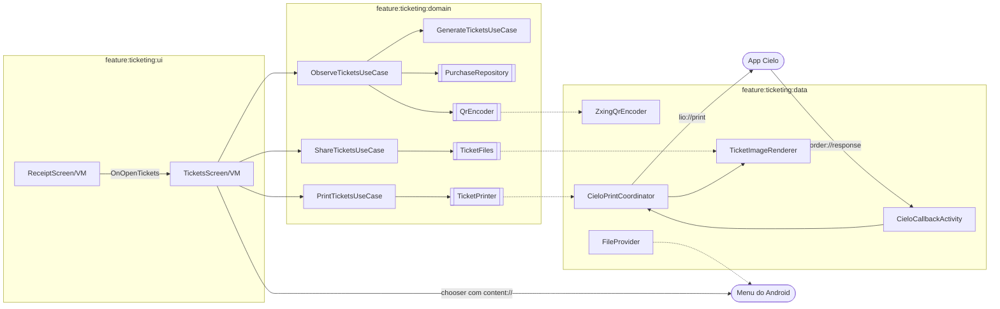

# Plano Técnico: QR Code do ingresso

| Campo | Valor |
|---|---|
| **Spec** | [spec.md](spec.md) (versão 1.1.2) · [ui-spec.md](ui-spec.md) (0.2.1) · estende a [001](../001-venda-de-ingressos/plan.md) |
| **Status** | Aprovado (2026-10-19) |
| **Tamanho** | M |

> Este plano descreve **como** a spec será implementada. O fato novo que mais pesa vem da documentação da Cielo,
> lida em 2026-10-19: [Impressão](https://docs.cielo.com.br/cielo-smart/docs/impressao.md) e
> [Realizando testes de impressão](https://docs.cielo.com.br/cielo-smart/docs/realizando-testes-de-impressao.md) (§2.1).
> Ele muda duas premissas da spec e gera as **mudanças de spec propostas** da §12, que precisam da sua aprovação
> junto com este plano. O que só o emulador responde está marcado **validar no spike (T01)**.

## 1. Constitution Check
| Artigo | Conforme? | Observação |
|---|---|---|
| I — Spec como fonte da verdade | ✅ com nota | Todo componente cita a `BR-xx` (§2). A leitura da doc de impressão exige ajustar a spec (§12); nada diverge em silêncio: as mudanças vão para a spec 1.1.0 antes do código |
| II — Arquitetura | ✅ | `domain` em Kotlin puro (ZXing fica no `data`); portas `TicketPrinter`/`TicketFiles`/`QrEncoder` no domain; UDF com um `StateFlow` e `onEvent`; composables stateless |
| III — Stack | ✅ com pendência | Única dependência nova: **ZXing core** no `feature:ticketing:data`, aprovada na Q7 da spec; `group:artifact` e versão estável serão conferidos no Maven Central na T01 (AP-11). Nenhuma outra. Avaliada a alternativa de gerar o QR sem biblioteca (§6) |
| IV — Testes | ✅ | Cada AC com teste nomeado (§10); decodificação do QR gerado com o leitor do próprio ZXing prova AC-29/AC-30; JVM, sem rede nem relógio |
| V — Segurança e Privacidade | ✅ com nota | QR só carrega `reference` + ordem; sem PII nem cartão. O `PRINT_IMAGE` da Cielo exige arquivo em armazenamento compartilhado: risco tratado na §7 (arquivo temporário, apagado, sem permissão nova em API ≥ 29) e levado à spec (§12) |
| VI — Qualidade | ✅ | Erros explícitos (§5); a11y na UI Spec; observabilidade por `Logger` sem o conteúdo do QR (ADR-0009, S1) |
| VII — Simplicidade | ✅ | Sem módulo novo, sem tabela nova, sem migração. QR derivado, não persistido. Uma imagem composta por ingresso serve à impressão e ao compartilhamento |
| VIII — Harness de IA | ✅ | Sensores do 000 valem; subagentes em sonnet; `security-reviewer` obrigatório (manifest, intents, arquivos, callback) |

Nenhum ❌. Decisões que valem além da feature: [ADR-0012](../../adr/0012-qr-code-do-ingresso-impressao-por-imagem-e-compartilhamento.md) (escrito depois da implementação). Sem exceção à constitution; o acesso que faltava (`MANAGE_EXTERNAL_STORAGE`) é do app Cielo, não do nosso (research.md §4).

## 2. Visão da Solução
O QR Code é **derivado**: dado o `Purchase` aprovado, o domain monta `n` tickets (`TicketCode` = `bilheteria:1:<reference>:<n>`), e a
codificação em matriz fica atrás de uma porta (`QrEncoder`, implementada com ZXing no `data`). Nada é persistido (BR-32).
A tela observa a compra pelo Room (como o comprovante), então a aprovação tardia (BR-37) aparece sozinha.

**Imprimir** reaproveita o canal Cielo da 001 (`lio://`, resposta em `order://response`). Pelo que a doc diz (§2.1), cada chamada
faz **uma** operação e devolve **uma** resposta; o `PRINT_IMAGE` recebe um **caminho de arquivo** de 384 px de largura. Por isso o
`data` compõe uma **imagem por ingresso** (título, evento, data, local e QR Code, feita com `Canvas`), grava como arquivo
temporário, imprime um ingresso por vez e só passa ao próximo quando a resposta anterior chega com sucesso. Isso também resolve a
pendência P4 da UI Spec: se a impressora falha no ingresso 2 de 3, a nova tentativa **retoma do 2**, sem duplicar o 1.
O mesmo compositor, em largura maior, gera as imagens do **compartilhamento** (`ACTION_SEND_MULTIPLE` via `FileProvider`).

### 2.1 Fatos da documentação Cielo (lida em 2026-10-19; o spike confirma no emulador)
| Fato | Fonte | Consequência |
|---|---|---|
| URI `lio://print?request=<base64>&urlCallback=order://response`; JSON `{operation, styles[], value[]}` | Impressão | Mesmo canal e mesma `Activity` de retorno do pagamento |
| Operações: `PRINT_TEXT`, `PRINT_IMAGE`, `PRINT_MULTI_COLUMN_TEXT`. **Não há operação de QR Code** | Impressão | QR só como imagem |
| `PRINT_IMAGE`: `value` = **caminho completo do arquivo**; imagem de **384 px** de largura | Impressão | Arquivo em armazenamento que o app da Cielo consiga ler; compositor com 384 px |
| O exemplo cita `MANAGE_EXTERNAL_STORAGE` e `requestLegacyExternalStorage` "para salvar arquivos" | Impressão | Risco R1 (§11): evitar, se o `MediaStore` bastar |
| Resposta `{ "code": 0, "message": "SUCCESS" }`; `1` = `WITHOUT PAPER`; `2` = erro (texto da exceção em `message`) | Impressão | **Sem papel** é motivo próprio. E há sucesso explícito: a confirmação "impresso" é possível (P1) |
| A resposta de **pagamento** com erro usa `{ "code", "reason" }`; a de impressão usa `{ "code", "message" }` e os códigos 1 e 2 **colidem** | research 001 §6 e Impressão | O parser atual leria "sem papel" (`code:1`) como pagamento **Cancelado**. Exige separar os dois (§4, R2) |
| O emulador simula a impressora: escolhe-se texto ou imagem (QR Code, código de barras) e o cenário (sucesso, erro, sem papel); "Não perguntar novamente" fixa a resposta | Testes de impressão | A impressão é verificável no AVD (resolve P3 em parte); atenção ao diálogo de escolha na Journey |

**Módulos e arquivos afetados** (pacote base `com.rafaeloliveira.bilheteria`):

| Camada | Módulo | Arquivos principais | Novo / Alterado |
|---|---|---|---|
| api | `feature:ticketing:api` | `navigation/TicketingRoutes.kt` (+ `TicketsRoute(purchaseId)`) | Alterado |
| domain | `feature:ticketing:domain` | `model/` (`Ticket`, `TicketCode`, `TicketSet`, `QrMatrix`, `PrintStatus`, `PrintOutcome`, `PrintFailureReason`), `ticket/` (`QrEncoder`, `TicketPrinter`, `TicketFiles` — portas), `usecase/` (§4), `error/TicketingError.kt` (+ casos) | Novo / Alterado |
| data | `feature:ticketing:data` | `ticket/` (`ZxingQrEncoder`, `TicketImageRenderer`, `DefaultTicketFiles`, `TicketFileStore`), `cielo/` (`CieloPrintEncoder`, `CieloPrintCoordinator`, parser ganha o ramo de impressão, `CieloCallbackHandler` roteia), `di/TicketDataModule.kt`, `AndroidManifest.xml` (`<provider>` do `FileProvider`), `res/xml/ticket_file_paths.xml` | Novo / Alterado |
| ui | `feature:ticketing:ui` | `tickets/` (`TicketsUiState`, `TicketsUiEvent`, `TicketsViewModel`, `TicketsRoute`, `TicketsScreen`, `TicketCard`, `TicketActionBar`, previews), `receipt/` (ação "Ver ingressos", `OnOpenTickets`), `navigation/TicketingNavGraph.kt` (rota nova), `res/values/strings_tickets.xml` | Novo / Alterado |
| ui (core) | `core:designsystem` | `component/DsQrCode.kt` + `QrMatrix`, tokens `qr.*`, estado "ocupado" do `DsButton`, `DsSnackbar` (se ainda não existir em código) | Novo / Alterado |
| app | `app` | nenhuma mudança prevista (o `<provider>` entra por fusão de manifest) | — |
| build | `gradle/libs.versions.toml`, `feature/ticketing/data/build.gradle.kts` | `zxing-core` (versão estável conferida na T01) | Alterado — **dependência pendente de confirmação** |

## 3. Arquitetura
### Componentes


### Imprimir (BR-38..40)
```mermaid
sequenceDiagram
    actor O as Operador
    participant VM as TicketsViewModel
    participant UC as PrintTicketsUseCase
    participant CP as CieloPrintCoordinator
    participant G as App Cielo
    participant CB as CieloCallbackActivity
    O->>VM: OnPrint
    VM->>UC: invoke(purchaseId)
    UC->>CP: print(job) — ignora se status = Printing (BR-39)
    loop um ingresso por vez (retoma do primeiro não impresso)
        CP->>CP: compõe PNG 384 px; grava em arquivo temporário
        CP->>G: lio://print (PRINT_IMAGE, caminho)
        G->>CB: order://response {code, message}
        CB->>CP: resposta de impressão (nunca vai ao pagamento)
        CP->>CP: apaga o arquivo; code 0 → próximo; 1/2/timeout → PrintFailed
    end
    CP-->>VM: status: Idle(feito) | Failed(reason, impressos)
    VM-->>O: TicketActionState
```
O app Cielo pode assumir a tela a cada chamada (como no pagamento); o spike mede isso. Se assumir, `Printing` segue o padrão de espera da 001 e
a `PaymentSession` (serviço em primeiro plano) é reaproveitada durante a impressão (R4).

## 4. Contratos
### Domain
```kotlin
// model
@JvmInline value class TicketCode(val value: String)   // "bilheteria:1:<reference>:<n>" (BR-31); toString mascarado
data class Ticket(val ordinal: Int, val total: Int, val code: TicketCode)
data class TicketSet(val purchaseId: String, val eventName: String, val eventStartsAt: Instant, val venue: String, val tickets: List<Ticket>)
class QrMatrix(val side: Int, private val modules: BooleanArray) { fun isDark(x: Int, y: Int): Boolean }   // Kotlin puro

sealed interface PrintStatus {                        // estado do trabalho de impressão (singleton no data)
    data object Idle : PrintStatus
    data class Printing(val printed: Int, val total: Int) : PrintStatus
    data class Failed(val reason: PrintFailureReason, val printed: Int, val total: Int) : PrintStatus
    data class Done(val total: Int) : PrintStatus    // BR-44 proposto (§12): confirmação "impresso"
}
enum class PrintFailureReason { TerminalAppUnavailable, NoPaper, PrinterError, Unknown, Timeout }
sealed interface PrintOutcome { data object Success; data object NoPaper; data object PrinterError; data object Unreadable }

// portas
fun interface QrEncoder { fun encode(code: TicketCode): DataResult<QrMatrix> }            // CPU; dispatcher injetado no use case
interface TicketPrinter {
    val status: StateFlow<PrintStatus>
    suspend fun print(set: TicketSet, from: Int = 0): DataResult<Unit>                     // from = primeiro ingresso não impresso
    fun acknowledge()                                                                       // Failed/Done → Idle
}
interface TicketFiles { suspend fun prepareShare(set: TicketSet): DataResult<ShareBundle> } // ShareBundle(uris: List<String>, text: String)

// erros
sealed interface TicketingError : AppError {   // casos novos
    data object TicketsUnavailable : TicketingError         // compra não Aprovada ou inexistente (BR-33, BR-36)
    data object TicketGenerationFailed : TicketingError     // QrEncoder/arquivo falhou (BR-36, BR-43)
    // reaproveita StorageFailure e TerminalAppUnavailable
}

// use cases (um operator invoke cada)
class GenerateTicketsUseCase            // BR-30..33: Purchase → TicketSet?; null se status != Approved
class ObserveTicketsUseCase             // BR-30, BR-36, BR-37: observePurchase → TicketSet + matrizes (dispatcher injetado)
class PrintTicketsUseCase               // BR-38, BR-39: exige Approved; no-op se Printing; retoma de PrintStatus.Failed.printed
class ShareTicketsUseCase               // BR-41, BR-42: TicketSet → ShareBundle; texto só com evento, data e local
```
`ObserveTicketsUseCase` devolve `Flow<DataResult<TicketSetWithMatrices>>`: Approved → gera e codifica (fora da main); outro status ou inexistente →
`TicketsUnavailable`; leitura falha → `StorageFailure`; codificação falha → `TicketGenerationFailed`.

### Data
- **`ZxingQrEncoder`:** `QRCodeWriter` com correção `M`, margem 0 (a margem de 4 módulos é do `DsQrCode` e do compositor), `EncodeHintType.CHARACTER_SET=UTF-8`; devolve `QrMatrix`. Sem rede, sem câmera.
- **`TicketImageRenderer`:** `Canvas`/`Bitmap` com a mesma `QrMatrix`, margem e cores de `qr.*`; largura 384 px (impressão) ou 1080 px (compartilhar); módulo com tamanho **inteiro** em pixels (leitura confiável); texto do ingresso fixo (pt-BR, fonte do sistema). Não depende de `Context` de UI.
- **`CieloPrintEncoder`:** JSON `{"operation":"PRINT_IMAGE","styles":[{"key_attributes_align":0}],"value":["<caminho>"]}` → Base64 → `lio://print?request=…&urlCallback=order://response` (**sem** `accessToken`/`clientID`: a doc não os pede; o spike confirma).
- **`CieloPrintCoordinator`** (singleton, implementa `TicketPrinter`): máquina de estados com um `Mutex`; um passo por vez; timeout de 15 s por passo; apaga o arquivo do passo ao receber a resposta, ao estourar o timeout e a cada abertura do app (varredura de sobras). Usa o `TerminalAppLauncher` e a lista de pacotes permitidos da 001.
- **Roteamento no callback (R2, crítico):** `CieloResponseParser` ganha o ramo de impressão: o JSON com `message` e **sem** `reason`, `results`, `id` e `reference` é uma resposta de impressão (`PrintOutcome`) e **nunca** chega ao `HandlePaymentOutcomeUseCase`. `CieloCallbackHandler` decide: resposta de impressão com trabalho em andamento → coordenador; sem trabalho → descartada com log `print_result_discarded`. Nenhum `code` de impressão vira `Cancelled`/`Declined`/`Failed` de pagamento.
- **Armazenamento da imagem de impressão:** `MediaStore.Images` (`RELATIVE_PATH=Pictures/Bilheteria`, nome aleatório, `IS_PENDING`), disponível sem permissão em API ≥ 29; o caminho vem da coluna `DATA`. **API < 29:** a impressão é tratada como `TerminalAppUnavailable` ("Impressão Cielo indisponível neste aparelho"); sem `WRITE_EXTERNAL_STORAGE`. Se o app da Cielo não conseguir ler esse arquivo, ver R1.
- **Compartilhar:** `DefaultTicketFiles` grava os PNG em `filesDir/shared_tickets/` (nome aleatório); `FileProvider` (`exported=false`, `grantUriPermissions=true`, só `files-path` desse subdiretório) devolve `content://`; o texto usa `ticketing_tickets_share_text` com **data absoluta**. Limpeza: ao preparar um novo compartilhamento e ao abrir o app, apaga o que tem mais de 1 h.
- **Persistência local:** nenhuma. Room continua na v1 (sem migração).
- **Manifest (`data`):** só o `<provider>`. Sem permissão nova, sem `<queries>` novo (o esquema `lio` já está declarado).

### Presentation
```kotlin
sealed interface TicketsUiState {
    data object Loading : TicketsUiState
    data class Content(val event: TicketEvent, val tickets: ImmutableList<TicketItem>, val action: TicketActionState) : TicketsUiState
    data object Error : TicketsUiState
}
data class TicketItem(val ordinal: Int, val total: Int, val qr: QrMatrix)            // matriz de domínio; a tela converte para o QrMatrix do design system
sealed interface TicketActionState {
    data object Idle : TicketActionState
    data class Printing(val printed: Int, val total: Int) : TicketActionState
    data class PrintFailed(val reason: PrintFailureReason, val printed: Int, val total: Int) : TicketActionState
    data object ShareFailed : TicketActionState
    data class ShareReady(val bundle: ShareBundle) : TicketActionState   // sinal para a Route abrir o menu; consumido por OnShareLaunched
    data object Printed : TicketActionState                              // BR-44 proposto (§12)
}
sealed interface TicketsUiEvent {
    data object OnRetry : TicketsUiEvent ; data object OnPrint : TicketsUiEvent ; data object OnShare : TicketsUiEvent
    data object OnRetryAction : TicketsUiEvent ; data object OnShareLaunched : TicketsUiEvent   // OnShareLaunched e OnActionDismissed são técnicos (consumo de sinal), sem AC
    data object OnActionDismissed : TicketsUiEvent
}
// ReceiptUiEvent ganha OnOpenTickets; a Route chama o callback onOpenTickets(purchaseId) (navegação por clique, como OnOpenHistory).
```
`TicketsViewModel`: um `StateFlow<TicketsUiState>` (`combine` de `ObserveTicketsUseCase` e `TicketPrinter.status` com `stateIn(WhileSubscribed(5_000))`), um `onEvent`, dispatchers injetados; `purchaseId` vem da rota. A ação "Compartilhar" fica indisponível em `Printing` (D3). Sem PAN, CVV nem PII em `SavedStateHandle`.

## 5. Tratamento de Erros
| Erro técnico | Erro de domínio | Estado de UI | Ação do usuário |
|---|---|---|---|
| `SQLiteException` ao ler a compra | `StorageFailure` | `TicketsUiState.Error` | Tentar novamente (`OnRetry`) |
| Compra inexistente ou não `Approved` | `TicketsUnavailable` | `Error` | Tentar novamente |
| Falha do `QrEncoder` (`WriterException`) | `TicketGenerationFailed` | `Error` | Tentar novamente |
| Sem app Cielo / sem resolvedor `lio://` / API < 29 | `TerminalAppUnavailable` → `PrintFailureReason.TerminalAppUnavailable` | `PrintFailed(TerminalAppUnavailable)` | Tentar novamente |
| Falha ao gravar o arquivo da imagem (`IOException`, `MediaStore` nulo) | `TicketGenerationFailed` → `PrintFailureReason.Unknown` | `PrintFailed(Unknown)` | Tentar novamente |
| Resposta `{code:1, message:"WITHOUT PAPER"}` | `PrintOutcome.NoPaper` → `NoPaper` | `PrintFailed(NoPaper, impressos)` | Colocar papel; retoma do primeiro não impresso |
| Resposta `{code:2}` | `PrintOutcome.PrinterError` → `PrinterError` | `PrintFailed(PrinterError, impressos)` | Conferir quantos saíram; retoma |
| Resposta ilegível, código desconhecido ou sem resposta em 15 s | `Unreadable` → `Unknown`/`Timeout` | `PrintFailed(Unknown, impressos)` | Conferir o papel; retoma |
| Resposta de impressão sem trabalho em andamento | descartada + log `print_result_discarded` | Sem mudança | — |
| Resposta de impressão com formato de pagamento forjado | nunca altera compra: só o ramo de pagamento altera | Sem mudança | — |
| Toque em imprimir/compartilhar durante `Printing` | ignorado (BR-39, D3) | `Printing` | — |
| `IOException`/`IllegalArgumentException` ao gerar imagem de compartilhar | `TicketGenerationFailed` | `ShareFailed` | Tentar novamente |
| `ActivityNotFoundException` ao abrir o menu de compartilhar | `TicketGenerationFailed`-equivalente de UI | `ShareFailed` | Tentar novamente |

Nenhum retry automático de impressão (escrita com efeito físico, error-handling.md): só por ação do operador, e retomando do ingresso seguinte ao último confirmado.

## 6. Alternativas Consideradas
| Alternativa | Prós | Contras | Motivo da decisão |
|---|---|---|---|
| **ZXing core** para gerar o QR | Madura, Apache 2.0, Java puro, sem câmera; o leitor do próprio pacote permite teste de ida e volta | ~500 KB antes do R8 | **Escolhida** (Q7) |
| Gerar o QR sem biblioteca | Zero dependência | Reed-Solomon, máscaras e versões à mão: risco sem ganho; contraria Art. III.5 | Descartada |
| `qrcode-kotlin`, `qrose` | API Kotlin/Compose | Menos madura; sem leitor para o teste de ida e volta | Descartada |
| Imprimir com `PRINT_TEXT` (sem QR) | Sem arquivo, sem armazenamento | O ingresso perde o QR, que é a razão da feature | Descartada |
| QR "desenhado" com caracteres de bloco em `PRINT_TEXT` | Sem arquivo | Depende da fonte da impressora; leitura incerta | Descartada |
| `PRINT_IMAGE` + `MANAGE_EXTERNAL_STORAGE` (como na doc) | Funciona como o exemplo | Permissão de acesso a todos os arquivos, ruim em auditoria e de aprovação difícil | Só se o `MediaStore` não bastar (R1, ADR-0012) |
| **`PRINT_IMAGE` + `MediaStore`** (API ≥ 29) | Sem permissão; arquivo nosso, apagável | Fica visível a apps com acesso a mídia durante segundos | **Escolhida**, sujeita ao spike |
| Texto e imagem em chamadas separadas por ingresso | Texto nítido da impressora | 2–3 respostas por ingresso; mais pontos de falha | Descartada: **uma imagem composta por ingresso** |
| Todos os ingressos numa imagem alta | 1 chamada | Limite de altura desconhecido; falha perde tudo e impede retomar | Descartada (o spike pode reabrir se um ingresso por vez piscar a tela) |
| Persistir os QR Codes no Room | Imutáveis por construção | Migração e dado novo sem necessidade (BR-32 se cumpre por derivação) | Descartada |
| Compartilhar por `Intent` com bitmap no extra | Sem arquivo | Limite de tamanho do Binder; sem `ACTION_SEND_MULTIPLE` com várias imagens | **`FileProvider`** |

## 7. Segurança (OWASP MASVS + STRIDE)
**Controles MASVS aplicáveis:**
- [x] **MASVS-STORAGE:** QR Code derivado e não persistido; imagens de compartilhar só em `filesDir` (sem armazenamento externo) com limpeza em 1 h; imagem de **impressão** temporária no `MediaStore` (exigência da doc Cielo), nome aleatório, apagada ao fim, no timeout e na abertura do app; `allowBackup=false` (já no D0).
- [ ] MASVS-CRYPTO: não se aplica (o QR não é assinado; Q1).
- [ ] MASVS-AUTH: não se aplica (sem login; a impressão não leva credencial, a confirmar no spike).
- [ ] MASVS-NETWORK: não se aplica (sem rede).
- [x] **MASVS-PLATFORM:** `FileProvider` com `exported=false`, `grantUriPermissions`, paths mínimos; concessão de leitura só no `Intent` do menu; `Intent` da Cielo explícito com pacote da allowlist (reaproveita o `TerminalAppLauncher`); callback exportado continua com `VIEW`/`DEFAULT`, sem `BROWSABLE`; nenhum `Intent` montado a partir de dado externo (AP-37).
- [x] **MASVS-CODE:** resposta de impressão tratada como entrada não confiável (limite de tamanho, parse defensivo, nunca roteada ao pagamento); ZXing sem CVE conhecido conferido pelo OSV-Scanner (S-15).
- [ ] MASVS-RESILIENCE: não exigido.
- [x] **MASVS-PRIVACY:** QR e texto compartilhado sem PII, sem cartão, sem dado da transação; destinatário escolhido no app do sistema, não coletado; logs sem conteúdo do QR.

**Threat model (STRIDE):**

| Ameaça | Cenário | Mitigação | Prova |
|---|---|---|---|
| Spoofing | App malicioso envia `order://response` parecido com impressão para marcar "impresso" ou "sem papel" | Só vale com trabalho em andamento; efeito limitado ao estado da ação (nenhum dado de compra muda); log do descarte | Testes do `CieloPrintCoordinator` e do `CieloCallbackHandler` |
| Spoofing (cruzado) | Resposta de impressão `{code:1}` chega com compra **Pending** aberta e é lida como "pagamento cancelado" | Ramo de impressão separado por `message`/`reason`; só o ramo de pagamento chega ao `HandlePaymentOutcomeUseCase` | Teste do parser e do handler (AC-40) |
| Tampering | Imagem de impressão trocada no `MediaStore` antes da leitura pelo app Cielo | Arquivo gravado e apagado em poucos segundos, nome aleatório; impacto é imprimir outra imagem, sem alterar compra ou pagamento; risco aceito | Revisão (`security-reviewer`) |
| Repudiation | Operador afirma que imprimiu | Sem registro persistente de impressão (fora da spec); log de depuração com contagem | — |
| Information disclosure | (a) outro app lê o PNG no `MediaStore`; (b) QR enviado ao app errado no menu; (c) log com conteúdo do QR | (a) nome aleatório, vida curta, só `reference` + ordem (sem PII/cartão), risco aceito pela spec §8; (b) escolha do destino é do operador; (c) `Logger` sem o `TicketCode`, `toString` mascarado | Teste do `TicketCode.toString`; S-02 |
| Denial of service | Respostas de impressão em laço ou muito grandes | Descarte sem trabalho; limite de tamanho do parser; timeout de 15 s por passo; um passo por vez | Testes do parser e do coordenador |
| Elevation of privilege | `FileProvider` expondo arquivos internos; concessão ampla | `exported=false`, paths só de `shared_tickets/`, `FLAG_GRANT_READ_URI_PERMISSION` no `Intent` do menu; sem `grantUriPermission` global | Teste do manifest e do XML de paths |

## 8. Observabilidade
- **Logs** (`Logger`, só debug, ADR-0009): `tickets_generated(count)`, `print_started(count)`, `print_step_done(ordinal)`, `print_failed(reason, printed)`, `print_result_discarded`, `share_started(count)`, `share_failed(reason)`. Nunca o `TicketCode`, o `reference`, o caminho do arquivo nem a resposta bruta.
- **Analytics:** nenhum (ADR-0009, S1).
- **Crash/erros:** sem crash reporter (S1); inesperados em `Logger.error` com o tipo.

## 9. Rollout
- **Feature flag:** nenhuma (app novo).
- **Migrações:** nenhuma (Room v1 intacto; `exportSchema` sem mudança).
- **Compatibilidade:** QR e compartilhamento em `minSdk 24`; **impressão só em API ≥ 29** (Cielo Smart e AVD Android 10); abaixo disso mostra "Impressão Cielo indisponível neste aparelho". `targetSdk 36` já cobre `<queries>`; sem `POST_NOTIFICATIONS`.
- **Rollback:** reverter o PR; sem dados remotos nem persistidos.

## 10. Estratégia de Testes
| Nível | Escopo | Ferramentas | ACs cobertos |
|---|---|---|---|
| Unitário (domain) | `GenerateTicketsUseCase` (quantidade, formato do `TicketCode`, status), `ObserveTicketsUseCase` (4 status, leitura e geração falhando, aprovação tardia com `FakePurchaseRepository`), `PrintTicketsUseCase` (Approved, `Printing` ignora, retomada), `ShareTicketsUseCase` (texto sem dado sensível), `TicketCode.toString` | JUnit 5, MockK, fakes, `Clock` fixo | AC-29, 30, 31, 32, 36, 37, 39, 42 |
| Unitário (data) | `ZxingQrEncoder` com **ida e volta** (renderiza e decodifica com o leitor do ZXing e compara com o `TicketCode`), `CieloPrintEncoder` (JSON e URI), `CieloResponseParser` (resposta de impressão × pagamento, `code:1` de impressão nunca vira Cancelada), `CieloCallbackHandler` (roteamento, descarte), `CieloPrintCoordinator` (um passo por vez, retomada, timeout, mapeamento 0/1/2/ilegível/app ausente/API < 29, limpeza do arquivo), `TicketImageRenderer` (dimensões, módulo inteiro) | JUnit 5, fixtures, fakes do `TerminalAppLauncher` e do armazenamento | AC-29, 30, 38, 39, 40, 41, 43 |
| Integração (data) | `DefaultTicketFiles` + `FileProvider` (URI em `filesDir/shared_tickets`, limpeza, sem armazenamento externo), manifest: provider `exported=false` e **nenhuma** permissão de armazenamento | Robolectric, leitura do manifest | AC-41, 42, 43 |
| Unitário (presentation) | `TicketsViewModel`: `Loading`→`Content`/`Error`, `Printing`→`Idle`/`PrintFailed`, `ShareReady`→consumo, D3 (share indisponível em `Printing`), `OnRetry`/`OnRetryAction`; ReceiptViewModel: ação só em `Approved`; mapeador de strings | JUnit 5, Turbine, `MainDispatcherExtension` | AC-33, 34, 35, 36, 38, 39, 40, 41, 43 |
| UI (componente) | **Fora de foco por decisão do humano (2026-10-18)**: sem testes Compose nem screenshot; os ACs de UI ficam nos testes de ViewModel e em lógica pura | — | — |
| Fluxo crítico (dispositivo) | Journeys no AVD Android 10 com `lio-emulator`: **J10** abrir ingressos pelo comprovante e pelo histórico; **J11** imprimir com sucesso; **J12** sem papel e erro (cenários do emulador), com retomada; **J13** compartilhar e falha | `verify-on-device` | AC-33, 34, 38, 40, 41 |

Nome de todo teste cita o `AC-xx` (S-09). Cobertura pelos limites do testing.md (domain 90%, ui 85%, data 75%).

## 11. Riscos
| # | Risco | Probabilidade | Impacto | Mitigação |
|---|---|---|---|---|
| R1 | **Verificado (T16):** o app Cielo lê o arquivo do `MediaStore` por caminho só com `MANAGE_EXTERNAL_STORAGE` (Android 11+); sem isso, e no Android 10, dá EACCES. Num terminal real não foi verificado | Média | Alto | **Spike T01** no AVD, com o cenário de imagem. Se falhar: parar, propor ADR-0012 e a permissão (pergunta obrigatória do `security.md`); alternativa final é imprimir só texto e registrar a limitação |
| R2 | Resposta de impressão (`code` 1/2) lida como pagamento cancelado/falho, alterando a compra aberta. **Mitigado:** roteamento por estado e impressão bloqueada com compra aberta | Alta (colidem hoje) | Alto | Ramo de impressão separado no parser e no handler (§4); testes do cruzamento (§10). Prioridade da primeira tarefa de `data` |
| R3 | Doc imprecisa: limite de altura da imagem, `styles` obrigatório, retorno sem tela, credenciais no pedido | Média | Médio | Spike mede e ajusta `CieloPrintEncoder`; muda BR-38/40 só se preciso (nova versão da spec) |
| R4 | O app Cielo toma a tela a cada ingresso (pisca) e o processo pode morrer entre passos | Média | Médio | Reaproveitar `PaymentSession` como serviço em primeiro plano durante a impressão; se piscar demais, avaliar uma imagem alta (reabre §6) |
| R5 | Impressora sem papel ou erro no meio duplica ingressos | Média | Médio | Um ingresso por chamada, retomada do primeiro não impresso, mensagem com "n de q impressos" (§12) |
| R6 | QR ilegível por módulo fracionário, contraste ou tamanho | Baixa | Alto | Módulo inteiro em pixels, margem 4, preto sobre branco fixos; teste de ida e volta; conferência no emulador (QR do ingresso aparece na escolha "imagem/QR") |
| R7 | PNG de compartilhar com o `reference` fica acessível a outros apps por tempo demais | Baixa | Baixo | `filesDir` privado, `FileProvider` sem exportar, vida de 1 h, nome aleatório |
| R8 | ZXing: `group:artifact` ou versão errados (slopsquatting) | Baixa | Alto | Conferir no Maven Central na T01 (versão estável, dono `zxing`); OSV-Scanner |
| R9 | Terminal real Android < 29 (sem impressão) | Baixa | Médio | Mensagem "Impressão Cielo indisponível neste aparelho"; QR e compartilhar continuam |

## 12. Mudanças de spec (aprovadas em 2026-10-19; spec 1.1.0 e UI Spec 0.2.0)
A doc da Cielo (§2.1) mostra quatro pontos em que a spec 1.0.1 e a UI Spec 0.1.1 ficaram curtas ou conflitam. Proponho **spec 1.1.0** e **UI Spec 0.2.0**; sem elas o plano não fecha:

| # | Ponto | Mudança proposta | Por quê |
|---|---|---|---|
| M1 | §8 diz "nunca em armazenamento externo" para a imagem, mas o `PRINT_IMAGE` exige arquivo legível pelo app Cielo | §8: nova linha "imagem de impressão (arquivo temporário no armazenamento compartilhado, só em API ≥ 29, apagada ao fim)", Interno; o compartilhamento continua só em `filesDir` | Conflito direto (Gestão de Mudanças) |
| M2 | BR-40 não separa "sem papel" de erro, e "tentar novamente" reimprime tudo | BR-40: motivos app ausente, **sem papel**, erro da impressora, desconhecido; "tentar novamente" **retoma do primeiro ingresso não impresso** e a mensagem informa quantos saíram; AC-40 ajustado. Fecha **P4** | A doc dá código próprio para papel; impressão por ingresso permite retomar |
| M3 | Hoje `Printing` volta a `Idle` sem confirmação (P1) | Nova **BR-44**: QUANDO a impressão concluir com sucesso, o sistema deve exibir confirmação "Ingressos impressos"; **AC-44**; novo estado `Printed` | A resposta `SUCCESS` existe; heurística de feedback da UI Spec |
| M4 | API < 29 | BR-40/AC-40: no aparelho sem suporte, a mensagem é a de "app Cielo ausente" | Sem permissão de armazenamento (R1) |

Efeitos na UI Spec 0.2.0: texto novo `ticketing_tickets_print_error_paper` ("A impressora está sem papel. Coloque papel e tente de novo."), contagem "Imprimiu %1$d de %2$d ingressos." nas falhas, snackbar `ticketing_tickets_printed` ("Ingressos impressos"), prancha dos estados `PrintFailed(NoPaper)` e `Printed`, P1, P2 e P4 fechadas; P3 depende do spike. Os IDs BR-30…43 e AC-29…43 não são renumerados.

## 13. Changelog
| Data | Mudança | Origem |
|---|---|---|
| 2026-10-19 | Versão inicial (rascunho) | Spec 1.0.1, UI Spec 0.1.1 aprovadas; leitura da doc de impressão da Cielo |
| 2026-10-19 | Plano aprovado com M1 a M4; spec → 1.1.0, UI Spec → 0.2.0; evento técnico `OnActionDismissed` | Humano |
| 2026-10-19 | **Registro do implementado:** nomes reais (`TicketSheet`/`TicketWithQr` no lugar de `TicketSetWithMatrices`; `PrintImageStore`/`MediaStorePrintImageStore`/`QrRaster`/`TicketFileProvider` no lugar de `TicketFileStore`; `common/ActionBar` e `TicketCard` privado na tela; `LoadTicketSetUseCase` e `SweepTicketFilesUseCase` novos); `PrintStatus.*` com `purchaseId`; `PrintOutcome.FileUnreadable`; `ShareBundle(uris)` sem texto e `ShareTicketsUseCase` devolve `ShareBundle?` (null durante a impressão); o texto do compartilhamento é montado na Route só com os campos de `TicketEvent` (sem `reference`); roteamento do callback **por estado** (`awaitingResult`), não por "message sem reason"; impressão sem credenciais; impressão bloqueada com compra aberta; limpeza de imagens ao abrir a tela de ingressos e no início de cada impressão; logs reais: `print_started`, `print_done`, `print_failed`, `print_result_discarded`; risco residual: duas respostas seguidas (reenvio ou app malicioso) avançam o passo seguinte, sem alterar compra | Implementação e revisão (T02–T16) |
| 2026-10-19 | Risco residual (revisão de segurança, rodada 2): a colisão `{code, reason}` pagamento × impressão só é evitada no sentido pagamento→impressão (a impressão não inicia com compra aberta). No sentido inverso, uma compra iniciada durante os segundos de uma impressão, com o app Cielo em primeiro plano, teria um erro de pagamento tratado como resposta de impressão (a compra fica `Pending` e a recuperação BR-15 resolve). O `PrintImageStore.sweepStale` pode deixar de ver linhas `IS_PENDING` órfãs (o sistema as expira); a janela entre a checagem de `Printing` e a limpeza é de milissegundos e só afeta a disponibilidade. `print()` roda no escopo do singleton: sair da tela durante a gravação não deixa o trabalho preso nem a imagem órfã | Revisão (T15) |
