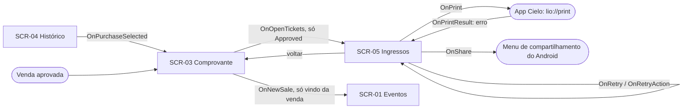

# UI Spec: QR Code do ingresso

| Campo | Valor |
|---|---|
| **Spec** | [spec.md](spec.md) (versão: 1.1.2) |
| **Status** | Aprovada (0.2.0) |
| **Versão** | 0.2.1 |
| **Fidelidade** | Prancha hi-fi + protótipo (M) |
| **Prancha** | [design/mockups.html](design/mockups.html) · revisão local: `python3 -m http.server 8766` em `docs/` e abrir `http://127.0.0.1:8766/specs/002-qr-code-ingresso/design/mockups.html` |
| **Design system** | [DESIGN.md](../../design/DESIGN.md) v0.2.0 (direção A "Ciano Smart") · [components.md](../../design/components.md) |

> A UI Spec descreve **como** cada estado da spec aparece e se comporta. Não cria regra de negócio.
> Guia: [ui-design.md](../../harness/guides/ui-design.md). A tela de ingressos é nova (SCR-05); o comprovante (SCR-03)
> é da [UI Spec 001](../001-venda-de-ingressos/ui-spec.md), que ganha a versão 0.5.0 só com a ação "Ver ingressos".

## 1. Contexto de uso
- **Persona e tarefa principal:** operador da bilheteria, logo depois de uma venda aprovada (ou ao reapresentar uma venda antiga): entregar ao comprador um ingresso por pessoa.
- **Ambiente:** balcão ou porta do evento, luz forte, fila, uma mão; o comprador espera diante do terminal.
- **Dispositivos:** terminal Cielo Smart (480×854 a 1440×720) e celular Android 7–10 com o emulador Cielo. Classe de janela: **compact** apenas (ADR-0009, S9).
- **Métrica de UX:** do comprovante aprovado à impressão em 2 toques ("Ver ingressos" → "Imprimir ingressos"), sem rolar: as ações ficam numa barra fixa nas duas telas.

## 2. Inventário de telas
| ID | Tela | Propósito | Histórias | Rota (`:api`) |
|---|---|---|---|---|
| SCR-05 | Ingressos | QR Code de cada ingresso da compra aprovada; imprimir e compartilhar | US-01, US-04, US-05 | `TicketsRoute(purchaseId)` |
| SCR-03 | Comprovante (alteração) | Ação "Ver ingressos" no estado `Approved` | US-01, US-02, US-03 | `ReceiptRoute(purchaseId)` (da 001) |

Os nomes de rota são provisórios; o `plan.md` define os contratos de `:api`.

## 3. Fluxo

"Voltar" (seta da top app bar e voltar do sistema) é navegação tratada na `Route`, não `UiEvent`.

## 4. Telas

### SCR-05 — Ingressos

#### 4.1 Estrutura
```
┌──────────────────────────────┐
│ ← Ingressos                  │  DsTopAppBar (voltar ao comprovante)
├──────────────────────────────┤
│ Noite de Jazz no Parque      │  cabeçalho do evento (nome, data · local, qtd)
│ sáb., 15 nov · 20:00 · Concha│
│ 3 ingressos                  │
│ ┌──────────────────────────┐ │
│ │ Ingresso 1 de 3          │ │  TicketCard (feature) · surfaceContainerLow
│ │      ┌──────────┐        │ │
│ │      │ QR Code  │        │ │  DsQrCode 200dp (preto sobre branco)
│ │      └──────────┘        │ │
│ │ Noite de Jazz… · data    │ │
│ └──────────────────────────┘ │
│ ┌ Ingresso 2 de 3 … ┐ (rola) │
├──────────────────────────────┤
│ [ 🖨  Imprimir ingressos   ] │  DsButton Filled (barra fixa)
│ [ ⤴  Compartilhar ingressos] │  DsButton Tonal
└──────────────────────────────┘
```
**Adaptativo:** compact = coluna única; os cartões rolam e a barra de ações fica fixa. Sem medium/expanded (ADR-0009, S9).

#### 4.2 Estados
Nomes idênticos a `TicketsUiState` e `TicketActionState` (spec §6). Cada estado = uma prancha + um `@Preview`.

| Estado | AC | O que aparece | Foco/anúncio inicial |
|---|---|---|---|
| `Loading` | AC-34 | Skeleton com a geometria dos cartões; sem ações | "Carregando ingressos" (status) |
| `Content` · `Idle` | AC-29, AC-31, AC-34, AC-37, AC-41 | Cabeçalho do evento, um cartão por ingresso, ações habilitadas | Título da tela |
| `Content` · `Printing` | AC-38, AC-39 | "Imprimir" ocupado (contêiner `primary` mantido, indicador e "Imprimindo…"); QR Codes continuam; "Compartilhar" indisponível | "Imprimindo os ingressos" (status, educado) |
| `Content` · `PrintFailed(reason, printed, total)` | AC-40 | `DsSnackbar` sobreposto acima da barra, com texto por motivo e "Tentar novamente"; ações habilitadas | Anunciado como status; foco permanece onde estava |
| `Content` · `Printed` | AC-44 | `DsSnackbar` "Ingressos impressos" (sem ação); volta a `Idle` sozinho | Anunciado como status |
| `Content` · `ShareFailed` | AC-43 | `DsSnackbar` com texto próprio e "Tentar novamente" | Idem |
| `Error` | AC-35, AC-36 | `DsErrorState`: "Não foi possível abrir os ingressos" + "Tentar novamente"; nenhum QR Code | Alerta; foco no botão |

**Regras do `TicketActionState`:** uma ação por vez. `OnPrint` ou `OnShare` substitui a falha anterior (`PrintFailed`/`ShareFailed`). Durante `Printing`, `OnPrint` é ignorado (BR-39) e "Compartilhar" fica indisponível (**D3**, aprovada em 2026-10-19: a spec 1.0.1 estende o §6 e a BR-39 às duas ações), para uma falha de compartilhamento não trocar `Printing` por `ShareFailed` e liberar uma segunda impressão. Toque repetido em "Compartilhar" e em "Tentar novamente" também é ignorado enquanto a ação anterior abre (requisito de implementação; sem AC próprio).

#### 4.3 Componentes
| Nº na prancha | Componente | Variante | Tokens relevantes | Observações |
|---|---|---|---|---|
| 1 | Cabeçalho do evento (composição local, como o da compra) | — | `titleMedium`, `bodyMedium`, `onSurfaceVariant` | Mesmo padrão da SCR-02 |
| 2 | `TicketCard` (composição local na feature) | — | `surfaceContainerLow`, `shape.large`, `titleMedium` | Compõe `DsQrCode` e os textos; promover a `core:ui` só se outra feature precisar |
| 3 | `DsQrCode` **(proposto, §5)** | 200dp | `qr.foreground`, `qr.background` (novos) | Fixo preto/branco nos dois temas |
| 4 | `DsButton` | Filled com ícone, largura total; estado carregando | `primary`, `onPrimary` | "Imprimir ingressos"; ação primária. **Carregando** mantém `primary`/`onPrimary` (6,4:1) e bloqueia o toque, anunciado como ocupado; não usa o cinza de 38% do desabilitado porque é a única informação de progresso |
| 4 | `DsButton` | Tonal com ícone, largura total | `secondaryContainer` | "Compartilhar ingressos"; desabilitado em `Printing` |
| 4 | Barra de ações (composição local, `bottomBar` do `Scaffold`) | fixa; com `fontScale` ≥ 1,5 rola junto da lista | `surface`, `outlineVariant` | Respeita o inset da barra de gestos; ver §5 |
| 5 | `DsSnackbar` | com ação | `inverseSurface`, `inverseOnSurface`, `inversePrimary` | Falhas de impressão e compartilhamento; **sobreposto** acima da barra (`SnackbarHost`), sem empurrar a lista |
| — | `DsLoadingSkeleton`, `DsErrorState` | cartão; com ação | — | — |

#### 4.4 Conteúdo (strings)
Chaves em `strings_tickets.xml`; plurais com `plurals`.

| Chave | Texto (pt-BR) | Onde | Observação |
|---|---|---|---|
| `ticketing_tickets_title` | Ingressos | Top app bar | |
| `ticketing_tickets_back` | Voltar ao comprovante | `contentDescription` da seta | |
| `ticketing_purchase_event_when` (da SCR-02, reutilizada) | %1$s, %2$d %3$s · %4$s · %5$s | Cabeçalho e cartão | dia da semana, dia, mês, hora · local |
| `ticketing_tickets_event_lines` | %1$s\n%2$s | Cartão, sob o QR Code | evento e linha de data/local |
| `ticketing_tickets_count` | %d ingresso / %d ingressos | Cabeçalho | `plurals` |
| `ticketing_tickets_item_title` | Ingresso %1$d de %2$d | Cartão (heading nível 2) | |
| `ticketing_tickets_qr_description` | QR Code do ingresso %1$d de %2$d, %3$s | `contentDescription` do QR Code | %3$s = nome do evento; nunca o conteúdo codificado |
| `ticketing_tickets_print` | Imprimir ingressos | Botão | |
| `ticketing_tickets_printing` | Imprimindo… | Botão em `Printing` | |
| `ticketing_tickets_printing_a11y` | Imprimindo os ingressos | Anúncio (status) | |
| `ticketing_tickets_share` | Compartilhar ingressos | Botão | |
| `ticketing_tickets_action_retry` | Tentar novamente | Ação do snackbar | |
| `ticketing_tickets_print_error_terminal` | Impressão Cielo indisponível neste aparelho. Nenhum ingresso foi impresso. | Snackbar (`PrintFailed`, app Cielo ausente) | BR-40 |
| `ticketing_tickets_print_error_paper` | A impressora está sem papel. Coloque papel e tente de novo. | Snackbar (sem papel; 0.2.0) | BR-40 |
| `ticketing_tickets_print_error_printer` | A impressora não concluiu a impressão. Confira o papel. | Snackbar (erro da impressora) | BR-40 |
| `ticketing_tickets_print_progress` | Imprimiu %1$d de %2$d ingressos. | Linha do snackbar de falha de impressão (0.2.0) | `plurals`; a nova tentativa retoma dali (BR-40) |
| `ticketing_tickets_printed` | Ingressos impressos | Snackbar `Printed` (0.2.0) | BR-44 |
| `ticketing_tickets_print_error_timeout` | A impressora não respondeu. Confira o terminal. | Snackbar (`Timeout`: sem resposta em 15 s) | BR-40 |
| `ticketing_tickets_print_failed_format` | %1$s %2$s | Snackbar: motivo e contagem | só quando já saiu pelo menos um ingresso |
| `ticketing_tickets_share_datetime` | %1$s às %2$s | Texto compartilhado | data/hora absoluta |
| `ticketing_tickets_print_error_unknown` | Não foi possível imprimir os ingressos. | Snackbar (código desconhecido) | BR-40 |
| `ticketing_tickets_share_error` | Não foi possível compartilhar os ingressos. | Snackbar (`ShareFailed`) | BR-43 |
| `ticketing_tickets_share_text` | Ingresso %1$d de %2$d · %3$s · %4$s · %5$s | Texto de cada imagem no `ACTION_SEND_MULTIPLE` | evento · data/hora **absoluta** (`15/11/2026 às 20:00`, como no comprovante: o texto vai a terceiros e é lido depois) · local; sem `reference`, sem dado da transação (BR-31, BR-41) |
| `ticketing_tickets_share_chooser` | Compartilhar ingressos | Título do menu do sistema | |
| `ticketing_tickets_loading` | Carregando ingressos | Skeleton (a11y) | |
| `ticketing_tickets_error_title` | Não foi possível abrir os ingressos | `Error` | BR-36 |
| `ticketing_tickets_error_body` | Os dados desta compra não puderam ser lidos ou os QR Codes não puderam ser gerados. | `Error` | |
| `ticketing_tickets_retry` | Tentar novamente | Botão em `Error` | A spec 002 usa "Tentar novamente" (como o comprovante) |

#### 4.5 Interações
Nomes idênticos aos eventos da spec §6.

| Gesto | Elemento | `UiEvent` | Resultado | Feedback |
|---|---|---|---|---|
| Toque | "Imprimir ingressos" | `OnPrint` | Envia à impressora; ignorado se `Printing` | Botão vira "Imprimindo…" |
| Toque | "Compartilhar ingressos" | `OnShare` | Abre o menu de compartilhamento do Android | Ripple; o sistema assume a tela |
| Toque | "Tentar novamente" no snackbar | `OnRetryAction` | Repete a última ação (imprimir ou compartilhar) | Snackbar some; `Printing` se for impressão |
| Toque | "Tentar novamente" em `Error` | `OnRetry` | Volta a `Loading` e repete leitura e geração | — |
| Sistema | Retorno do `lio://print` | `OnPrintResult(response)` | Próximo ingresso, `Printed` ou `PrintFailed` | Sem gesto |
| Sistema | Fim do snackbar `Printed` ou dispensa do aviso | `OnActionDismissed` (técnico, sem AC) | Volta a `Idle`; só o aviso "Ingressos impressos" expira sozinho (4 s, cronometrado na Route); as falhas ficam até o operador agir | — |
| Sistema | Seta e voltar do sistema | — (navegação na `Route`) | Volta ao comprovante | — |

#### 4.6 Acessibilidade
- **Ordem de leitura:** título → cabeçalho do evento → cartões na ordem (título do ingresso → QR Code → texto do evento) → "Imprimir ingressos" → "Compartilhar ingressos". O snackbar, quando aparece, é anunciado sem tirar o foco dos botões. "Compartilhar" desabilitado em `Printing` é anunciado como indisponível.
- **Rótulos falados:** QR Code → "QR Code do ingresso 2 de 3, Noite de Jazz no Parque" (imagem com papel `Image`; o conteúdo codificado nunca é lido). O cartão **não** usa `mergeDescendants` (engoliria o heading e repetiria o rótulo do QR Code); cada parte é lida em ordem: título do ingresso, QR Code, texto do evento. Não há leitura agregada do cartão (a chave `item_a11y` foi retirada).
- **Headings:** título da tela; "Ingresso n de q" em cada cartão; título do `Error` (`heading()`, sem níveis: o Compose não os tem).
- **Live regions / foco:** `Printing` anunciado como status educado; o snackbar de falha é uma região viva educada e não rouba foco; `Error` como alerta com foco em "Tentar novamente". Ao voltar de `Printing` para `Idle` o foco permanece em "Imprimir ingressos".
- **Fonte 200%:** os textos do cartão quebram sem limite de linhas; o QR Code mantém 200dp (não escala com a fonte) para continuar legível; botões ocupam a largura toda e o texto quebra em 2 linhas. Com `fontScale` ≥ 1,5 a barra deixa de ser fixa e as ações rolam junto da lista (como o `DsListItem` na 0.4.4 da 001), porque duas ações de 2 linhas ocupariam cerca de metade de uma tela de 720dp. Em escala menor a barra fixa ocupa cerca de 17% da tela; o snackbar é sobreposto e não encolhe a lista (na prancha, com fonte ≥ 150% ele aparece inline acima dos botões porque a barra rola; no Compose o `SnackbarHost` segue sobreposto).
- **Contraste:** QR Code preto sobre branco 21:1 (tokens fixos, nos dois temas); `onPrimary`/`primary` 6,4:1 claro · 7,8:1 escuro; `onSecondaryContainer`/`secondaryContainer` 13,2:1 · 7,1:1; `inverseOnSurface`/`inverseSurface` (snackbar) 11,6:1 · 10,2:1; ação do snackbar `inversePrimary`/`inverseSurface` 7,7:1 · 5,0:1; `onSurfaceVariant`/`surfaceContainerLow` (texto do cartão) conforme a SCR-03 da 001 (≥ 7:1).
- **Movimento:** o indicador de "Imprimindo…" fica estático com "remover animações".

#### 4.7 Dados sensíveis na tela
| Dado | Classificação (spec §8) | Como aparece | `FLAG_SECURE` |
|---|---|---|---|
| `reference` e ordem (dentro do QR Code) | Interno | Só dentro da imagem do QR Code; nunca em texto na tela | Não (Q10 da spec) |
| Nome, data e local do evento | Público | Texto | Não |
| Dados da transação, número do cartão | Interno / PCI | **Não aparecem** | — |

### SCR-03 — Comprovante (alteração, ver UI Spec 001 v0.5.0)

#### 4.1 Estrutura
Igual à da 001, com as ações do estado `Approved`:
```
┌──────────────────────────────┐
│ …resultado e comprovante…    │  rola
├──────────────────────────────┤
│ [   🎫 Ver ingressos       ] │  barra fixa · DsButton Filled (nova, primária)
│ [   🛒 Nova venda          ] │  DsButton Tonal (só vindo da venda)
└──────────────────────────────┘
```

#### 4.2 Estados
| Estado (`ReceiptUiState`) | AC | O que muda | Foco/anúncio inicial |
|---|---|---|---|
| `Approved` · fim da venda | AC-33 | Barra inferior fixa com "Ver ingressos" (Filled) acima de "Nova venda" (Tonal); o comprovante rola por trás | Sem mudança (resultado anunciado) |
| `Approved` · pelo histórico | AC-33 | Barra fixa só com "Ver ingressos" (Filled) | Sem mudança (bloco silencioso) |
| `Declined`, `Cancelled` | AC-32, AC-33 | Nada: sem ação de ingressos; "Nova venda" segue Filled | Sem mudança |

#### 4.3 a 4.7
Componentes, strings, interações, acessibilidade e dados sensíveis estão na UI Spec 001 v0.5.0 (§4.3 a §4.5 da SCR-03): `DsButton` "Ver ingressos" (`ticketing_receipt_view_tickets`), evento `OnOpenTickets`. Acessibilidade: "Ver ingressos" lido como botão, ordem de leitura = resultado → lista → "Ver ingressos" → "Nova venda"; ao **voltar** da SCR-05 o bloco de resultado não é reanunciado (a live region é só do fim da venda; ao abrir os ingressos a tela marca o resultado como já anunciado) e o foco segue o padrão do sistema (início da tela; pedir foco programático competiria com o TalkBack); contraste `onPrimary`/`primary` 6,4:1 · 7,8:1 e `onSecondaryContainer`/`secondaryContainer` 13,2:1 · 7,1:1.

## 5. Mudanças no design system

### DsQrCode (Proposto)
- **Problema:** nenhum componente exibe uma matriz de QR Code. Ela precisa de contraste e margem fixos, independentes do tema, ou os leitores falham (um QR Code claro sobre fundo escuro, por exemplo, pode não ser lido).
- **Anatomia:** quadrado de `size` (padrão 200dp) com fundo `qr.background`, módulos em `qr.foreground`, margem (quiet zone) de 4 módulos embutida; cantos `shape.small`; desenhado em `Canvas`, sem imagem rasterizada.
- **Variantes e estados:** único (sem estado interativo).
- **Comportamento:** não é clicável; não escala com a fonte; tamanho mínimo 200dp na tela de ingressos.
- **Acessibilidade:** papel `Image` com `contentDescription` recebido por parâmetro; nunca expõe o conteúdo codificado.
- **API proposta:** `@Composable fun DsQrCode(matrix: QrMatrix, contentDescription: String, modifier: Modifier = Modifier, size: Dp = 200.dp)`. `QrMatrix` é um tipo simples do `core:designsystem` (lado `size` e `isDark(x, y)`), para o módulo não depender da biblioteca de geração; quem converte a matriz da biblioteca é a feature.
- **Classe no kit:** `.qr` (já na prancha; entra no `template.html` após aprovação).
- **Também na ficha (revisão):** (a) o lado do módulo é um número inteiro de pixels (`size` arredondado ao múltiplo da matriz), para o `Canvas` não borrar os módulos e prejudicar a leitura; (b) a imagem de impressão e de compartilhamento (bitmap) usa a mesma `QrMatrix`, a mesma margem e as mesmas cores, gerada por quem converte a matriz, para a tela e o papel não divergirem.

### Ajustes de kit e composições locais (Propostos)
Só entram no `template.html` e no catálogo após a aprovação; as classes já existem na prancha.
| Item | Natureza | Observação |
|---|---|---|
| `.ticket` | composição local (`TicketCard`) | Não vira `Ds*`; promover a `core:ui` se outra feature precisar |
| `.sticky-actions` | composição local (barra de ações no `bottomBar` do `Scaffold`) | Fixa; rola junto da lista com `fontScale` ≥ 1,5; respeita o inset da barra de gestos. Usada na SCR-03 `Approved` e na SCR-05 |
| `.snack-action`, `.snackbar` sobreposto | variante do `DsSnackbar` com ação (já no catálogo) | Só a classe da ação e o posicionamento acima da barra são novos |
| `.btn.busy`, `.spin` | `DsButton` carregando (já listado nas variantes) | Mantém o contêiner `primary`; indicador estático com "remover animações" |
| `.sk-*` | utilitários do skeleton | Escala de 4dp; sem medidas soltas na prancha |

### Tokens novos (Propostos)
| Token | Valor claro | Valor escuro | Uso |
|---|---|---|---|
| `color.qr.foreground` | `#000000` | `#000000` | Módulos do QR Code |
| `color.qr.background` | `#FFFFFF` | `#FFFFFF` | Fundo e margem do QR Code |

Iguais nos dois temas **de propósito**; ficam no `base.tokens.json` (não duplicados em `color.light`/`color.dark`). Mudam em três lugares juntos após a aprovação: `docs/design/tokens/base.tokens.json`, variáveis `--md-qr-*` do `template.html` e `core:designsystem`. `TicketCard` e o cabeçalho do evento são composições locais da feature e não entram no catálogo.

## 6. Movimento e feedback
- Transições de tela padrão do Navigation (300 ms); nenhuma animação própria.
- Indicador de "Imprimindo…": anel estático nesta versão (a rotação fica para uma melhoria do `DsButton`); sem animação própria.
- Sem haptics. Falhas aparecem no `DsSnackbar` (sem diálogo modal); sucesso da impressão não tem mensagem (ver pendência P1).

## 7. Pendências
| # | Pergunta | Responsável | Status |
|---|---|---|---|
| P1 | ~~Confirmação de impressão concluída~~ Fechada (0.2.0): BR-44, `Printed`. Texto original: A heurística "todo resultado tem confirmação" pediria um aviso de sucesso depois de imprimir, mas ele depende do retorno do `lio://print` (spike da Q11). Hoje `Printing` volta a `Idle` sem mensagem. Se o retorno confirmar sucesso, proponho um snackbar "Ingressos impressos"; isso exige estado novo na spec (nova versão) | Agente (spike) → humano | Aberta |
| P2 | **Layout do papel impresso** (parcialmente fechada: uma imagem de 384 px por ingresso, composta pelo app; o desenho do papel segue o mesmo cartão da tela, sem prancha própria) (tamanho do QR Code, largura da bobina, cabeçalho) depende do que o `lio://print` aceita (texto, imagem, QR Code?). Não há prancha do papel nesta versão; entra depois do spike, como nova versão da UI Spec se mudar algo visível ao operador | Agente (spike) | Aberta |
| P5 | **D3: Compartilhar indisponível em `Printing`.** Regra criada pelo design (revisão 1, I1). Spec 1.0.1 com a linha `Printing` do §6 e a BR-39 cobrindo as duas ações | Humano | Fechada: aprovada (2026-10-19), spec 1.0.1 |
| P4 | ~~Reimpressão pode duplicar ingressos~~ Fechada (0.2.0): BR-40 retoma do primeiro não impresso. Texto original: O pedido imprime todos os ingressos; se a impressora falhar no meio, "Tentar novamente" reimprime tudo (BR-40). O texto do erro já pede para conferir quantos saíram. Se o spike mostrar retorno por ingresso, pode virar reimpressão só do que falta; isso exigiria mudar BR-38/BR-40 (spec 002, nova versão) | Agente (spike) → humano | Aberta |
| P3 | ~~Comportamento da tela durante a impressão~~ Fechada (0.2.1): o app Cielo toma a tela a cada ingresso e devolve o foco sozinho (research.md §1); a tela não bloqueia o voltar. Texto original: o app Cielo pode assumir a tela, como no pagamento, ou imprimir em segundo plano. Se assumir, `Printing` precisa seguir o padrão de espera da 001 (voltar bloqueado). A prancha assume impressão sem trocar de app | Agente (spike) | Aberta |

## 8. Design Ready (checklist antes do checkpoint)
- [x] Toda tela tem ID `SCR-xx` e liga a uma `US-xx`
- [x] Todo estado da seção 6 da spec tem prancha com o mesmo nome (`Loading`, `Content` em `Idle`/`Printing`/`PrintFailed`/`ShareFailed`, `Error`; mais 3 pranchas do `ReceiptUiState.Approved`/`Cancelled`)
- [x] Todo `UiEvent` da spec aparece na tabela de interações (`OnOpenTickets` na UI Spec 001 v0.5.0 e no protótipo)
- [x] Só componentes `Ds*` do catálogo ou propostos na seção 5 (`DsQrCode`)
- [x] Só tokens do design system; nenhuma cor/medida solta na prancha (utilitários em escala de 4dp; tokens `qr.*` propostos na §5)
- [x] Textos pt-BR revisados com chave de recurso; nada hardcoded
- [x] Acessibilidade anotada (ordem, rótulos, headings, foco, fonte 200%, contraste)
- [x] Dados sensíveis mascarados e dados da prancha fictícios (QR Codes ilustrativos, não escaneáveis)
- [ ] Tema claro e escuro verificados; layout compact (claro verificado em captura; escuro e 200% a conferir pelo humano na prancha)
- [x] `ui-design-reviewer`: rodada 2 sem bloqueante; achados A e B resolvidos aqui (A vira a decisão D3 e a pendência P5), sugestões C a I aplicadas
- [x] Nenhum `[PRECISA ESCLARECIMENTO]` aberto (P1 a P3 dependem do spike da Q11, não bloqueiam a aprovação do design)

## 9. Revisão de design
| Versão | Data | Revisor | Decisão | Comentários |
|---|---|---|---|---|
| 0.1.0 | 2026-10-19 | `ui-design-reviewer` (sonnet) | Ajustes necessários → aplicados | Rodada 1: 0 bloqueantes, 7 importantes, 8 sugestões. Corrigidos: Compartilhar indisponível em `Printing` (BR-39), "Imprimindo…" sem o cinza de desabilitado, snackbar sobreposto e ações que rolam com fonte ≥ 150%, ações da SCR-03 na barra fixa, ficha de kit completa, skeleton sem medidas soltas e com a geometria do cartão, strings sem retry redundante, chaves de leitura falada e de texto compartilhado, headings sem níveis, variante "terminal ausente", `OnPrintResult` no protótipo, ficha do `DsQrCode`; P4 registrada |
| 0.1.1 | 2026-10-19 | `ui-design-reviewer` (sonnet) | Ajustes necessários → aplicados | Rodada 2 (delta): 0 bloqueantes; 2 importantes (regra D3 que a spec não tem → proposta de spec 1.0.1; versão da prancha) e 6 sugestões, aplicados |
| 0.1.1 | 2026-10-19 | Rafael Oliveira | Aprovado | Inclui D1 (Ver ingressos Filled, Nova venda Tonal), D2 (barra fixa) e D3 (Compartilhar indisponível em `Printing`, que vira a spec 1.0.1). Prancha 0.1.1 congelada; ajustes geram nova versão |

## 10. Changelog
| Versão | Data | Autor | Mudança |
|---|---|---|---|
| 0.1.1 | 2026-10-19 | Rafael Oliveira (com Claude Code) | Revisão 1 do `ui-design-reviewer` aplicada (ver §9); SCR-03 `Approved` com barra fixa |
| 0.1.0 | 2026-10-19 | Rafael Oliveira (com Claude Code) | Versão inicial: SCR-05 (6 estados e variantes) e alteração da SCR-03 `Approved`; `DsQrCode` e tokens `qr.*` propostos |
| 0.1.1 | 2026-10-19 | Rafael Oliveira | Aprovada (inclui D1, D2, D3 e os componentes e tokens propostos na §5: `DsQrCode`, `qr.*`, ajustes de kit) |
| 0.2.0 | 2026-10-19 | Rafael Oliveira (com Claude Code) | Spec 1.1.0 (mudanças M1 a M4 do plano, aprovadas): `PrintFailed` com contagem e motivo "sem papel"; estado `Printed` com snackbar "Ingressos impressos"; evento técnico `OnActionDismissed`; P1 e P4 fechadas, P2 parcial. Pranchas novas: `PrintFailed · sem papel` e `Printed` |
| 0.2.0 | 2026-10-19 | Rafael Oliveira | Aprovada (as mudanças de UI estavam listadas no §12 do plano aprovado) |
| 0.2.1 | 2026-10-19 | Rafael Oliveira (com Claude Code) | Foco ao voltar da SCR-05 segue o padrão do sistema (sem `FocusRequester`). Registro do que foi implementado e revisado (aprovada junto com a spec 1.1.2): motivo `Timeout` e chaves de texto reais, chaves retiradas, P3 fechada, só `Printed` expira, anel de progresso estático, `DsQrMatrix`, tokens `qr.*` em `base.tokens.json`, aviso inline com fonte ≥ 150%, comprovante sem reanúncio ao voltar de SCR-05 |
| 0.2.1 | 2026-10-19 | Rafael Oliveira | Aprovada (com a spec 1.1.2) |

