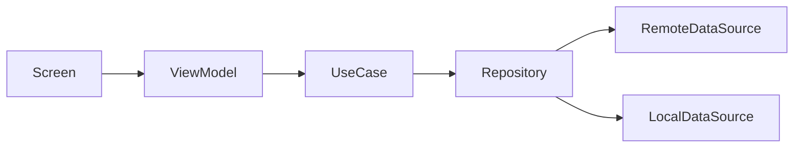
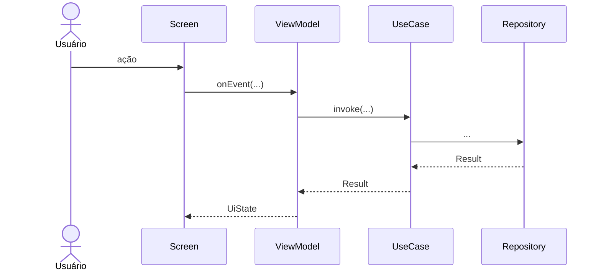

# Plano Técnico: <Nome da Feature>

| Campo | Valor |
|---|---|
| **Spec** | [spec.md](spec.md) (versão X.Y.Z) |
| **Status** | Rascunho · Em revisão · Aprovado |
| **Tamanho** | P · M · G |

> Este plano descreve **como** a spec será implementada.
> Features **P** podem preencher apenas as seções 1, 2, 4 e 10.

## 1. Constitution Check
Valide o plano contra [docs/constitution.md](../../constitution.md).

| Artigo | Conforme? | Observação |
|---|---|---|
| I — Spec como fonte da verdade | ✅ / ❌ | |
| II — Arquitetura | | |
| III — Stack | | |
| IV — Testes | | |
| V — Segurança e Privacidade | | |
| VI — Qualidade | | |
| VII — Simplicidade | | |
| VIII — Harness de IA | | |

Qualquer ❌ exige justificativa e um ADR antes da aprovação.

## 2. Visão da Solução
<Resumo em poucos parágrafos da abordagem escolhida.>

**Módulos e arquivos afetados:**

| Camada | Módulo | Arquivo | Novo / Alterado |
|---|---|---|---|
| domain | | | |
| data | | | |
| presentation | | | |
| ui | | | |

## 3. Arquitetura
### Componentes


### Fluxo principal


## 4. Contratos
### Domain
```kotlin
// Entidades, interfaces de repositório e assinaturas dos use cases
```

### Data
- **Endpoints:** método, path, request e response
- **DTOs e mappers:**
- **Persistência local:** tabelas/chaves e migrações

### Presentation
```kotlin
// UiState, UiEvent e efeitos one-shot
```

## 5. Tratamento de Erros
| Erro técnico | Erro de domínio | Estado de UI | Ação do usuário |
|---|---|---|---|
| Timeout / sem conexão | NetworkError | Error (com retry) | Tentar novamente |
| HTTP 401 | Unauthorized | Navega para login | — |
| HTTP 5xx | ServerError | Error | Tentar novamente |

## 6. Alternativas Consideradas
| Alternativa | Prós | Contras | Motivo da decisão |
|---|---|---|---|
| | | | |

Decisões que valem além desta feature viram ADR em `docs/adr/`.

## 7. Segurança (OWASP MASVS + STRIDE)
**Controles MASVS aplicáveis:**
- [ ] MASVS-STORAGE — armazenamento seguro de dados sensíveis
- [ ] MASVS-CRYPTO — uso correto de criptografia
- [ ] MASVS-AUTH — autenticação e autorização
- [ ] MASVS-NETWORK — comunicação segura
- [ ] MASVS-PLATFORM — IPC, WebView, intents, deep links
- [ ] MASVS-CODE — dependências atualizadas, validação de entrada
- [ ] MASVS-RESILIENCE — proteção contra adulteração (se aplicável)
- [ ] MASVS-PRIVACY — minimização de dados e transparência

**Threat model (STRIDE):**

| Ameaça | Cenário | Mitigação |
|---|---|---|
| Spoofing (falsificação) | | |
| Tampering (adulteração) | | |
| Repudiation (repúdio) | | |
| Information disclosure (vazamento) | | |
| Denial of service (negação de serviço) | | |
| Elevation of privilege (escalada de privilégio) | | |

## 8. Observabilidade
- **Logs:** <o que logar; nunca PII ou dados de cartão>
- **Analytics:** <eventos e parâmetros>
- **Crash/erros:** <exceções não fatais a reportar>

## 9. Rollout
- **Feature flag:**
- **Migrações:**
- **Compatibilidade com versões anteriores (app e API):**
- **Plano de rollback:**

## 10. Estratégia de Testes
| Nível | Escopo | Ferramentas | ACs cobertos |
|---|---|---|---|
| Unitário | Use cases, ViewModel | | |
| Integração | Repository, data sources | | |
| UI | Fluxos críticos | | |

## 11. Riscos
| Risco | Probabilidade | Impacto | Mitigação |
|---|---|---|---|
| | Baixa · Média · Alta | Baixo · Médio · Alto | |
