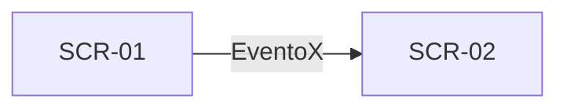

# UI Spec: <Nome da Feature>

| Campo | Valor |
|---|---|
| **Spec** | [spec.md](spec.md) (versão aprovada: x.y.z) |
| **Status** | Rascunho · Em revisão · Aprovada · Implementada |
| **Versão** | 0.1.0 |
| **Fidelidade** | Wireframe (P) · Prancha hi-fi + protótipo (M/G) |
| **Prancha** | [design/mockups.html](design/mockups.html) · link privado: <url do artifact, se publicado> |
| **Design system** | [DESIGN.md](../../design/DESIGN.md) v0.1.0 · [components.md](../../design/components.md) |

> A UI Spec descreve **como** cada estado da spec aparece e se comporta. Não cria regra de negócio:
> se o design revelar uma regra nova ou um estado faltando, pare e atualize a `spec.md` primeiro
> (nova versão + changelog). Marque indefinições com `[PRECISA ESCLARECIMENTO: ...]`.
> Guia: [ui-design.md](../../harness/guides/ui-design.md).

## 1. Contexto de uso
- **Persona e tarefa principal:** <quem usa e o que precisa concluir>
- **Ambiente:** <balcão, rua, luz forte, uma mão, interrupções>
- **Dispositivos:** <celular compacto · tablet · terminal POS> — classes de janela: compact / medium / expanded
- **Métrica de UX:** <ex.: ver o total do dia em até 1 toque>

## 2. Inventário de telas
| ID | Tela | Propósito | Histórias | Rota (`:api`) |
|---|---|---|---|---|
| SCR-01 | | | US-01 | `<Nome>Route` |

## 3. Fluxo


## 4. Telas

### SCR-01 — <Nome>

#### 4.1 Estrutura
Wireframe (obrigatório em P; em M/G complementa a prancha):
```
┌──────────────────────────────┐
│ ← Título               [ação]│  DsTopAppBar
├──────────────────────────────┤
│ ┌──────────────────────────┐ │
│ │ Resumo                   │ │  DsSummaryCard
│ └──────────────────────────┘ │
│ (Chip) (Chip) (Chip)         │  DsFilterChip
│ ○ Linha 1          R$ 0,00   │  DsListItem
└──────────────────────────────┘
```
**Adaptativo:** compact = coluna única · medium = <…> · expanded = <ex.: list-detail com SCR-02>

#### 4.2 Estados
Nomes **idênticos** às variantes de `UiState` da seção 6 da spec. Cada estado = uma prancha + um `@Preview`.

| Estado (`UiState`) | AC | O que aparece | Foco/anúncio inicial |
|---|---|---|---|
| Loading | AC-xx | | |
| Content | AC-xx | | |
| Empty | AC-xx | | |
| Error | AC-xx | | |

#### 4.3 Componentes
| Nº na prancha | Componente | Variante | Tokens relevantes | Observações |
|---|---|---|---|---|
| 1 | `DsSummaryCard` | — | `primaryContainer`, `displaySmall`, `shape.large` | |

#### 4.4 Conteúdo (strings)
Chave = nome do recurso em `strings.xml`. Sem concatenar frases; plurais com `plurals`.

| Chave | Texto (pt-BR) | Onde | Observação |
|---|---|---|---|
| `<feature>_title` | | Top app bar | |

#### 4.5 Interações
Nomes **idênticos** aos `UiEvent` da spec.

| Gesto | Elemento | `UiEvent` | Resultado | Feedback |
|---|---|---|---|---|
| Toque | Botão "Tentar de novo" | `RetryClicked` | Volta a Loading | — |

#### 4.6 Acessibilidade
- **Ordem de leitura:** <1. título, 2. resumo, 3. filtros, 4. lista>
- **Rótulos falados:** <elemento → texto lido pelo TalkBack, ex.: valor → "189 reais e 90 centavos">
- **Headings:** <quais textos>
- **Live regions / foco:** <o que é anunciado ao mudar de estado; onde o foco vai>
- **Fonte 200%:** <o que quebra linha, o que rola>

#### 4.7 Dados sensíveis na tela
| Dado | Classificação (spec §8) | Como aparece | `FLAG_SECURE` |
|---|---|---|---|
| Cartão | PCI | "•••• 4821" / lido "final 4821" | Sim |

<!-- Repita a seção 4 para cada SCR-xx -->

## 5. Mudanças no design system
Tokens ou componentes novos propostos por esta feature (ficha em [components.md](../../design/components.md#ficha-de-componente-para-propor-um-novo)).
Nenhum? Escreva "Nenhuma".

## 6. Movimento e feedback
<transições entre telas, animações de estado, haptics; sempre respeitando reduzir animações>

## 7. Pendências
| # | Pergunta | Responsável | Status |
|---|---|---|---|
| 1 | | | Aberta |

## 8. Design Ready (checklist antes do checkpoint)
- [ ] Toda tela tem ID `SCR-xx` e liga a uma `US-xx`
- [ ] Todo estado da seção 6 da spec tem prancha (ou wireframe) com o mesmo nome
- [ ] Todo `UiEvent` da spec aparece na tabela de interações
- [ ] Só componentes `Ds*` do catálogo ou propostos na seção 5
- [ ] Só tokens do design system; nenhuma cor/medida solta
- [ ] Textos pt-BR revisados com chave de recurso; nada hardcoded
- [ ] Acessibilidade anotada (ordem, rótulos, headings, foco, fonte 200%, contraste)
- [ ] Dados sensíveis mascarados e dados da prancha fictícios
- [ ] Tema claro e escuro verificados; layout compact (e medium/expanded se aplicável)
- [ ] `ui-design-reviewer` APROVADO (M/G)
- [ ] Nenhum `[PRECISA ESCLARECIMENTO]` aberto

## 9. Revisão de design
Registro dos checkpoints. A versão aprovada da prancha fica congelada; mudança posterior gera nova versão.

| Versão | Data | Revisor | Decisão | Comentários |
|---|---|---|---|---|
| 0.1.0 | AAAA-MM-DD | `ui-design-reviewer` | | |
| 0.1.0 | AAAA-MM-DD | <Tech Lead/PO> | Aprovado · Ajustes | |

## 10. Changelog
| Versão | Data | Autor | Mudança |
|---|---|---|---|
| 0.1.0 | AAAA-MM-DD | | Versão inicial |
